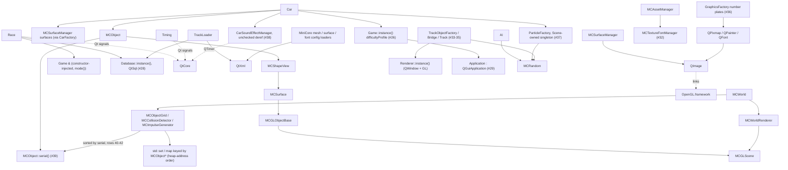

# Phase 0 dependency map

## Coupling graph

Built from what S1 found on `spike/s1-headless` and checked against the upstream source on `main` (paths relative to `DustRacing2D/src/game/`). Solid arrows are compile-time or ownership dependencies (the labelled `Collisions → Serial` edge is the S1 fix: the iteration sites call `serial()`); dotted arrows are Qt signal or link-time dependencies. Numbers in node labels are hack-log rows below.

Corrections to the Task 14 baseline:

- `Race` does not call `Game::instance()`. It takes a `Game &` in its constructor (`race.hpp:46`) and reads `mode()` (`race.cpp:340, 558`). The singleton callers in the sim path are `Car` (`car.cpp:398`), `CarFactory` (`carfactory.cpp:53, 63`) and `CarPhysicsComponent` (`carphysicscomponent.cpp:31`), all for `difficultyProfile()`. Row 26 also names `TrackLoader`, but `trackloader.cpp` calls only `Database::instance()` (lines 126, 139, 146), not `Game`.
- `MCShapeView → MCSurface` goes through the subclass `MCSurfaceView : MCShapeView`, which holds a `std::shared_ptr<MCSurface>`. `MCSurface : MCGLObjectBase`, whose constructor reads `MCGLScene::instance()` default shader programs (`mcglobjectbase.cc:33-34`).
- Added from S1: the Scene-owned `ParticleFactory` and per-car `CarSoundEffectManager` (both crash a scene-less sim), `Renderer::instance()` in the track factories, `GraphicsFactory`'s QPainter number plates, QtGui's own link to OpenGL.framework, and the address-ordered collision containers that made 12-car races non-repeatable.
- `MCRandom` is also used by `TrackObjectFactory`, `Tree` and `CarParticleEffectManager` (cosmetic), so Phase 1's seeded RNG must either reset all of them or split a cosmetic RNG from the sim RNG (row 37).

## Hack log (S1, branch spike/s1-headless)

Rows 1-23 (Task 10): all paths are relative to `DustRacing2D/src/game/MiniCore/src/`. Line numbers are post-edit. Every guard is `#ifdef MC_HEADLESS` / `#ifndef MC_HEADLESS`; behaviour with `MC_HEADLESS` undefined is unchanged (the original code sits in the `#else` / un-negated branch). Where a function mixes GL calls with CPU bookkeeping (pending flags, offsets, sizes, geometry), only the GL calls are guarded so the bookkeeping still runs.

| # | File:line | Hack | Why | Phase 2 resolution |
|---|---|---|---|---|
| 1 | Graphics/mcglobjectbase.hh:33, 225 | Base-class selection is `#if defined(__MC_QOPENGLFUNCTIONS__) && !defined(MC_HEADLESS)`: no `QOpenGLFunctions` base, no `<QOpenGLFunctions>` / `<QOpenGLVertexArrayObject>` includes, and `m_vao` is a plain `GLuint m_vao = 0` (the non-Qt branch) under headless | `QOpenGLFunctions` resolves GL entry points through a context; it must not be linked or constructed in a headless process | Split MiniCore into a GL-free core (geometry, physics, assets) and a GL renderer library selected at link time, instead of an `#ifdef` inside one class |
| 2 | Graphics/mcglshaderprogram.hh:44 | Same base-class selection for `MCGLShaderProgram` (no `QOpenGLFunctions` base under headless) | Same as #1 | Same as #1 |
| 3 | Graphics/mcglobjectbase.cc:36 | Constructor: `initializeOpenGLFunctions()` guarded with `!defined(MC_HEADLESS)`. The initializer-list lookups of `MCGLScene::instance().default*ShaderProgram()` are unchanged (see #10) | Needs a current GL context | As #1 |
| 4 | Graphics/mcglobjectbase.cc:65-141 | `bindVAO`, `releaseVAO` (empty), `createVAO` (returns `false`), `bindVBO`, `releaseVBO`, `createVBO` (empty), `render()` (no `glDrawArrays`) compiled out. `createVAO` returning `false` leaves `m_hasVao == false` | VAO/VBO management and the draw call are pure GL | Move buffer handling behind a renderer interface that the headless build never instantiates |
| 5 | Graphics/mcglobjectbase.cc:243-255, 360-362 | `initBufferData` and `initUpdateBufferData`: only the `glBufferData` call guarded (`(void)drawType` under headless). `m_totalDataSize` / `m_bufferDataOffset` bookkeeping kept | Upload only; sizes are plain data | As #4 |
| 6 | Graphics/mcglobjectbase.cc:376-378 | `addBufferSubData(4-arg)`: only `glBufferSubData` guarded; offset and per-attribute data-size bookkeeping kept | Upload only | As #4 |
| 7 | Graphics/mcglobjectbase.cc:403-436 | `enableAttributePointers`, `setAttributePointers`, `disableAttributePointers` bodies compiled out. `finishBufferData()` is unchanged: it only calls the guarded helpers | Attribute pointer setup is pure GL | As #4 |
| 8 | Graphics/mcglobjectbase.cc:520-533 | Destructor: `glDeleteBuffers` / `glDeleteVertexArrays` compiled out | No GL objects were created headlessly, and the entry points must not be referenced | As #4 |
| 9 | Graphics/mcsurface.cc:161-177, 192 | `initVBOs()` body compiled out (`(void)TOTAL_DATA_SIZE`). Constructors still compute and store vertices, normals, texcoords, colors, width, height and z before calling it. `updateTexCoords` body compiled out | Geometry is read by physics shapes; the upload is GL-only | Make `MCSurface` a CPU-side geometry value type and put GPU upload in the renderer |
| 10 | Graphics/mcglscene.cc:115-136 | `MCGLScene::initialize()`: GLEW init and all `gl*` state calls compiled out. `createDefaultShaderPrograms()` still runs, so `defaultShaderProgram()` etc. return stub (handle 0) programs rather than null | State calls need a context. Stub programs keep `MCGLObjectBase`'s `m_program` non-null if a harness calls `initialize()` | Make scene construction independent of GL; build shader programs lazily in the renderer |
| 11 | Graphics/mcglscene.cc:213-256 | `updateViewport()`: only the `glViewport` / `glScissor` / `glEnable` / `glDisable(GL_SCISSOR_TEST)` lines guarded per case. `setProjection`, `setViewerPosition`, `updateViewProjectionMatrixAndShaders` still run | Viewport state is GL; the matrices are CPU math | As #10 |
| 12 | Graphics/mcglshaderprogram.cc:50-88 | Both constructors: `glCreateProgram` / `glCreateShader` compiled out; `m_program`, `m_fragmentShader`, `m_vertexShader` set to 0. `initializeOpenGLFunctions()` guarded as in #3 | No context | As #1 |
| 13 | Graphics/mcglshaderprogram.cc:123-575 | Destructor, `initUniformLocationCache`, `bind` (`glUseProgram` only; `m_activeProgram` and pending-uniform flush still run), `setPending*` (only the `glUniform*` calls guarded; the `...Pending = false` bookkeeping kept), `setTransform`, `setUserData1/2`, `setCamera`, `setColor`, `setScale`, `setFadeValue`, `bindTextureUnit`, `bindMaterial` GL calls compiled out | Uniform and texture binding are GL | As #4 |
| 14 | Graphics/mcglshaderprogram.cc:171-275 | `link()` (no `glLinkProgram`; scene registration unchanged), `isLinked()` returns `true`, `addVertexShaderFromSource` / `addFragmentShaderFromSource` return `true` without compiling, `getShaderLog` returns empty | Compile and link status must report success so no `throw std::runtime_error` path triggers | As #10 |
| 15 | Graphics/mcglmaterial.cc:74-84 | `doAlphaBlend()` body compiled out. The `m_useAlphaBlend`/`m_src`/`m_dst` state setters are untouched | Blend state is GL | As #4 |
| 16 | Graphics/mcworldrenderer.cc:202-323 | `renderObjects`, `renderParticles`, `renderObjectShadows`, `renderParticleShadows` bodies compiled out (`(void)camera`). `buildBatches` / `buildObjectBatches`, `addObject`, `removeObject`, `clear` still run. `MCWorldRenderer` still owns `m_glScene`, so constructing an `MCWorld` creates the `MCGLScene` instance (read `mcworldrenderer.hh:108`, `mcworld.cc:54`) | The render path is GL-only; world and physics do not depend on it | Split `MCWorldRenderer` into batch building (kept in core) and rendering |
| 17 | Graphics/mcsurfaceobjectrenderer.cc:149-181 | `render()`, `renderShadows()` bodies compiled out | Draw calls | As #4 |
| 18 | Graphics/mcsurfaceobjectrendererlegacy.cc:113-161 | `setAttributePointers()`, `render()`, `renderShadows()` bodies compiled out | Draw calls and client-side arrays | As #4 |
| 19 | Graphics/mcsurfaceparticlerenderer.cc:204-245 | `render()`, `renderShadows()` bodies compiled out | Draw calls | As #4 |
| 20 | Graphics/mcsurfaceparticlerendererlegacy.cc:161-220 | `setAttributePointers()`, `render()`, `renderShadows()` bodies compiled out | Draw calls and client-side arrays | As #4 |
| 21 | Asset/mcsurfacemanager.cc:324-426 | `create2DTextureFromImage()` returns handle 0 immediately (the texture upload is compiled out; `(void)&convertToGLFormatHelper` silences an unused-function warning). `createSurfaceFromImage` still scales the image and builds the `MCSurface` from the image size, z values and metadata, so width/height/z are unchanged. Material texture handle is 0 | Texture upload needs a context; surface geometry does not | Decouple image decode (CPU) from texture creation (GPU) behind a texture-uploader interface |
| 22 | Asset/mcsurfacemanager.cc:463-477 | `~MCSurfaceManager()` texture-deletion loop compiled out | Handles are all 0; `glDeleteTextures` must not be referenced | As #21 |
| 23 | Text/mctexturetext.cc:132-134 | `MCTextureText::render()`: `glDisable(GL_DEPTH_TEST)` compiled out. **Not in the brief's file list**; found by a repo-wide `gl[A-Z]...(` grep of MiniCore, and needed so no object file in the library references a GL symbol | The only remaining GL call outside the briefed files | As #4 |

### Rows 24-42: headless harness (Task 11)

Paths in rows 24-42 are relative to `DustRacing2D/src/game/` (so MiniCore rows start with `MiniCore/src/`), except `spikes/s1-headless/...` rows, which are relative to the repo root. Line numbers are post-edit. Rows marked *harness* change no DustRacing2D source: they record something the harness has to do because the game's `Scene` normally does it. Category tags in brackets feed the tally in `findings/s1.md`.

| # | File:line | Hack | Why | Phase 2 resolution |
|---|---|---|---|---|
| 24 | car.hpp:27, 81-83 | [accessor] Public `Steer steerDirection() const` and `const Gearbox & gearbox() const`; `#include "gearbox.hpp"` replaces the `class Gearbox;` forward declaration | The emitter needs steer and gear, which `Car` keeps private | Snapshot struct exported by the sim, with the analog steer value stored (today only the ±1 direction is kept; `control` is consumed in `Car::steer`) |
| 25 | race.hpp:71-73, race.cpp:711-743 | [accessor] `float Race::routeFraction(size_t carIndex) const`: `(prevTargetNode + t) / nodeCount`, with `t` the car's projection onto the prev→current target-node segment, clamped to [0, 1]. Replaces the brief's `trackNodeCount()` accessor, which was therefore not added | Contract `progress` needs continuous route progress; `CarStatus` is private | Part of the sim snapshot struct. Note the last ~4 % of a lap is never reported: the lap ticks over when the car enters checkpoint 0's box (half-width 128 units), before `t` reaches 1 |
| 26 | spikes/s1-headless/stub_game.cpp | [singleton] Replaces game.cpp. Defines only the constructor/destructor, `instance`, `mode`/`setMode`, `lapCount`/`setLapCount`, `hasTwoHumanPlayers` (false), `hasComputerPlayers` (true), `difficultyProfile` (Medium) | `Car`, `CarFactory` and `CarPhysicsComponent` call `Game::instance()` for `difficultyProfile()`, and `Race` calls `mode()` on its constructor-injected `Game &` (see the corrections above; `TrackLoader` does not use `Game`); real game.cpp drags in renderer, input, audio, state machine | Inject a small `SimConfig` (difficulty, lap count, mode) into the sim instead of the `Game` singleton |
| 27 | spikes/s1-headless/stub_game.cpp | [singleton] No-op `Game::exitGame`, `Game::init`, `Game::togglePause` | Link errors: the moc metaobject for `Game` references every slot declared in game.hpp | Goes away with #26 |
| 28 | spikes/s1-headless/stub_database.cpp | [singleton] Replaces database.cpp (QtSql): every load returns "no record", `loadTrackUnlockStatus` returns true, saves are no-ops. No destructor (database.hpp declares none) | Race and TrackLoader call `Database::instance()` for records and unlocks; QtSql must not be linked | Records become a service outside the sim, fed by `result` messages |
| 29 | game.hpp:130-132 | [Qt] `Application m_app;` (a `QGuiApplication` subclass) wrapped in `#ifndef MC_HEADLESS` | `Game` owns the GUI application object. Constructing it loads the cocoa platform plugin and would clash with the harness's `QCoreApplication`; the stub cannot skip a member | Goes away with #26 |
| 30 | spikes/s1-headless/CMakeLists.txt (GAME_SRC) | [singleton] Add `settings.cpp` | Link error `Settings::Settings()`: `Game` has a `Settings` member. Construction only fills an action-name map, no `QSettings` I/O | Goes away with #26 |
| 31 | spikes/s1-headless/CMakeLists.txt (GAME_SRC) | [audio] Add `audio/audiosource.cpp` | Link errors for `AudioSource` vtable/signals: `Race` and `CarSoundEffectManager` derive from it. It is a `QObject` with five signals and no OpenAL code; no OpenAL/Vorbis/Ogg was linked | Sim emits events; audio subscribes from outside |
| 32 | spikes/s1-headless/CMakeLists.txt (MC_SRC glob) | [render] Add `MiniCore/src/Text/*.cc` | Link error `MCTextureFontManager::MCTextureFontManager`: `MCAssetManager` owns a font manager. Text compiles GL-free since #23; text is never rendered headless | Move the font manager to the renderer's asset manager |
| 33 | trackobjectfactory.cpp:60-62, 102-104, 180-182, 206-208 | [render] Each `setShaderProgram(Renderer::instance().program("defaultSpecular"))` wrapped in `#ifndef MC_HEADLESS` (4 sites) | `Renderer` is the `QWindow`/GL renderer and cannot exist headless. A `Renderer::instance()` stub would have to return a reference to an object that does not exist, so the render-only call sites are compiled out instead (deviation from the brief's stub-first order) | The factory builds sim objects; the render layer assigns shaders when it creates views |
| 34 | bridge.cpp:97-100, 103-105 | [render] Bridge rail shader lookup and both `setShaderProgram` calls wrapped in `#ifndef MC_HEADLESS`; collision layer and mass setup unchanged | Same as #33. Monza has no bridge tiles, so the harness does not build bridges (`Scene::createBridgeObjects` is not mirrored) | As #33 |
| 35 | track.cpp:118-134 | [render] `Track::render()` body compiled out (`(void)camera`) | References `Renderer::instance()`; never called headless | Move tile rendering out of `Track` into the renderer |
| 36 | graphicsfactory.cpp:36-64, 75 | [Qt] Headless `generateNumberSurface` makes a blank white 32×32 `QImage` instead of `QPixmap` + `QPainter` + `QFont` text | Runtime abort at car construction: `QPlatformPixmap: QGuiApplication required`. The plate surface size comes from `surfaceData` (9×9), not the image, and the plate object has `setBypassCollisions(true)`, so physics is unaffected | Number plates generated by the renderer |
| 37 | spikes/s1-headless/harness.cpp (*harness*) | [singleton] Construct a `ParticleFactory` after `loadAssets()` | Segfault in `ParticleFactory::newSurfaceParticle` from `Car::onStepTime` (skid marks): `Scene` owns the singleton (scene.cpp:93). Particles also draw from `MCRandom`, so creating it keeps the RNG sequence game-like | Particle effects become render-side subscribers to sim events, with a cosmetic RNG separate from the sim RNG |
| 38 | spikes/s1-headless/harness.cpp (*harness*) | [audio] Attach an unconnected `CarSoundEffectManager` to every car (mirrors `Scene::setupAudio` minus the `AudioWorker` connection) | Segfault at car.cpp:301: `Car::updateAnimations` dereferences `m_soundEffectManager` on every collision without a null check (line 307 does check). Its `QTimer`s only gate sound signals, never physics | Null-check, or sim emits collision events and audio subscribes |
| 39 | MiniCore/src/Core/mcobject.hh:33, 257-259; mcobject.cc:44-47, 247-250, 687, 1046-1049 | [determinism] `uint64_t MCObject::serial()`: a creation counter assigned once in `MCObject::Impl`. **Unguarded**: applies to desktop builds too | Stable ordering key for #40-42. Only ever read from objects the iteration sites dereference anyway | Keep the idea, not the implementation: the sim needs stable object IDs anyway (telemetry ids, replays). Phase 2 should assign per-world stable IDs (reset with the world, so a second race in one process starts from the same IDs), not this process-global counter, which keeps counting across races and depends on every object ever constructed in the process |
| 40 | MiniCore/src/Physics/mcobjectgrid.cc:217-230 | [determinism] `getPossibleCollisions()` orients each pair lower-serial-first and sorts the pair list by serial before returning. Unguarded | 12-car runs with the same seed diverged as early as tick 315, and the runs finished on different ticks (6/6 distinct; see evidence/s1-repeatability.txt). Grid cells hold objects in `std::set<MCObject *>`, ordered by heap address, which changes between runs | Deterministic broadphase: ordered by stable ID, not address |
| 41 | MiniCore/src/Physics/mccollisiondetector.cc:30-31, 314-336 | [determinism] `iterateCurrentCollisions()` copies the address-keyed `m_currentCollisions` pairs into a vector sorted by serial, then processes that. Unguarded. **This is a semantic change, not just a reorder.** The original loop walked the live `std::map`/`std::set` while `processPossibleCollision` inserted into it (`m_currentCollisions[...].insert` at mccollisiondetector.cc:93, 165, 220). A pair added during a pass (for example the reverse entry B→A after testing A→B) was re-tested in the same pass if it sorted after the current position by address. The snapshot only tests the pairs that existed when the pass started. So the pairs tested per resolver pass, duplicate-contact counts and the returned `numCollisions` can all differ from upstream, and `numCollisions` gates the resolver loop's early exit (mcworld.cc:441) | Same cause as #40, in the resolver loop; the snapshot was the simplest way to get a fixed order | Keep only after validating collision behaviour against the desktop game, because the set of pairs re-tested per pass changed. Alternative: a deterministic ordered container (by stable ID) iterated live, which keeps upstream's re-test-within-pass behaviour |
| 42 | MiniCore/src/Physics/mcimpulsegenerator.cc:27-45, 109-111, 136-138 | [determinism] `resolvePositions` and `generateImpulsesFromDeepestContacts` visit an object's `ContactHash` (keyed by address) in serial order. Unguarded | Same cause: contact order changes displacement and impulse order | As #40 |

Determinism note: a first attempt keyed the containers themselves by serial (custom comparators on `ObjectSet`, `CollisionMap`, `ContactHash`, `RegistryHash`). It made the harness repeatable but crashed MiniCore's `MCWorldTest`, because `MCCollisionDetector::remove()` runs from `~MCObject` while `m_currentCollisions` still holds a pointer to an already-destroyed object. Address comparison tolerates that dangling key; a serial comparator dereferences it. The final fix leaves every container alone and sorts only at the iteration sites, which dereference every object they visit anyway (the upstream loops already did), so the sorts add no new dereference. That does not make the objects provably alive: `remove()` can leave stale inner pointers in `m_currentCollisions` (pre-existing upstream behaviour, and the cause of the comparator crash), and the snapshot in #41 would dereference such a pointer exactly as the original loop did. `MCForceRegistry` was left alone: each generator only writes its own object's forces, so the order across objects does not change the result.

## Verification notes

- Scene ordering: `MCWorldRenderer` owns `MCGLScene m_glScene` (`Graphics/mcworldrenderer.hh:108`) and `MCWorld`'s constructor builds the renderer (`Core/mcworld.cc:54`), so constructing an `MCWorld` first creates the `MCGLScene` that `MCGLObjectBase`'s constructor dereferences. No scene hack was needed; the harness must construct `MCWorld` before any `MCSurface`. Nothing in MiniCore calls `MCGLScene::initialize()`, so without a call from the harness the default shader programs are null `shared_ptr`s. That is harmless because the render path is compiled out. Calling `initialize()` headlessly is safe (see #10).
- No CMake option was added. A headless consumer passes `-DMC_HEADLESS` itself. Task 11 must also decide whether to keep `-D__MC_QOPENGLFUNCTIONS__` (compiles clean either way, see the report).
- Task 11 link check: `MiniCore/src/Graphics/contrib/glew/glew.c` stays out of the harness build (the `MC_SRC` glob filters `/contrib/`) and is not needed: the harness links with `__MC_NO_GLEW__`, and `nm` shows no `glew` symbols, defined or undefined, and no undefined `gl*`, `CGL*` or `NSOpenGL*` symbols in `s1_headless`. The harness does not define `__MC_QOPENGLFUNCTIONS__`.
- Task 11 non-headless check: after rows 24-42, `cmake --build ~/dust-build/desktop` succeeds and `ctest` passes 5/5 (MCForceRegistryTest, MCObjectTest, MCMeshLoaderTest, MCWorldTest, gearboxtest).
