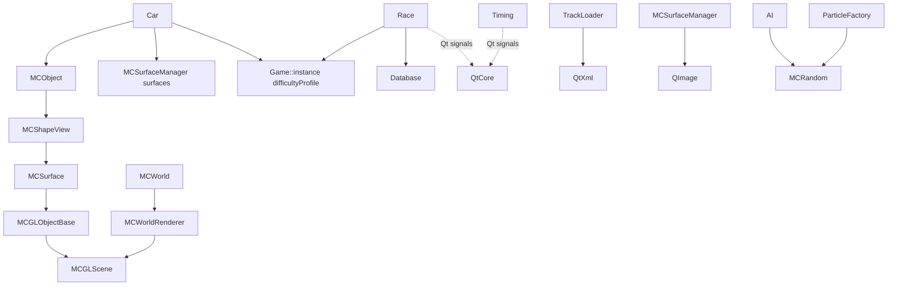

# Phase 0 — Toolchain & Architecture Spikes — Implementation Plan

> **For agentic workers:** REQUIRED SUB-SKILL: Use superpowers:subagent-driven-development (recommended) or superpowers:executing-plans to implement this plan task-by-task. Steps use checkbox (`- [ ]`) syntax for tracking.

**Goal:** Stand up the monorepo and toolchain, then answer the four riskiest hybrid-architecture questions with throwaway spikes. The answers, plus a telemetry contract v0, feed the Phase 1/2 specs.

**Architecture:** Contract-first, converging spikes.

1. Contract v0 (NDJSON + JSON Schema) is written first.
2. S3 (three.js render) and S4 (WebSocket timing tower) build against mocked data in that format, in parallel with S1.
3. S1 (headless C++ harness, GL compiled out via an `MC_HEADLESS` flag) emits the same format.
4. S2 compiles a Qt-free physics scenario plus the S1 harness to WASM and diffs native against WASM.
5. S5 streams a real S1 recording through S3 and S4 together.

**Tech Stack:** C++17, CMake + Ninja, Qt 6.12 (Homebrew), Emscripten (emsdk), Node 25 (`node:test`), three.js, Vite, `ws`, Ajv. All on macOS 15.6 arm64.

**Spec:** `docs/superpowers/specs/2026-10-15-phase0-toolchain-spikes-design.md`. Parent: `docs/superpowers/specs/2026-10-15-dustracing2d-upgrade-scope.md`.

**Deviations from spec (deliberate, recorded in findings):**

- **S2 splits into S2-A and S2-B.**
  - **S2-A** is a Qt-free MiniCore physics scenario. It always runs, so drift numbers exist even if Qt blocks the full harness.
  - **S2-B** is the full S1 harness under WASM. It is attempted, and its Qt blockers are inventoried.
  - Reason: `Race`, `Timing` and `DifficultyProfile` are `QObject`s with signals (`race.hpp:46-86`). The S1 harness therefore needs QtCore, and Qt for WASM is out of scope by spec §6 S2.
- **Contract v0 adds an optional `wallMs` field** (producer wall-clock ms). Needed to measure end-to-end latency in S4.

## Global Constraints

- Platform: macOS 15.6 arm64, Apple clang 16. Homebrew Qt **6.12.x** (project floor: Qt ≥ 6.4, `DustRacing2D/CMakeLists.txt:150`). **C++17.**
- `tools/bootstrap.sh` **refuses to run with < 12 GB free**. Build directories live under `~/dust-build/`, outside the repo.
- Emscripten via `emsdk` in `~/.emsdk`, pinned version recorded in `docs/phase0/toolchain-versions.txt`.
- npm pins, exact versions with lockfile: `three@0.176.0`, `vite@6.3.5`, `ws@8.18.2`, `ajv@8.17.1`, `ajv-formats@3.0.1`.
- Sim tick: **16 ms** fixed. `tMs = tick × 16`. World scale: `METERS_PER_UNIT = 0.05` (`scene.cpp:80`). Tile = 256 units = 12.8 m.
- Contract: NDJSON, `schemaVersion: "0.1.0"`, units metres and radians.
  - Coordinates are in the **Dust world frame: y-up, origin bottom-left**. `.trk` files are y-down and the loader flips them (`trackloader.cpp:254,354`).
  - Telemetry feed: 20 Hz subsample of the tick feed.
- `seq` strictly increasing per session across all message types. `eventId` unique per session.
- Spike hacks to DustRacing2D source live only on `spike/*` branches and are **never merged** to `main`.
- `apex-gp/` and `py-race/` are **gitignored**. Nothing from apex-gp is committed (licence unresolved).
- No GCP resources. No CI changes. No fixed-tick change to the shipping game.
- Spike caps (agent-assisted days): **S1 3, S2 2, S3 2, S4 1, S5 0.5**. At the cap, stop and write findings; do not push on.

## Review Focus

1. **Relay restart mid-race** loses the relay's in-memory log. The producer must re-send from the relay-reported `lastSeq`, and consumers resume with no lost events. Pinned in Task 6 (`producerHello` test) and Task 7 (kill-relay scenario).
2. **Duplicate messages** from producer re-send (at-least-once). The hub must drop `seq ≤ lastSeq` silently and never forward duplicates. Pinned in Task 6.
3. **Malformed or partial `.trk`** (no route nodes, missing attributes). The parser must throw an error naming the problem, not render a broken scene. Pinned in Task 8.
4. **Heading wrap-around** (e.g. 6.2 rad → 0.1 rad). Interpolation must take the short way round, not spin the car backwards. Pinned in Task 9.
5. **Gap edge cases.** If the car ahead is a lap up or beyond buffer history, or the car "behind" is actually further along, the gap is `null`, never negative or garbage. Pinned in Task 5.

---

## File Structure

```
racing-telemetry-gcp/
├── .gitignore                                  Task 1
├── DustRacing2D/                               Task 1 (git subtree)
│   └── (spike/s1-headless branch only) MiniCore Graphics/Asset guards     Task 10
├── docs/
│   ├── superpowers/specs/*.md                  existing
│   ├── superpowers/plans/2026-10-15-phase0-toolchain-spikes.md   this file
│   └── phase0/
│       ├── toolchain-versions.txt              Task 2
│       ├── desktop-build.md                    Task 3
│       ├── dependency-map.md                   Tasks 10–11 (hack log), Task 14 (graph)
│       ├── findings.md                         Task 14 — summary + decisions, links findings/*
│       ├── findings/s1.md … s5.md              Tasks 11, 12, 9, 7, 13 — one file per spike (no cross-branch merge conflicts)
│       └── evidence/                           Tasks 7, 9, 11, 12, 13
├── contracts/telemetry-v0/
│   ├── package.json                            Task 4
│   ├── schema.json                             Task 4
│   ├── lib/validate.mjs                        Task 4  — validateLines(lines) → errors[]
│   ├── lib/rng.mjs                             Task 4  — mulberry32(seed)
│   ├── bin/validate.mjs                        Task 4  — CLI
│   ├── bin/gen-mock.mjs                        Task 4  — mock race generator
│   ├── samples/mock-12car-3lap.telemetry.ndjson  Task 4
│   ├── samples/s1-monza-*.ndjson               Task 11
│   └── test/*.test.mjs                         Task 4
├── spikes/
│   ├── s4-timing/
│   │   ├── package.json                        Task 5
│   │   ├── lib/gap.mjs                         Task 5  — GapTracker
│   │   ├── lib/hub.mjs                         Task 6  — SessionHub (pure, no network)
│   │   ├── relay.mjs                           Task 6  — ws server wrapping SessionHub
│   │   ├── replay.mjs                          Task 7  — NDJSON producer
│   │   ├── public/index.html, public/tower.mjs Task 7  — timing tower
│   │   └── test/*.test.mjs                     Tasks 5, 6
│   ├── s3-render/
│   │   ├── package.json, vite.config.mjs, index.html   Task 9
│   │   ├── src/trk.mjs                         Task 8  — parseTrk(xml), tileToWorld(), worldToScene()
│   │   ├── src/playback.mjs                    Task 9  — sampleAt(frames, tMs), lerpAngle()
│   │   ├── src/main.mjs                        Task 9  — scene, cameras, feed loading, frame stats
│   │   └── test/*.test.mjs                     Tasks 8, 9
│   ├── s1-headless/
│   │   ├── CMakeLists.txt                      Task 11
│   │   ├── stub_game.cpp, stub_database.cpp    Task 11
│   │   ├── emitter.hpp/.cpp                    Task 11 — NDJSON writer + FNV-1a state hash
│   │   ├── harness.cpp                         Task 11 — main()
│   │   └── run_twice.sh                        Task 11 — repeatability test
│   └── s2-wasm/
│       ├── physics_scenario.cpp                Task 12 — Qt-free MiniCore scenario
│       ├── CMakeLists.txt                      Task 12
│       ├── build.sh                            Task 12 — native(default), native(-ffp-contract=off), wasm
│       ├── diff.mjs + test/diff.test.mjs       Task 12 — per-tick diff → CSV + summary
│       └── package.json                        Task 12
└── tools/
    ├── bootstrap.sh                            Task 2
    └── test_bootstrap.sh                       Task 2
```

**Order and parallelism:**

- Tasks 1–4 run sequentially.
- Then three streams run in parallel:
  - **S4:** Tasks 5–7
  - **S3:** Tasks 8–9
  - **S1:** Tasks 10–11
- Task 12 needs Task 11.
- Task 13 needs Tasks 7, 9, 11 and 12.
- Task 14 comes last.

---

### Task 1: Monorepo with DustRacing2D as a subtree

**Files:**
- Create: `/Users/duncansynthesis.co.za/lombard/racing-telemetry-gcp/.gitignore`
- Create: git repo at `/Users/duncansynthesis.co.za/lombard/racing-telemetry-gcp`
- Move (temporary): `DustRacing2D/` → `../DustRacing2D-upstream-clone/`

**Interfaces:**
- Produces: git repo on branch `main`; `DustRacing2D/` as a subtree tracking upstream `master`.

- [ ] **Step 1: Verify the clone is clean and record its HEAD**

```bash
cd /Users/duncansynthesis.co.za/lombard/racing-telemetry-gcp/DustRacing2D
git status --porcelain | wc -l      # Expected: 0
git rev-parse HEAD                  # Record this hash in the commit message of Step 5
```

If Step 1 shows any changes, STOP and ask the user. Nothing in the clone may be lost.

- [ ] **Step 2: Move the clone aside (outside the future repo)**

```bash
cd /Users/duncansynthesis.co.za/lombard/racing-telemetry-gcp
mv DustRacing2D ../DustRacing2D-upstream-clone
```

- [ ] **Step 3: Create `.gitignore`**

```gitignore
# Unrelated / licence-unresolved projects
apex-gp/
py-race/

# Build output (builds live in ~/dust-build, these guard strays)
build*/
**/node_modules/
**/dist/
*.wasm
!contracts/**/*.wasm

# Large generated tick feeds; only telemetry-rate samples are committed
**/*.tick.ndjson

# OS / tooling
.DS_Store
.claude/settings.local.json
```

- [ ] **Step 4: Init the repo and make the first commit (docs only)**

```bash
cd /Users/duncansynthesis.co.za/lombard/racing-telemetry-gcp
git init -b main
git add .gitignore docs/
git commit -m "docs: scope rev 2, Phase 0 spec and plan

Co-Authored-By: Claude Opus 5.5 <noreply@anthropic.com>"
```

Expected: one commit; `git status` shows only `.claude/` untracked (if present).

- [ ] **Step 5: Import DustRacing2D as a subtree from the local clone (no network)**

```bash
cd /Users/duncansynthesis.co.za/lombard/racing-telemetry-gcp
git subtree add --prefix=DustRacing2D ../DustRacing2D-upstream-clone master \
  -m "chore: import DustRacing2D upstream master (<HEAD-hash-from-step-1>) as subtree

Co-Authored-By: Claude Opus 5.5 <noreply@anthropic.com>"
```

Replace `<HEAD-hash-from-step-1>` with the actual hash.

- [ ] **Step 6: Verify the import is byte-identical**

```bash
cd /Users/duncansynthesis.co.za/lombard/racing-telemetry-gcp
diff -rq --exclude=.git ../DustRacing2D-upstream-clone DustRacing2D && echo IDENTICAL
```

Expected: `IDENTICAL`.

- [ ] **Step 7: Add an upstream remote for future subtree pulls**

```bash
git remote add dust-upstream https://github.com/juzzlin/DustRacing2D.git
git remote -v | grep dust-upstream
```

- [ ] **Step 8: Ask the user before deleting the moved-aside clone**

Ask exactly: "Subtree import verified identical. OK to delete `../DustRacing2D-upstream-clone`? (frees ~disk; recoverable from GitHub)". Only on an explicit yes:

```bash
rm -rf /Users/duncansynthesis.co.za/lombard/DustRacing2D-upstream-clone
```

---

### Task 2: Toolchain bootstrap script

**Files:**
- Create: `tools/bootstrap.sh`
- Create: `tools/test_bootstrap.sh`
- Create (generated): `docs/phase0/toolchain-versions.txt`

**Interfaces:**
- Produces:
  - `tools/bootstrap.sh [--check-only]`. Exit codes: 0 = ok, 3 = insufficient disk.
  - Env overrides: `MIN_FREE_GB` (default 12), `EMSDK_VERSION` (default `4.0.10`), `EMSDK_DIR` (default `~/.emsdk`).
  - After a full run, `source ~/.emsdk/emsdk_env.sh` puts `emcc` on PATH.

- [ ] **Step 1: Write the failing test**

`tools/test_bootstrap.sh`:

```bash
#!/usr/bin/env bash
# Tests for tools/bootstrap.sh disk gate and check-only mode.
set -uo pipefail
here="$(cd "$(dirname "$0")" && pwd)"
fail=0

out="$(MIN_FREE_GB=999999 "$here/bootstrap.sh" --check-only 2>&1)"; code=$?
if [[ $code -ne 3 ]]; then echo "FAIL: expected exit 3 on low disk, got $code"; fail=1; fi
if ! grep -q "need 999999 GB" <<<"$out"; then echo "FAIL: low-disk message missing: $out"; fail=1; fi

out="$(MIN_FREE_GB=0 "$here/bootstrap.sh" --check-only 2>&1)"; code=$?
if [[ $code -ne 0 ]]; then echo "FAIL: expected exit 0 in check-only with enough disk, got $code: $out"; fail=1; fi
if ! grep -q "check-only: no installs" <<<"$out"; then echo "FAIL: check-only did not announce itself"; fail=1; fi

[[ $fail -eq 0 ]] && echo "PASS" || exit 1
```

- [ ] **Step 2: Run the test and verify it fails**

Run: `chmod +x tools/test_bootstrap.sh && tools/test_bootstrap.sh`
Expected: FAIL (`bootstrap.sh: No such file or directory`).

- [ ] **Step 3: Implement `tools/bootstrap.sh`**

```bash
#!/usr/bin/env bash
# Phase 0 toolchain bootstrap (macOS/Homebrew). Idempotent.
# Spec: docs/superpowers/specs/2026-10-15-phase0-toolchain-spikes-design.md §4.2
set -euo pipefail

MIN_FREE_GB="${MIN_FREE_GB:-12}"
EMSDK_VERSION="${EMSDK_VERSION:-4.0.10}"
EMSDK_DIR="${EMSDK_DIR:-$HOME/.emsdk}"
BREW_PKGS=(cmake ninja pkg-config qt openal-soft libvorbis)
repo_root="$(cd "$(dirname "$0")/.." && pwd)"
versions_file="$repo_root/docs/phase0/toolchain-versions.txt"

free_gb() { df -g "$HOME" | awk 'NR==2 {print $4}'; }

check_disk() {
  local free
  free="$(free_gb)"
  if (( free < MIN_FREE_GB )); then
    echo "bootstrap: only ${free} GB free on the \$HOME volume; need ${MIN_FREE_GB} GB. Free space and re-run." >&2
    exit 3
  fi
  echo "bootstrap: ${free} GB free (>= ${MIN_FREE_GB} GB) ok"
}

install_brew_pkgs() {
  for pkg in "${BREW_PKGS[@]}"; do
    if brew list --versions "$pkg" >/dev/null 2>&1; then
      echo "bootstrap: $pkg already installed"
    else
      brew install "$pkg"
    fi
  done
}

install_emsdk() {
  if [[ ! -d "$EMSDK_DIR" ]]; then
    git clone https://github.com/emscripten-core/emsdk.git "$EMSDK_DIR"
  fi
  (cd "$EMSDK_DIR" && ./emsdk install "$EMSDK_VERSION" && ./emsdk activate "$EMSDK_VERSION")
}

report_versions() {
  {
    echo "# Toolchain versions — generated by tools/bootstrap.sh on $(date -u +%Y-%m-%dT%H:%M:%SZ)"
    echo "macOS: $(sw_vers -productVersion) $(uname -m)"
    echo "clang: $(clang++ --version | head -1)"
    for pkg in "${BREW_PKGS[@]}"; do
      echo "$pkg: $(brew list --versions "$pkg" 2>/dev/null || echo MISSING)"
    done
    echo "node: $(node --version 2>/dev/null || echo MISSING)"
    if [[ -f "$EMSDK_DIR/emsdk_env.sh" ]]; then
      # shellcheck disable=SC1091
      echo "emcc: $(source "$EMSDK_DIR/emsdk_env.sh" >/dev/null 2>&1; emcc --version | head -1)"
    else
      echo "emcc: MISSING"
    fi
  } | tee "$1"
}

main() {
  check_disk
  if [[ "${1:-}" == "--check-only" ]]; then
    echo "bootstrap: check-only: no installs"
    report_versions /dev/null
    exit 0
  fi
  install_brew_pkgs
  install_emsdk
  mkdir -p "$(dirname "$versions_file")"
  report_versions "$versions_file"
  echo "bootstrap: done. Run 'source $EMSDK_DIR/emsdk_env.sh' to put emcc on PATH."
}

main "$@"
```

- [ ] **Step 4: Run the test and verify it passes**

Run: `chmod +x tools/bootstrap.sh && tools/test_bootstrap.sh`
Expected: `PASS`.

- [ ] **Step 5: Run the real bootstrap**

Run: `tools/bootstrap.sh`

Expected: exit 0, and `docs/phase0/toolchain-versions.txt` lists every package with a version and **no `MISSING`**.

If exit 3: STOP and tell the user how much space is needed.

- [ ] **Step 6: Commit**

```bash
git add tools/bootstrap.sh tools/test_bootstrap.sh docs/phase0/toolchain-versions.txt
git commit -m "build: add Phase 0 toolchain bootstrap with disk gate

Co-Authored-By: Claude Opus 5.5 <noreply@anthropic.com>"
```

---

### Task 3: Desktop DustRacing2D builds, tests and runs on macOS

**Files:**
- Create: `docs/phase0/desktop-build.md`
- Modify (only if the build fails): DustRacing2D files, on branch `spike/macos-build`. Record each fix in `desktop-build.md`.

**Interfaces:**
- Produces: `~/dust-build/desktop/dustrac-game` binary; the documented configure command reused by Task 11.

- [ ] **Step 1: Configure**

```bash
cmake -S DustRacing2D -B ~/dust-build/desktop -G Ninja \
  -DCMAKE_BUILD_TYPE=Debug \
  -DCMAKE_PREFIX_PATH="$(brew --prefix qt)" \
  -DOpenALDir="$(brew --prefix openal-soft)"
```

Expected: `-- Configuring done` / `-- Generating done`.

- [ ] **Step 2: Build**

Run: `cmake --build ~/dust-build/desktop`
Expected: `dustrac-game` and `dustrac-editor` link.

If it fails:

1. `git switch -c spike/macos-build`
2. Apply the smallest fix.
3. Note `file:line — error — fix` in `docs/phase0/desktop-build.md`.
4. Rebuild.
5. Return to `main` afterwards with `git switch main`.

Fixes stay on the spike branch.

- [ ] **Step 3: Run the existing unit tests**

```bash
cd ~/dust-build/desktop && QT_QPA_PLATFORM=offscreen ctest --output-on-failure
```

Expected: all tests pass (gearbox plus four MiniCore suites). Record the pass count.

- [ ] **Step 4: Launch the game and drive one race**

```bash
cd ~/dust-build/desktop && ./dustrac-game
```

Expected: the menu appears. Start a race on any track, drive a lap, and confirm AI cars move. Take a screenshot to `docs/phase0/evidence/desktop-baseline.png`.

If the binary can't find `./data`, check `InstallLinux.cmake:49-50` (non-release `DATA_PATH=./data`) and run from the directory containing `data/`. Record what worked.

- [ ] **Step 5: Write `docs/phase0/desktop-build.md`**

```markdown
# Desktop build on macOS (Phase 0, Task 3)

- Configure: <exact command from Step 1>
- Build: `cmake --build ~/dust-build/desktop` — <result>
- ctest: <N>/<N> passed
- Run: <how it was launched; data path notes>
- Fixes needed: <none | table file:line — error — fix, on branch spike/macos-build>
```

Fill every `<…>` with the observed values before committing.

- [ ] **Step 6: Commit**

```bash
git add docs/phase0/desktop-build.md docs/phase0/evidence/desktop-baseline.png
git commit -m "docs(phase0): record macOS desktop build baseline

Co-Authored-By: Claude Opus 5.5 <noreply@anthropic.com>"
```

---

### Task 4: Telemetry contract v0 — schema, validator, mock generator

**Files:**
- Create: `contracts/telemetry-v0/package.json`, `schema.json`, `lib/validate.mjs`, `lib/rng.mjs`, `bin/validate.mjs`, `bin/gen-mock.mjs`
- Create: `contracts/telemetry-v0/test/validate.test.mjs`, `test/gen-mock.test.mjs`
- Create (generated): `contracts/telemetry-v0/samples/mock-12car-3lap.telemetry.ndjson`

**Interfaces:**
- Produces:
  - `validateLines(lines: string[]) → Array<{line: number, message: string}>` — schema plus cross-line checks (seq strictly increasing, eventId unique, single sessionId). Blank lines are ignored.
  - `mulberry32(seed: number) → () => number` in [0, 1).
  - CLI `node bin/validate.mjs <file.ndjson>...` → exit 0 when valid, 1 with errors printed `file:line: message`.
  - CLI `node bin/gen-mock.mjs --cars 12 --laps 3 --seed 42 --hz 20 > out.ndjson`. `--hz 0` emits the tick feed (every 16 ms tick).
  - Message shapes per `schema.json` below. Every later task consumes these exact field names.

- [ ] **Step 1: Create `package.json`**

```json
{
  "name": "telemetry-v0",
  "private": true,
  "type": "module",
  "scripts": {
    "test": "node --test test/",
    "validate": "node bin/validate.mjs"
  },
  "dependencies": {
    "ajv": "8.17.1",
    "ajv-formats": "3.0.1"
  }
}
```

Run: `cd contracts/telemetry-v0 && npm install`
Expected: `package-lock.json` created.

- [ ] **Step 2: Write `schema.json`**

```json
{
  "$schema": "https://json-schema.org/draft/2020-12/schema",
  "$id": "https://racing-telemetry-gcp.local/contracts/telemetry-v0/schema.json",
  "title": "DustRacing2D telemetry v0",
  "type": "object",
  "required": ["type", "sessionId", "schemaVersion", "seq", "tick", "tMs"],
  "properties": {
    "type": { "enum": ["snapshot", "event", "result"] },
    "sessionId": { "type": "string", "format": "uuid" },
    "schemaVersion": { "const": "0.1.0" },
    "seq": { "type": "integer", "minimum": 0 },
    "tick": { "type": "integer", "minimum": 0 },
    "tMs": { "type": "integer", "minimum": 0 },
    "wallMs": { "type": "integer", "minimum": 0, "description": "Optional producer wall-clock epoch ms; used for latency measurement." }
  },
  "oneOf": [
    {
      "properties": {
        "type": { "const": "snapshot" },
        "phase": { "enum": ["countdown", "racing", "finished"] },
        "cars": { "type": "array", "items": { "$ref": "#/$defs/car" } }
      },
      "required": ["phase", "cars"]
    },
    {
      "properties": {
        "type": { "const": "event" },
        "eventId": { "type": "string", "minLength": 1 },
        "eventType": { "enum": ["lightsOut", "lap", "positionChange", "finish"] },
        "carId": { "type": "integer", "minimum": 0 },
        "data": { "type": "object" }
      },
      "required": ["eventId", "eventType", "data"]
    },
    {
      "properties": {
        "type": { "const": "result" },
        "classification": {
          "type": "array",
          "items": {
            "type": "object",
            "required": ["carId", "pos", "laps", "totalMs", "bestLapMs"],
            "properties": {
              "carId": { "type": "integer", "minimum": 0 },
              "pos": { "type": "integer", "minimum": 1 },
              "laps": { "type": "integer", "minimum": 0 },
              "totalMs": { "type": "integer", "minimum": 0 },
              "bestLapMs": { "type": ["integer", "null"], "minimum": 0 }
            }
          }
        }
      },
      "required": ["classification"]
    }
  ],
  "$defs": {
    "car": {
      "type": "object",
      "required": ["id", "x", "y", "heading", "vx", "vy", "speedKmh", "throttle", "brake", "steer", "gear", "lap", "progress", "pos"],
      "properties": {
        "id": { "type": "integer", "minimum": 0 },
        "x": { "type": "number" },
        "y": { "type": "number" },
        "heading": { "type": "number" },
        "vx": { "type": "number" },
        "vy": { "type": "number" },
        "speedKmh": { "type": "number", "minimum": 0 },
        "throttle": { "type": "number", "minimum": 0, "maximum": 1 },
        "brake": { "type": "number", "minimum": 0, "maximum": 1 },
        "steer": { "type": "number", "minimum": -1, "maximum": 1 },
        "gear": { "type": "integer" },
        "lap": { "type": "integer", "minimum": 0 },
        "progress": { "type": "number", "minimum": 0, "maximum": 1 },
        "pos": { "type": "integer", "minimum": 1 }
      }
    }
  }
}
```

- [ ] **Step 3: Write the failing validator tests**

`test/validate.test.mjs`:

```js
import { test } from 'node:test';
import assert from 'node:assert/strict';
import { validateLines } from '../lib/validate.mjs';

const SID = '6f1c2a3b-4d5e-4f60-8a7b-9c0d1e2f3a4b';
const base = (over) => ({ sessionId: SID, schemaVersion: '0.1.0', tick: 0, tMs: 0, ...over });
const car = (over = {}) => ({ id: 0, x: 1, y: 2, heading: 0, vx: 0, vy: 0, speedKmh: 0, throttle: 0, brake: 0, steer: 0, gear: 1, lap: 0, progress: 0, pos: 1, ...over });
const line = (o) => JSON.stringify(o);

test('valid snapshot, event and result pass', () => {
  const errs = validateLines([
    line(base({ type: 'snapshot', seq: 0, phase: 'racing', cars: [car()] })),
    line(base({ type: 'event', seq: 1, eventId: 'e1', eventType: 'lightsOut', data: {} })),
    line(base({ type: 'result', seq: 2, classification: [{ carId: 0, pos: 1, laps: 3, totalMs: 1000, bestLapMs: 300 }] })),
  ]);
  assert.deepEqual(errs, []);
});

test('blank and trailing lines are ignored', () => {
  const errs = validateLines(['', line(base({ type: 'event', seq: 0, eventId: 'e', eventType: 'lap', data: {} })), '   ', '']);
  assert.deepEqual(errs, []);
});

test('missing required car field is reported with line number', () => {
  const bad = car(); delete bad.heading;
  const errs = validateLines([line(base({ type: 'snapshot', seq: 0, phase: 'racing', cars: [bad] }))]);
  assert.equal(errs.length > 0, true);
  assert.equal(errs[0].line, 1);
  assert.match(errs[0].message, /heading/);
});

test('non-increasing seq is reported', () => {
  const errs = validateLines([
    line(base({ type: 'event', seq: 5, eventId: 'a', eventType: 'lap', data: {} })),
    line(base({ type: 'event', seq: 5, eventId: 'b', eventType: 'lap', data: {} })),
  ]);
  assert.deepEqual(errs.map((e) => e.line), [2]);
  assert.match(errs[0].message, /seq/);
});

test('duplicate eventId is reported', () => {
  const errs = validateLines([
    line(base({ type: 'event', seq: 0, eventId: 'dup', eventType: 'lap', data: {} })),
    line(base({ type: 'event', seq: 1, eventId: 'dup', eventType: 'lap', data: {} })),
  ]);
  assert.deepEqual(errs.map((e) => e.line), [2]);
  assert.match(errs[0].message, /eventId/);
});

test('mixed sessionId is reported', () => {
  const errs = validateLines([
    line(base({ type: 'event', seq: 0, eventId: 'a', eventType: 'lap', data: {} })),
    line({ ...base({ type: 'event', seq: 1, eventId: 'b', eventType: 'lap', data: {} }), sessionId: '00000000-0000-4000-8000-000000000000' }),
  ]);
  assert.deepEqual(errs.map((e) => e.line), [2]);
  assert.match(errs[0].message, /sessionId/);
});

test('invalid JSON is reported, not thrown', () => {
  const errs = validateLines(['{not json']);
  assert.equal(errs[0].line, 1);
  assert.match(errs[0].message, /JSON/);
});
```

- [ ] **Step 4: Run the tests and verify they fail**

Run: `npm test`
Expected: FAIL (`Cannot find module '../lib/validate.mjs'`).

- [ ] **Step 5: Implement `lib/validate.mjs`**

```js
import { readFileSync } from 'node:fs';
import { fileURLToPath } from 'node:url';
import { dirname, join } from 'node:path';
import Ajv2020 from 'ajv/dist/2020.js';
import addFormats from 'ajv-formats';

const here = dirname(fileURLToPath(import.meta.url));
const schema = JSON.parse(readFileSync(join(here, '..', 'schema.json'), 'utf8'));
const ajv = new Ajv2020({ allErrors: true, strict: false });
addFormats(ajv);
const validateMessage = ajv.compile(schema);

/** Validate NDJSON lines against schema v0 plus cross-line rules. Returns [] when valid. */
export function validateLines(lines) {
  const errors = [];
  let lastSeq = -1;
  let sessionId = null;
  const eventIds = new Set();

  lines.forEach((raw, idx) => {
    const lineNo = idx + 1;
    if (raw.trim() === '') return;
    let msg;
    try {
      msg = JSON.parse(raw);
    } catch (e) {
      errors.push({ line: lineNo, message: `invalid JSON: ${e.message}` });
      return;
    }
    if (!validateMessage(msg)) {
      const detail = validateMessage.errors
        .map((e) => `${e.instancePath || '/'} ${e.message}${e.params?.missingProperty ? ` (${e.params.missingProperty})` : ''}`)
        .join('; ');
      errors.push({ line: lineNo, message: `schema: ${detail}` });
      return;
    }
    if (sessionId === null) sessionId = msg.sessionId;
    else if (msg.sessionId !== sessionId) errors.push({ line: lineNo, message: `sessionId changed from ${sessionId} to ${msg.sessionId}` });
    if (msg.seq <= lastSeq) errors.push({ line: lineNo, message: `seq ${msg.seq} not greater than previous ${lastSeq}` });
    lastSeq = Math.max(lastSeq, msg.seq);
    if (msg.type === 'event') {
      if (eventIds.has(msg.eventId)) errors.push({ line: lineNo, message: `duplicate eventId ${msg.eventId}` });
      eventIds.add(msg.eventId);
    }
  });
  return errors;
}
```

- [ ] **Step 6: Run the tests and verify they pass**

Run: `npm test`
Expected: 7 passing.

- [ ] **Step 7: Write the failing mock-generator tests**

`test/gen-mock.test.mjs`:

```js
import { test } from 'node:test';
import assert from 'node:assert/strict';
import { generateRace } from '../bin/gen-mock.mjs';
import { validateLines } from '../lib/validate.mjs';
import { mulberry32 } from '../lib/rng.mjs';

test('mulberry32 is deterministic per seed', () => {
  const a = mulberry32(42), b = mulberry32(42), c = mulberry32(43);
  const sa = [a(), a(), a()], sb = [b(), b(), b()], sc = [c(), c(), c()];
  assert.deepEqual(sa, sb);
  assert.notDeepEqual(sa, sc);
});

test('mock race validates and has expected structure', () => {
  const msgs = generateRace({ cars: 4, laps: 2, seed: 1, hz: 20 });
  const errs = validateLines(msgs.map((m) => JSON.stringify(m)));
  assert.deepEqual(errs, []);
  assert.equal(msgs[0].type, 'event');
  assert.equal(msgs[0].eventType, 'lightsOut');
  assert.equal(msgs.at(-1).type, 'result');
  assert.equal(msgs.at(-1).classification.length, 4);
  const lapEvents = msgs.filter((m) => m.type === 'event' && m.eventType === 'lap');
  assert.equal(lapEvents.length, 4 * 2);
  const finishEvents = msgs.filter((m) => m.type === 'event' && m.eventType === 'finish');
  assert.equal(finishEvents.length, 4);
});

test('telemetry snapshots are ~20 Hz and tMs = tick * 16', () => {
  const snaps = generateRace({ cars: 2, laps: 1, seed: 1, hz: 20 }).filter((m) => m.type === 'snapshot');
  for (const s of snaps) assert.equal(s.tMs, s.tick * 16);
  const gaps = snaps.slice(1).map((s, i) => s.tMs - snaps[i].tMs);
  for (const g of gaps) assert.ok(g === 48 || g === 64, `gap ${g}`);
});

test('tick feed (hz 0) has a snapshot every tick', () => {
  const snaps = generateRace({ cars: 2, laps: 1, seed: 1, hz: 0 }).filter((m) => m.type === 'snapshot');
  snaps.slice(1).forEach((s, i) => assert.equal(s.tick - snaps[i].tick, 1));
});
```

- [ ] **Step 8: Run the tests and verify they fail**

Run: `npm test`
Expected: FAIL (`Cannot find module '../bin/gen-mock.mjs'`).

- [ ] **Step 9: Implement `lib/rng.mjs` and `bin/gen-mock.mjs`**

`lib/rng.mjs`:

```js
/** Small deterministic PRNG (mulberry32). Returns a function yielding floats in [0, 1). */
export function mulberry32(seed) {
  let a = seed >>> 0;
  return function next() {
    a = (a + 0x6d2b79f5) >>> 0;
    let t = a;
    t = Math.imul(t ^ (t >>> 15), t | 1);
    t ^= t + Math.imul(t ^ (t >>> 7), t | 61);
    return ((t ^ (t >>> 14)) >>> 0) / 4294967296;
  };
}
```

`bin/gen-mock.mjs`:

```js
#!/usr/bin/env node
// Mock race on a circular track in contract v0 format. Used by S3/S4 before S1 produces real data.
import { randomUUID } from 'node:crypto';
import { fileURLToPath } from 'node:url';
import { mulberry32 } from '../lib/rng.mjs';

const TICK_MS = 16;
const LAP_M = 1000;
const RADIUS = LAP_M / (2 * Math.PI);
const CENTER = { x: 400, y: 300 };

export function generateRace({ cars, laps, seed, hz }) {
  const rand = mulberry32(seed);
  const sessionId = randomUUID();
  const out = [];
  let seq = 0;
  let eventN = 0;
  const common = (tick) => ({ sessionId, schemaVersion: '0.1.0', seq: seq++, tick, tMs: tick * TICK_MS });
  const event = (tick, eventType, carId, data = {}) =>
    out.push({ type: 'event', ...common(tick), eventId: `e${eventN++}`, eventType, ...(carId === undefined ? {} : { carId }), data });

  const field = Array.from({ length: cars }, (_, id) => ({
    id,
    speed: 40 + rand() * 5, // m/s
    dist: -id * 8,          // staggered grid, metres behind the line
    lap: 0,
    lastLapTick: 0,
    bestLapMs: null,
    finishedTick: null,
  }));
  const periodMs = hz > 0 ? 1000 / hz : 0;
  let lastBucket = -1;
  let order = field.map((c) => c.id);

  event(0, 'lightsOut');
  for (let tick = 1; field.some((c) => c.finishedTick === null); tick++) {
    for (const c of field) {
      if (c.finishedTick !== null) continue;
      c.dist += c.speed * (TICK_MS / 1000);
      const lapNow = Math.max(0, Math.floor(c.dist / LAP_M));
      if (lapNow > c.lap) {
        const lapMs = (tick - c.lastLapTick) * TICK_MS;
        c.bestLapMs = c.bestLapMs === null ? lapMs : Math.min(c.bestLapMs, lapMs);
        c.lap = lapNow;
        c.lastLapTick = tick;
        event(tick, 'lap', c.id, { lap: c.lap, lapMs });
        if (c.lap >= laps) {
          c.finishedTick = tick;
          event(tick, 'finish', c.id, {});
        }
      }
    }
    const newOrder = [...field].sort((a, b) => b.dist - a.dist).map((c) => c.id);
    newOrder.forEach((id, i) => {
      if (order[i] !== id) event(tick, 'positionChange', id, { pos: i + 1 });
    });
    order = newOrder;

    const bucket = periodMs > 0 ? Math.floor((tick * TICK_MS) / periodMs) : tick;
    if (bucket !== lastBucket) {
      lastBucket = bucket;
      out.push({
        type: 'snapshot',
        ...common(tick),
        phase: field.every((c) => c.finishedTick !== null) ? 'finished' : 'racing',
        cars: field.map((c) => {
          const lapFrac = (((c.dist % LAP_M) + LAP_M) % LAP_M) / LAP_M;
          const theta = lapFrac * 2 * Math.PI;
          const done = c.finishedTick !== null;
          return {
            id: c.id,
            x: CENTER.x + RADIUS * Math.cos(theta),
            y: CENTER.y + RADIUS * Math.sin(theta),
            heading: (theta + Math.PI / 2) % (2 * Math.PI),
            vx: done ? 0 : -c.speed * Math.sin(theta),
            vy: done ? 0 : c.speed * Math.cos(theta),
            speedKmh: done ? 0 : c.speed * 3.6,
            throttle: done ? 0 : 1,
            brake: 0,
            steer: done ? 0 : 0.2,
            gear: done ? 0 : 5,
            lap: Math.min(c.lap, laps),
            progress: lapFrac,
            pos: order.indexOf(c.id) + 1,
          };
        }),
      });
    }
  }
  const lastTick = out.at(-1).tick;
  const classified = [...field].sort((a, b) => a.finishedTick - b.finishedTick);
  out.push({
    type: 'result',
    ...common(lastTick),
    classification: classified.map((c, i) => ({ carId: c.id, pos: i + 1, laps, totalMs: c.finishedTick * TICK_MS, bestLapMs: c.bestLapMs })),
  });
  return out;
}

function parseArgs(argv) {
  const args = { cars: 12, laps: 3, seed: 42, hz: 20 };
  for (let i = 0; i < argv.length; i += 2) args[argv[i].replace(/^--/, '')] = Number(argv[i + 1]);
  return args;
}

if (process.argv[1] === fileURLToPath(import.meta.url)) {
  for (const m of generateRace(parseArgs(process.argv.slice(2)))) process.stdout.write(JSON.stringify(m) + '\n');
}
```

- [ ] **Step 10: Run the tests and verify they pass**

Run: `npm test`
Expected: 11 passing.

- [ ] **Step 11: Implement `bin/validate.mjs` (CLI)**

```js
#!/usr/bin/env node
import { readFileSync } from 'node:fs';
import { validateLines } from '../lib/validate.mjs';

let failed = false;
for (const file of process.argv.slice(2)) {
  const errors = validateLines(readFileSync(file, 'utf8').split('\n'));
  for (const e of errors) console.error(`${file}:${e.line}: ${e.message}`);
  if (errors.length) failed = true;
  else console.log(`${file}: ok`);
}
process.exit(failed ? 1 : 0);
```

- [ ] **Step 12: Generate and validate the committed sample**

```bash
mkdir -p samples
node bin/gen-mock.mjs --cars 12 --laps 3 --seed 42 --hz 20 > samples/mock-12car-3lap.telemetry.ndjson
node bin/validate.mjs samples/mock-12car-3lap.telemetry.ndjson
```

Expected: `samples/mock-12car-3lap.telemetry.ndjson: ok`.

- [ ] **Step 13: Commit**

```bash
cd /Users/duncansynthesis.co.za/lombard/racing-telemetry-gcp
git add contracts/telemetry-v0
git commit -m "feat(contract): telemetry v0 schema, validator and mock race generator

Co-Authored-By: Claude Opus 5.5 <noreply@anthropic.com>"
```

---

### Task 5: S4 — time-at-position gap tracker

**Files:**
- Create: `spikes/s4-timing/package.json`, `spikes/s4-timing/lib/gap.mjs`, `spikes/s4-timing/test/gap.test.mjs`

**Interfaces:**
- Consumes: contract v0 snapshot car fields `id`, `lap`, `progress`, plus message `tMs`.
- Produces: `class GapTracker`
  - `constructor({ capacity = 2048 } = {})`
  - `record(carId: number, distance: number, tMs: number): void` — `distance = lap + progress`, in laps, monotonic.
  - `gapMs(behindId: number, aheadId: number): number | null` — ms since the car ahead was at the behind car's current distance. `null` if unknown.
  - Static `GapTracker.distance(car) → car.lap + car.progress`.

- [ ] **Step 1: Create `package.json`**

```json
{
  "name": "s4-timing",
  "private": true,
  "type": "module",
  "scripts": { "test": "node --test test/", "relay": "node relay.mjs", "replay": "node replay.mjs" },
  "dependencies": { "ws": "8.18.2" }
}
```

Run: `cd spikes/s4-timing && npm install`

- [ ] **Step 2: Write the failing tests**

`test/gap.test.mjs`:

```js
import { test } from 'node:test';
import assert from 'node:assert/strict';
import { GapTracker } from '../lib/gap.mjs';

// Two cars at the same constant speed (0.01 lap per 100 ms), car 1 starting 1000 ms behind car 0.
function constantSpeed(tracker, untilMs) {
  for (let t = 0; t <= untilMs; t += 100) {
    tracker.record(0, (t / 100) * 0.01, t);
    if (t >= 1000) tracker.record(1, ((t - 1000) / 100) * 0.01, t);
  }
}

test('constant speed, 1 s apart → gap 1000 ms', () => {
  const g = new GapTracker();
  constantSpeed(g, 5000);
  assert.equal(Math.round(g.gapMs(1, 0)), 1000);
});

test('interpolates between samples', () => {
  const g = new GapTracker();
  g.record(0, 0.0, 0);
  g.record(0, 0.1, 1000);
  g.record(1, 0.05, 1200); // car 0 was at 0.05 at t=500 → gap 700
  assert.equal(Math.round(g.gapMs(1, 0)), 700);
});

test('gap reflects braking ahead (time-at-position, not distance/speed)', () => {
  const g = new GapTracker();
  // Car 0 passes distance 0.5 at t=5000, then slows down.
  g.record(0, 0.4, 4000); g.record(0, 0.5, 5000); g.record(0, 0.52, 6000);
  g.record(1, 0.5, 5600); // car 1 reaches 0.5 at 5600 → gap 600 regardless of car 0's current speed
  assert.equal(Math.round(g.gapMs(1, 0)), 600);
});

test('null when behind car is actually further along', () => {
  const g = new GapTracker();
  g.record(0, 0.2, 1000);
  g.record(1, 0.3, 1000);
  assert.equal(g.gapMs(1, 0), null);
});

test('null when ahead car history does not reach back (lapped / evicted)', () => {
  const g = new GapTracker({ capacity: 4 });
  for (let i = 0; i < 10; i++) g.record(0, 1 + i * 0.1, 1000 + i * 100); // only last 4 kept: 1.6..1.9
  g.record(1, 1.2, 2000);
  assert.equal(g.gapMs(1, 0), null);
});

test('null for unknown car ids', () => {
  const g = new GapTracker();
  g.record(0, 0.1, 100);
  assert.equal(g.gapMs(1, 0), null);
  assert.equal(g.gapMs(0, 9), null);
});

test('distance helper is lap + progress', () => {
  assert.equal(GapTracker.distance({ lap: 2, progress: 0.25 }), 2.25);
});
```

- [ ] **Step 3: Run the tests and verify they fail**

Run: `npm test`
Expected: FAIL (`Cannot find module '../lib/gap.mjs'`).

- [ ] **Step 4: Implement `lib/gap.mjs`**

```js
/**
 * Time-at-position gaps, after apex-gp src/game/race.js:134: "how long ago was the car ahead
 * where I am now?" — robust under braking, unlike distance / speed.
 * Each car keeps a ring buffer of (distance, tMs); distance = lap + progress (monotonic).
 */
export class GapTracker {
  constructor({ capacity = 2048 } = {}) {
    this.capacity = capacity;
    this.buffers = new Map(); // carId -> { d: Float64Array, t: Float64Array, start, size }
  }

  static distance(car) {
    return car.lap + car.progress;
  }

  record(carId, distance, tMs) {
    let b = this.buffers.get(carId);
    if (!b) {
      b = { d: new Float64Array(this.capacity), t: new Float64Array(this.capacity), start: 0, size: 0 };
      this.buffers.set(carId, b);
    }
    const idx = (b.start + b.size) % this.capacity;
    b.d[idx] = distance;
    b.t[idx] = tMs;
    if (b.size < this.capacity) b.size++;
    else b.start = (b.start + 1) % this.capacity;
  }

  #at(b, i) {
    const k = (b.start + i) % this.capacity;
    return [b.d[k], b.t[k]];
  }

  gapMs(behindId, aheadId) {
    const behind = this.buffers.get(behindId);
    const ahead = this.buffers.get(aheadId);
    if (!behind?.size || !ahead?.size) return null;
    const [dNow, tNow] = this.#at(behind, behind.size - 1);
    const [dFirst] = this.#at(ahead, 0);
    const [dLast] = this.#at(ahead, ahead.size - 1);
    if (dNow > dLast || dNow < dFirst) return null;
    // Binary search for the first sample with distance >= dNow.
    let lo = 0, hi = ahead.size - 1;
    while (lo < hi) {
      const mid = (lo + hi) >> 1;
      if (this.#at(ahead, mid)[0] < dNow) lo = mid + 1;
      else hi = mid;
    }
    const [d1, t1] = this.#at(ahead, lo);
    if (lo === 0 || d1 === dNow) return tNow - t1;
    const [d0, t0] = this.#at(ahead, lo - 1);
    const tCross = t0 + ((dNow - d0) / (d1 - d0)) * (t1 - t0);
    const gap = tNow - tCross;
    return gap >= 0 ? gap : null;
  }
}
```

- [ ] **Step 5: Run the tests and verify they pass**

Run: `npm test`
Expected: 7 passing.

- [ ] **Step 6: Commit**

```bash
cd /Users/duncansynthesis.co.za/lombard/racing-telemetry-gcp
git add spikes/s4-timing/package.json spikes/s4-timing/package-lock.json spikes/s4-timing/lib/gap.mjs spikes/s4-timing/test/gap.test.mjs
git commit -m "spike(s4): time-at-position gap tracker

Co-Authored-By: Claude Opus 5.5 <noreply@anthropic.com>"
```

---

### Task 6: S4 — session hub (resume, dedupe, backpressure) and relay server

**Files:**
- Create: `spikes/s4-timing/lib/hub.mjs`, `spikes/s4-timing/relay.mjs`, `spikes/s4-timing/test/hub.test.mjs`

**Interfaces:**
- Consumes: contract v0 messages (as parsed objects).
- Produces:
  - `class SessionHub`, `constructor({ highWaterBytes = 256 * 1024 } = {})`
    - `producerHello(sessionId) → { type: 'hello', sessionId, lastSeq }` — `lastSeq` is `-1` for an unknown session.
    - `ingest(msg) → boolean` — `false` when `msg.seq <= lastSeq` (duplicate, dropped).
    - `attach(sessionId, consumer, fromSeq = -1) → detach()`. `consumer` is `{ send(str), bufferedAmount: number }`. On attach, replays every stored event and result with `seq > fromSeq` plus the latest snapshot if its `seq > fromSeq`, merged in `seq` order.
    - Live forwarding: events and results always go; a snapshot is skipped for a consumer whose `bufferedAmount > highWaterBytes`.
  - Relay endpoints on `ws://localhost:8787`:
    - `/produce?session=<id>` — server first sends the hello JSON; producer sends NDJSON messages (one per WS frame).
    - `/watch?session=<id>&from=<seq>` — server pushes messages.
    - `GET /sessions` — JSON list of session ids.

- [ ] **Step 1: Write the failing tests**

`test/hub.test.mjs`:

```js
import { test } from 'node:test';
import assert from 'node:assert/strict';
import { SessionHub } from '../lib/hub.mjs';

const S = 'sess-1';
const ev = (seq, id = `e${seq}`) => ({ type: 'event', sessionId: S, seq, tick: seq, tMs: seq * 16, eventId: id, eventType: 'lap', data: {} });
const snap = (seq) => ({ type: 'snapshot', sessionId: S, seq, tick: seq, tMs: seq * 16, phase: 'racing', cars: [] });
const fakeConsumer = (bufferedAmount = 0) => {
  const got = [];
  return { got, bufferedAmount, send: (s) => got.push(JSON.parse(s)) };
};

test('producerHello reports -1 for new session, last seq after ingest', () => {
  const hub = new SessionHub();
  assert.deepEqual(hub.producerHello(S), { type: 'hello', sessionId: S, lastSeq: -1 });
  hub.ingest(ev(0)); hub.ingest(snap(1));
  assert.equal(hub.producerHello(S).lastSeq, 1);
});

test('duplicates (seq <= lastSeq) are dropped and not forwarded', () => {
  const hub = new SessionHub();
  const c = fakeConsumer();
  hub.attach(S, c);
  assert.equal(hub.ingest(ev(0)), true);
  assert.equal(hub.ingest(ev(1)), true);
  assert.equal(hub.ingest(ev(1)), false);
  assert.equal(hub.ingest(ev(0)), false);
  assert.deepEqual(c.got.map((m) => m.seq), [0, 1]);
});

test('live consumer receives messages in seq order', () => {
  const hub = new SessionHub();
  const c = fakeConsumer();
  hub.attach(S, c);
  [ev(0), snap(1), snap(2), ev(3)].forEach((m) => hub.ingest(m));
  assert.deepEqual(c.got.map((m) => m.seq), [0, 1, 2, 3]);
});

test('attach with fromSeq replays only missed events then latest snapshot', () => {
  const hub = new SessionHub();
  [ev(0), snap(1), ev(2), snap(3), ev(4), snap(5)].forEach((m) => hub.ingest(m));
  const c = fakeConsumer();
  hub.attach(S, c, 2);
  assert.deepEqual(c.got.map((m) => `${m.type}:${m.seq}`), ['event:4', 'snapshot:5']);
});

test('backpressured consumer gets events but not snapshots', () => {
  const hub = new SessionHub({ highWaterBytes: 100 });
  const slow = fakeConsumer(10_000);
  const fast = fakeConsumer(0);
  hub.attach(S, slow); hub.attach(S, fast);
  [snap(0), ev(1), snap(2), ev(3)].forEach((m) => hub.ingest(m));
  assert.deepEqual(slow.got.map((m) => m.seq), [1, 3]);
  assert.deepEqual(fast.got.map((m) => m.seq), [0, 1, 2, 3]);
});

test('relay restart: producer resends everything, consumer resumes without loss or dupes', () => {
  const all = [ev(0), snap(1), ev(2), snap(3), ev(4)];
  const hub1 = new SessionHub();
  all.slice(0, 3).forEach((m) => hub1.ingest(m));
  const c1 = fakeConsumer(); hub1.attach(S, c1);
  const lastSeenByConsumer = Math.max(...c1.got.map((m) => m.seq)); // 2

  const hub2 = new SessionHub(); // relay restarted, empty
  const { lastSeq } = hub2.producerHello(S); // -1
  all.filter((m) => m.seq > lastSeq).forEach((m) => hub2.ingest(m));
  const c2 = fakeConsumer(); hub2.attach(S, c2, lastSeenByConsumer);
  assert.deepEqual(c2.got.map((m) => `${m.type}:${m.seq}`), ['snapshot:3', 'event:4']);
});

test('detach stops delivery', () => {
  const hub = new SessionHub();
  const c = fakeConsumer();
  const detach = hub.attach(S, c);
  hub.ingest(ev(0)); detach(); hub.ingest(ev(1));
  assert.deepEqual(c.got.map((m) => m.seq), [0]);
});
```

- [ ] **Step 2: Run the tests and verify they fail**

Run: `npm test`
Expected: FAIL (`Cannot find module '../lib/hub.mjs'`).

- [ ] **Step 3: Implement `lib/hub.mjs`**

```js
/**
 * In-memory telemetry session hub. Pure (no network) so resume/dedupe/backpressure are unit-testable.
 * Stores all events/results (small) and only the latest snapshot (superseded snapshots are worthless live).
 */
export class SessionHub {
  constructor({ highWaterBytes = 256 * 1024 } = {}) {
    this.highWaterBytes = highWaterBytes;
    this.sessions = new Map(); // id -> { lastSeq, log: msg[], latestSnapshot, consumers: Set }
  }

  #session(id) {
    let s = this.sessions.get(id);
    if (!s) {
      s = { lastSeq: -1, log: [], latestSnapshot: null, consumers: new Set() };
      this.sessions.set(id, s);
    }
    return s;
  }

  sessionIds() {
    return [...this.sessions.keys()];
  }

  producerHello(sessionId) {
    return { type: 'hello', sessionId, lastSeq: this.#session(sessionId).lastSeq };
  }

  ingest(msg) {
    const s = this.#session(msg.sessionId);
    if (msg.seq <= s.lastSeq) return false;
    s.lastSeq = msg.seq;
    if (msg.type === 'snapshot') s.latestSnapshot = msg;
    else s.log.push(msg);
    const raw = JSON.stringify(msg);
    for (const c of s.consumers) {
      if (msg.type === 'snapshot' && c.bufferedAmount > this.highWaterBytes) continue;
      c.send(raw);
    }
    return true;
  }

  attach(sessionId, consumer, fromSeq = -1) {
    const s = this.#session(sessionId);
    const replay = s.log.filter((m) => m.seq > fromSeq);
    if (s.latestSnapshot && s.latestSnapshot.seq > fromSeq) replay.push(s.latestSnapshot);
    replay.sort((a, b) => a.seq - b.seq);
    for (const m of replay) consumer.send(JSON.stringify(m));
    s.consumers.add(consumer);
    return () => s.consumers.delete(consumer);
  }
}
```

- [ ] **Step 4: Run the tests and verify they pass**

Run: `npm test`
Expected: 14 passing (7 gap + 7 hub).

- [ ] **Step 5: Implement `relay.mjs`**

```js
#!/usr/bin/env node
// Localhost WebSocket relay around SessionHub. Spike only: no auth, no persistence.
import http from 'node:http';
import { readFileSync, existsSync } from 'node:fs';
import { join, extname } from 'node:path';
import { fileURLToPath } from 'node:url';
import { WebSocketServer } from 'ws';
import { SessionHub } from './lib/hub.mjs';

const PORT = Number(process.env.PORT ?? 8787);
const here = fileURLToPath(new URL('.', import.meta.url));
const hub = new SessionHub();
const MIME = { '.html': 'text/html', '.mjs': 'text/javascript', '.js': 'text/javascript' };

const server = http.createServer((req, res) => {
  const url = new URL(req.url, `http://localhost:${PORT}`);
  if (url.pathname === '/sessions') {
    res.writeHead(200, { 'content-type': 'application/json' });
    return res.end(JSON.stringify(hub.sessionIds()));
  }
  const rel = url.pathname === '/' ? 'index.html' : url.pathname.slice(1);
  const file = rel.startsWith('lib/') ? join(here, rel) : join(here, 'public', rel);
  if (!existsSync(file)) { res.writeHead(404); return res.end('not found'); }
  res.writeHead(200, { 'content-type': MIME[extname(file)] ?? 'application/octet-stream' });
  res.end(readFileSync(file));
});

const wss = new WebSocketServer({ server });
wss.on('connection', (ws, req) => {
  const url = new URL(req.url, `http://localhost:${PORT}`);
  const sessionId = url.searchParams.get('session');
  if (!sessionId) return ws.close(1008, 'session required');

  if (url.pathname === '/produce') {
    ws.send(JSON.stringify(hub.producerHello(sessionId)));
    ws.on('message', (data) => {
      try {
        hub.ingest(JSON.parse(data.toString()));
      } catch (e) {
        console.error('relay: bad message', e.message);
      }
    });
  } else if (url.pathname === '/watch') {
    const fromSeq = Number(url.searchParams.get('from') ?? -1);
    const consumer = {
      send: (s) => ws.readyState === ws.OPEN && ws.send(s),
      get bufferedAmount() { return ws.bufferedAmount; },
    };
    const detach = hub.attach(sessionId, consumer, fromSeq);
    ws.on('close', detach);
  } else {
    ws.close(1008, 'unknown path');
  }
});

server.listen(PORT, () => console.log(`relay: http://localhost:${PORT}  (ws /produce, /watch)`));
```

- [ ] **Step 6: Smoke-test the relay starts**

Run: `node relay.mjs & sleep 1; curl -s localhost:8787/sessions; kill %1`
Expected: `relay: http://localhost:8787 ...` then `[]`.

- [ ] **Step 7: Commit**

```bash
cd /Users/duncansynthesis.co.za/lombard/racing-telemetry-gcp
git add spikes/s4-timing/lib/hub.mjs spikes/s4-timing/relay.mjs spikes/s4-timing/test/hub.test.mjs
git commit -m "spike(s4): session hub with resume, dedupe, backpressure; ws relay

Co-Authored-By: Claude Opus 5.5 <noreply@anthropic.com>"
```

---

### Task 7: S4 — replayer, timing tower, resume/backpressure/latency runs

**Files:**
- Create: `spikes/s4-timing/replay.mjs`, `spikes/s4-timing/public/index.html`, `spikes/s4-timing/public/tower.mjs`
- Create: `docs/phase0/evidence/s4-*.{png,txt}`, `docs/phase0/findings/s4.md`

**Interfaces:**
- Consumes: relay endpoints (Task 6), `GapTracker` (Task 5), contract v0 NDJSON (Task 4).
- Produces:
  - `node replay.mjs <file.ndjson> [--speed 1] [--from-relay-hello] [--relay ws://localhost:8787]`. It paces messages by `tMs`, stamps `wallMs`, reconnects on close, and re-sends from the hello's `lastSeq + 1`.
  - Tower at `http://localhost:8787/?session=<id>`; exposes `window.__tower = { lastSeq, eventsSeen, latencies }`.

- [ ] **Step 1: Implement `replay.mjs`**

```js
#!/usr/bin/env node
// Plays an NDJSON race into the relay in real time. Reconnects and resumes from relay's lastSeq.
import { readFileSync } from 'node:fs';
import WebSocket from 'ws';

const args = process.argv.slice(2);
const file = args.find((a) => !a.startsWith('--'));
const opt = (name, dflt) => { const i = args.indexOf(`--${name}`); return i >= 0 ? args[i + 1] : dflt; };
const speed = Number(opt('speed', 1));
const relay = opt('relay', 'ws://localhost:8787');
const msgs = readFileSync(file, 'utf8').split('\n').filter((l) => l.trim()).map((l) => JSON.parse(l));
const sessionId = msgs[0].sessionId;
let next = 0;

function connect() {
  const ws = new WebSocket(`${relay}/produce?session=${sessionId}`);
  let timer = null;
  ws.on('message', (data) => {
    const hello = JSON.parse(data.toString());
    if (hello.type !== 'hello') return;
    next = msgs.findIndex((m) => m.seq > hello.lastSeq);
    if (next < 0) { console.log('replay: relay already has everything'); return ws.close(); }
    console.log(`replay: session ${sessionId} resuming at seq ${msgs[next].seq}`);
    const t0Wall = Date.now();
    const t0Sim = msgs[next].tMs;
    const pump = () => {
      while (next < msgs.length && (msgs[next].tMs - t0Sim) / speed <= Date.now() - t0Wall) {
        ws.send(JSON.stringify({ ...msgs[next], wallMs: Date.now() }));
        next++;
      }
      if (next >= msgs.length) { console.log('replay: done'); return ws.close(); }
      timer = setTimeout(pump, 5);
    };
    pump();
  });
  ws.on('close', () => {
    clearTimeout(timer);
    if (next < msgs.length) { console.log('replay: connection lost, retrying in 1 s'); setTimeout(connect, 1000); }
  });
  ws.on('error', () => {});
}

console.log(`replay: ${msgs.length} messages, session ${sessionId}. Tower: http://localhost:8787/?session=${sessionId}`);
connect();
```

- [ ] **Step 2: Implement `public/index.html`**

```html
<!doctype html>
<html lang="en">
<head>
  <meta charset="utf-8">
  <meta name="viewport" content="width=device-width, initial-scale=1">
  <title>S4 Timing Tower</title>
  <style>
    :root { --bg: #0d0f12; --fg: #e8eaed; --muted: #8a9099; --row: #161a1f; --accent: #e10600; }
    body { margin: 0; background: var(--bg); color: var(--fg); font: 14px/1.3 ui-monospace, Menlo, monospace; }
    #status { padding: 8px 12px; color: var(--muted); }
    table { border-collapse: collapse; margin: 0 12px; min-width: 420px; }
    td, th { padding: 4px 10px; text-align: right; }
    th { color: var(--muted); font-weight: normal; }
    tr:nth-child(even) td { background: var(--row); }
    td.pos { color: var(--accent); }
  </style>
</head>
<body>
  <div id="status">connecting…</div>
  <table>
    <thead><tr><th>P</th><th>Car</th><th>Lap</th><th>Last lap</th><th>Gap ahead</th><th>km/h</th></tr></thead>
    <tbody id="rows"></tbody>
  </table>
  <script type="module" src="/tower.mjs"></script>
</body>
</html>
```

- [ ] **Step 3: Implement `public/tower.mjs`**

```js
import { GapTracker } from '/lib/gap.mjs';

const params = new URLSearchParams(location.search);
const sessionId = params.get('session');
const statusEl = document.getElementById('status');
const rowsEl = document.getElementById('rows');
const gaps = new GapTracker();
const lastLapMs = new Map();
const seenEvents = new Set();
const state = { lastSeq: -1, eventsSeen: 0, latencies: [], snapshots: 0 };
window.__tower = state;
let latest = null;

const fmt = (ms) => (ms == null ? '—' : (ms / 1000).toFixed(3));

function onMessage(msg) {
  if (msg.seq <= state.lastSeq && msg.type !== 'event') return;
  state.lastSeq = Math.max(state.lastSeq, msg.seq);
  if (msg.wallMs) state.latencies.push(Date.now() - msg.wallMs);
  if (msg.type === 'event') {
    if (seenEvents.has(msg.eventId)) return; // dedupe across resumes
    seenEvents.add(msg.eventId);
    state.eventsSeen++;
    if (msg.eventType === 'lap') lastLapMs.set(msg.carId, msg.data.lapMs);
  } else if (msg.type === 'snapshot') {
    state.snapshots++;
    for (const car of msg.cars) gaps.record(car.id, GapTracker.distance(car), msg.tMs);
    latest = msg;
  }
}

function render() {
  if (latest) {
    const cars = [...latest.cars].sort((a, b) => a.pos - b.pos);
    rowsEl.innerHTML = cars.map((c, i) => {
      const gap = i === 0 ? null : gaps.gapMs(c.id, cars[i - 1].id);
      return `<tr><td class="pos">${c.pos}</td><td>#${c.id}</td><td>${c.lap}</td><td>${fmt(lastLapMs.get(c.id))}</td><td>${i === 0 ? 'Leader' : '+' + fmt(gap)}</td><td>${Math.round(c.speedKmh)}</td></tr>`;
    }).join('');
    const l = state.latencies.slice(-200).sort((a, b) => a - b);
    const p50 = l[Math.floor(l.length * 0.5)] ?? '—', p95 = l[Math.floor(l.length * 0.95)] ?? '—';
    statusEl.textContent = `session ${sessionId} · seq ${state.lastSeq} · events ${state.eventsSeen} · latency p50 ${p50} ms p95 ${p95} ms`;
  }
  requestAnimationFrame(render);
}

function connect() {
  const ws = new WebSocket(`ws://${location.host}/watch?session=${sessionId}&from=${state.lastSeq}`);
  ws.onmessage = (e) => onMessage(JSON.parse(e.data));
  ws.onclose = () => { statusEl.textContent = 'disconnected — retrying'; setTimeout(connect, 1000); };
}

if (!sessionId) statusEl.textContent = 'add ?session=<id> to the URL (see replay output)';
else { connect(); requestAnimationFrame(render); }
```

The tower dedupes events by `eventId` and resumes from `lastSeq`, so a replayed event with an old seq is still dropped safely.

- [ ] **Step 4: Happy-path run (mock data)**

```bash
cd spikes/s4-timing
node relay.mjs &
node replay.mjs ../../contracts/telemetry-v0/samples/mock-12car-3lap.telemetry.ndjson
```

Open the printed tower URL in the in-app browser.

Expected:
- 12 rows reorder as positions change;
- gaps are around 0.2–2 s and update about 20×/s;
- latency p50 is shown.

Screenshot to `docs/phase0/evidence/s4-tower.png`.

- [ ] **Step 5: Client-kill resume scenario**

While the replay runs:

1. Read `window.__tower.eventsSeen` with the browser JS tool.
2. Reload the page.
3. Wait for the end of the race.

Expected: after the reload, the final `eventsSeen` equals the total event count in the file (`grep -c '"type":"event"' <file>`). There are no duplicate rows and no gaps in lap times.

The reload starts the tower at `lastSeq = -1`, so the relay replays every event, which is the full-history resume case. Then test partial resume: in the console run `window.__tower.lastSeq`, and confirm reconnects after a relay close (Step 6) carry `from=<lastSeq>`.

- [ ] **Step 6: Relay-kill resume scenario**

While the replay runs:

1. `kill` the relay.
2. Wait 3 s.
3. Restart it with `node relay.mjs &`.

Expected:
- the replayer logs `connection lost, retrying` then `resuming at seq 0` (relay hello `lastSeq = -1`, so it re-sends everything);
- the tower reconnects with `from=<its lastSeq>` and continues;
- at the end, `eventsSeen` equals the file's event count.

Record both counts in `docs/phase0/evidence/s4-resume.txt`.

- [ ] **Step 7: Backpressure scenario**

In the browser console, simulate a slow consumer:

```js
const ws2 = new WebSocket(`ws://${location.host}/watch?session=${new URLSearchParams(location.search).get('session')}&from=-1`);
let block = Date.now() + 3000; ws2.onmessage = () => { while (Date.now() < block) {} };
```

Busy-waiting blocks the main thread, so the socket buffer fills on the relay side.

Expected: in relay-side counts (add a temporary `console.log` in `hub.ingest` counting skipped snapshots), snapshots are skipped and events are not. Record the skipped-snapshot count in `docs/phase0/evidence/s4-backpressure.txt`, then remove the temporary log.

- [ ] **Step 8: Write the S4 findings section**

Write `docs/phase0/findings/s4.md`:

```markdown
## S4 — Timing (contract end-to-end)

- Verdict: <GO | GO-with-conditions | NO-GO>
- Tower update rate: <observed Hz>; local latency p50/p95: <ms>/<ms>
- Client resume: events expected <N>, seen <N>, duplicates <0>
- Relay restart: producer resumed at seq <n>; events expected <N>, seen <N>
- Backpressure: snapshots skipped <n>, events dropped <0>
- Contract v0 amendments needed: <list or "none">
- Evidence: evidence/s4-tower.png, evidence/s4-resume.txt, evidence/s4-backpressure.txt
```

Every `<…>` must be replaced with observed values.

- [ ] **Step 9: Commit**

```bash
cd /Users/duncansynthesis.co.za/lombard/racing-telemetry-gcp
git add spikes/s4-timing docs/phase0/findings/s4.md docs/phase0/evidence/s4-*
git commit -m "spike(s4): replayer, timing tower, resume and backpressure results

Co-Authored-By: Claude Opus 5.5 <noreply@anthropic.com>"
```

---

### Task 8: S3 — `.trk` parser and coordinate mapping

**Files:**
- Create: `spikes/s3-render/package.json`, `spikes/s3-render/src/trk.mjs`, `spikes/s3-render/test/trk.test.mjs`

**Interfaces:**
- Produces:
  - `parseTrk(xmlText: string) → { name, cols, rows, tiles: Array<{i, j, o, type}>, nodes: Array<{index, x, y, w, h}>, objects: Array<{role, x, y, o}> }`.
    - Tiles and objects are kept **as in the file** (y-down `j`).
    - Throws `Error('trk: <reason>')` for a missing `<track>`, zero cols/rows, or zero route nodes.
  - `TILE_UNITS = 256`, `METERS_PER_UNIT = 0.05`.
  - `tileToWorld(tile, rows) → { x, y }` — tile centre in **world units**, Dust world frame y-up: `x = i*256 + 128`, `y = (rows - 1 - j)*256 + 128`.
  - `nodeToWorld(node, rows) → { x, y }` — route node in world units, y-up: `x = node.x`, `y = rows*256 - node.y`.
  - `worldToScene({x, y}) → { x, z }` — three.js metres: `x = x*0.05`, `z = -y*0.05`.

- [ ] **Step 1: Create `package.json`**

```json
{
  "name": "s3-render",
  "private": true,
  "type": "module",
  "scripts": { "test": "node --test test/", "dev": "vite", "build": "vite build" },
  "dependencies": { "three": "0.176.0" },
  "devDependencies": { "vite": "6.3.5" }
}
```

Run: `cd spikes/s3-render && npm install`

- [ ] **Step 2: Write the failing tests**

`test/trk.test.mjs`:

```js
import { test } from 'node:test';
import assert from 'node:assert/strict';
import { readFileSync } from 'node:fs';
import { parseTrk, tileToWorld, nodeToWorld, worldToScene } from '../src/trk.mjs';

const MINI = `<?xml version='1.0' encoding='UTF-8'?>
<track version="1.6.3" cols="2" rows="2" index="0" name="Mini">
 <t i="0" j="0" o="0" t="grass"/>
 <t i="1" j="0" o="90" t="straight"/>
 <t i="0" j="1" o="180" t="corner90"/>
 <t i="1" j="1" o="270" t="finish"/>
 <o x="100" y="200" o="45" r="tree" c="free"/>
 <n w="256" x="384" y="128" h="256" i="0"/>
 <n w="256" x="128" y="384" h="256" i="1"/>
</track>`;

test('parses header, tiles, objects and nodes', () => {
  const t = parseTrk(MINI);
  assert.equal(t.name, 'Mini');
  assert.equal(t.cols, 2);
  assert.equal(t.rows, 2);
  assert.equal(t.tiles.length, 4);
  assert.deepEqual(t.tiles[1], { i: 1, j: 0, o: 90, type: 'straight' });
  assert.deepEqual(t.objects[0], { role: 'tree', x: 100, y: 200, o: 45 });
  assert.deepEqual(t.nodes.map((n) => n.index), [0, 1]);
});

test('nodes are sorted by index even if file order differs', () => {
  const swapped = MINI.replace(/(<n [^>]*i="0"\/>)\s*(<n [^>]*i="1"\/>)/, '$2\n $1');
  assert.deepEqual(parseTrk(swapped).nodes.map((n) => n.index), [0, 1]);
});

test('tileToWorld flips j into y-up world units', () => {
  assert.deepEqual(tileToWorld({ i: 0, j: 0 }, 2), { x: 128, y: 384 });
  assert.deepEqual(tileToWorld({ i: 1, j: 1 }, 2), { x: 384, y: 128 });
});

test('nodeToWorld flips y against map height', () => {
  assert.deepEqual(nodeToWorld({ x: 384, y: 128 }, 2), { x: 384, y: 384 });
});

test('worldToScene converts to metres with z = -y', () => {
  assert.deepEqual(worldToScene({ x: 256, y: 512 }), { x: 12.8, z: -25.6 });
});

test('throws on missing track element', () => {
  assert.throws(() => parseTrk('<foo/>'), /trk: no <track> element/);
});

test('throws on track without route nodes', () => {
  assert.throws(() => parseTrk(MINI.replace(/<n [^>]*\/>/g, '')), /trk: no route nodes/);
});

test('throws on zero cols/rows', () => {
  assert.throws(() => parseTrk(MINI.replace('cols="2"', 'cols="0"')), /trk: invalid cols\/rows/);
});

test('parses real Monza: 35x19, 665 tiles, has route', () => {
  const xml = readFileSync(new URL('../../../DustRacing2D/data/levels/monza.trk', import.meta.url), 'utf8');
  const t = parseTrk(xml);
  assert.equal(t.name, 'Monza');
  assert.equal(t.cols, 35);
  assert.equal(t.rows, 19);
  assert.equal(t.tiles.length, 35 * 19);
  assert.ok(t.nodes.length > 10);
  assert.equal(t.objects.length, 606);
  assert.equal(t.objects[0].role, 'tree');
});
```

- [ ] **Step 3: Run the tests and verify they fail**

Run: `npm test`
Expected: FAIL (`Cannot find module '../src/trk.mjs'`).

- [ ] **Step 4: Implement `src/trk.mjs`**

```js
// DustRacing2D .trk parser. Regex-based so it runs in Node tests and the browser alike;
// the format is one element per line with plain attributes (see data/levels/*.trk).
export const TILE_UNITS = 256;
export const METERS_PER_UNIT = 0.05; // DustRacing2D scene.cpp:80

function attrs(tag) {
  const out = {};
  for (const m of tag.matchAll(/(\w+)="([^"]*)"/g)) out[m[1]] = m[2];
  return out;
}

function num(a, key, where) {
  const v = Number(a[key]);
  if (!Number.isFinite(v)) throw new Error(`trk: ${where} missing numeric "${key}"`);
  return v;
}

export function parseTrk(xmlText) {
  const header = xmlText.match(/<track\b[^>]*>/);
  if (!header) throw new Error('trk: no <track> element');
  const h = attrs(header[0]);
  const cols = Number(h.cols), rows = Number(h.rows);
  if (!(cols > 0 && rows > 0)) throw new Error('trk: invalid cols/rows');

  const tiles = [...xmlText.matchAll(/<t\b[^>]*\/>/g)].map((m) => {
    const a = attrs(m[0]);
    return { i: num(a, 'i', 'tile'), j: num(a, 'j', 'tile'), o: num(a, 'o', 'tile'), type: a.t ?? 'unknown' };
  });
  const objects = [...xmlText.matchAll(/<o\b[^>]*\/>/g)].map((m) => {
    const a = attrs(m[0]);
    return { role: a.r ?? a.role ?? 'unknown', x: num(a, 'x', 'object'), y: num(a, 'y', 'object'), o: Number(a.o ?? 0) };
  });
  const nodes = [...xmlText.matchAll(/<n\b[^>]*\/>/g)]
    .map((m) => {
      const a = attrs(m[0]);
      return { index: num(a, 'i', 'node'), x: num(a, 'x', 'node'), y: num(a, 'y', 'node'), w: Number(a.w ?? 0), h: Number(a.h ?? 0) };
    })
    .sort((a, b) => a.index - b.index);
  if (nodes.length === 0) throw new Error('trk: no route nodes');

  return { name: h.name ?? 'unnamed', cols, rows, tiles, nodes, objects };
}

export function tileToWorld(tile, rows) {
  return { x: tile.i * TILE_UNITS + TILE_UNITS / 2, y: (rows - 1 - tile.j) * TILE_UNITS + TILE_UNITS / 2 };
}

export function nodeToWorld(node, rows) {
  return { x: node.x, y: rows * TILE_UNITS - node.y };
}

export function worldToScene(p) {
  return { x: p.x * METERS_PER_UNIT, z: -p.y * METERS_PER_UNIT };
}
```

- [ ] **Step 5: Run the tests and verify they pass**

Run: `npm test`
Expected: 9 passing.

Real `.trk` objects look like `<o x="3273" y="4158" o="0" r="tree" c="free"/>` (role in `r`, Monza has 606); the parser reads `r`, falling back to `role`.

- [ ] **Step 6: Commit**

```bash
cd /Users/duncansynthesis.co.za/lombard/racing-telemetry-gcp
git add spikes/s3-render/package.json spikes/s3-render/package-lock.json spikes/s3-render/src/trk.mjs spikes/s3-render/test/trk.test.mjs
git commit -m "spike(s3): .trk parser and Dust→three.js coordinate mapping

Co-Authored-By: Claude Opus 5.5 <noreply@anthropic.com>"
```

---

### Task 9: S3 — three.js scene, feed playback, frame-time measurement

**Files:**
- Create: `spikes/s3-render/src/playback.mjs`, `spikes/s3-render/test/playback.test.mjs`
- Create: `spikes/s3-render/index.html`, `spikes/s3-render/vite.config.mjs`, `spikes/s3-render/src/main.mjs`
- Create: `docs/phase0/evidence/s3-*.png`, `docs/phase0/findings/s3.md`

**Interfaces:**
- Consumes: `parseTrk`, `tileToWorld`, `nodeToWorld`, `worldToScene` (Task 8); contract v0 snapshots (Task 4 sample, later Task 11 output).
- Produces:
  - `lerpAngle(a, b, t) → number` — shortest-arc interpolation, radians.
  - `sampleAt(frames: Array<{tMs, cars}>, tMs) → Map<id, {x, y, heading, speedKmh}>` — frames sorted by `tMs`; clamps outside the range; lerps x/y, `lerpAngle`s heading.
  - Page URL params:
    - `?track=monza` (loads `/levels/<track>.trk`)
    - `&feed=<url of ndjson>`
    - `&cam=chase|top`
    - `&follow=<carId>`
  - `window.__frameStats = { samples: number[] }` (ms per frame).

- [ ] **Step 1: Write the failing playback tests**

`test/playback.test.mjs`:

```js
import { test } from 'node:test';
import assert from 'node:assert/strict';
import { lerpAngle, sampleAt } from '../src/playback.mjs';

const close = (a, b, eps = 1e-9) => assert.ok(Math.abs(a - b) < eps, `${a} vs ${b}`);

test('lerpAngle takes the short way across 2π', () => {
  const r = lerpAngle(6.2, 0.1, 0.5); // ~0.18 rad apart via 2π, not 6.1 the long way
  const expected = (6.2 + ((0.1 + 2 * Math.PI - 6.2) / 2)) % (2 * Math.PI);
  close(r, expected);
});

test('lerpAngle handles negative direction', () => {
  close(lerpAngle(0.1, 6.2, 0.5), lerpAngle(6.2, 0.1, 0.5));
});

test('sampleAt interpolates position and heading', () => {
  const frames = [
    { tMs: 0, cars: [{ id: 1, x: 0, y: 0, heading: 0, speedKmh: 0 }] },
    { tMs: 100, cars: [{ id: 1, x: 10, y: 20, heading: 1, speedKmh: 100 }] },
  ];
  const s = sampleAt(frames, 25).get(1);
  close(s.x, 2.5); close(s.y, 5); close(s.heading, 0.25); close(s.speedKmh, 25);
});

test('sampleAt clamps before first and after last frame', () => {
  const frames = [
    { tMs: 100, cars: [{ id: 1, x: 1, y: 1, heading: 0, speedKmh: 0 }] },
    { tMs: 200, cars: [{ id: 1, x: 2, y: 2, heading: 0, speedKmh: 0 }] },
  ];
  assert.equal(sampleAt(frames, 0).get(1).x, 1);
  assert.equal(sampleAt(frames, 999).get(1).x, 2);
});

test('sampleAt keeps cars missing from the next frame at their last pose', () => {
  const frames = [
    { tMs: 0, cars: [{ id: 1, x: 0, y: 0, heading: 0, speedKmh: 0 }, { id: 2, x: 5, y: 5, heading: 0, speedKmh: 0 }] },
    { tMs: 100, cars: [{ id: 1, x: 10, y: 0, heading: 0, speedKmh: 0 }] },
  ];
  const s = sampleAt(frames, 50);
  close(s.get(1).x, 5);
  assert.equal(s.get(2).x, 5);
});
```

- [ ] **Step 2: Run the tests and verify they fail**

Run: `npm test`
Expected: FAIL (`Cannot find module '../src/playback.mjs'`).

- [ ] **Step 3: Implement `src/playback.mjs`**

```js
const TAU = 2 * Math.PI;

/** Interpolate between angles a→b (radians) along the shortest arc. Result in [0, 2π). */
export function lerpAngle(a, b, t) {
  let d = ((b - a) % TAU + TAU) % TAU;
  if (d > Math.PI) d -= TAU;
  return (((a + d * t) % TAU) + TAU) % TAU;
}

function upperIndex(frames, tMs) {
  let lo = 0, hi = frames.length - 1;
  while (lo < hi) {
    const mid = (lo + hi) >> 1;
    if (frames[mid].tMs < tMs) lo = mid + 1;
    else hi = mid;
  }
  return lo;
}

/** Pose of every car at tMs, interpolated between the bracketing snapshots. */
export function sampleAt(frames, tMs) {
  const out = new Map();
  if (frames.length === 0) return out;
  if (tMs <= frames[0].tMs) { for (const c of frames[0].cars) out.set(c.id, { ...c }); return out; }
  const last = frames[frames.length - 1];
  if (tMs >= last.tMs) { for (const c of last.cars) out.set(c.id, { ...c }); return out; }
  const i1 = upperIndex(frames, tMs);
  const f0 = frames[i1 - 1], f1 = frames[i1];
  const t = (tMs - f0.tMs) / (f1.tMs - f0.tMs);
  const next = new Map(f1.cars.map((c) => [c.id, c]));
  for (const a of f0.cars) {
    const b = next.get(a.id);
    if (!b) { out.set(a.id, { ...a }); continue; }
    out.set(a.id, {
      ...b,
      x: a.x + (b.x - a.x) * t,
      y: a.y + (b.y - a.y) * t,
      heading: lerpAngle(a.heading, b.heading, t),
      speedKmh: a.speedKmh + (b.speedKmh - a.speedKmh) * t,
    });
  }
  return out;
}
```

- [ ] **Step 4: Run the tests and verify they pass**

Run: `npm test`
Expected: 14 passing (9 trk + 5 playback).

- [ ] **Step 5: Create `vite.config.mjs` (serve Dust data and contract samples read-only)**

```js
import { defineConfig } from 'vite';
import { fileURLToPath } from 'node:url';

const root = fileURLToPath(new URL('../..', import.meta.url));
export default defineConfig({
  server: { port: 5173, fs: { allow: [root] } },
  resolve: {
    alias: {
      '/levels': `${root}DustRacing2D/data/levels`,
      '/images': `${root}DustRacing2D/data/images`,
      '/samples': `${root}contracts/telemetry-v0/samples`,
    },
  },
});
```

If the aliases don't serve raw files in dev mode, replace them with `server.proxy`-free `publicDir` symlinks created by a `predev` npm script:

```json
"predev": "mkdir -p public && ln -sfn ../../../DustRacing2D/data/levels public/levels && ln -sfn ../../../DustRacing2D/data/images public/images && ln -sfn ../../../contracts/telemetry-v0/samples public/samples"
```

Add `spikes/s3-render/public/` to `.gitignore` if you take the symlink route.

- [ ] **Step 6: Create `index.html`**

```html
<!doctype html>
<html lang="en">
<head>
  <meta charset="utf-8">
  <meta name="viewport" content="width=device-width, initial-scale=1">
  <title>S3 Dust Render</title>
  <style>
    body { margin: 0; background: #0b0d10; overflow: hidden; }
    #hud { position: fixed; top: 8px; left: 8px; color: #e8eaed; font: 12px ui-monospace, Menlo, monospace; background: #0008; padding: 6px 8px; }
  </style>
</head>
<body>
  <div id="hud">loading…</div>
  <script type="module" src="/src/main.mjs"></script>
</body>
</html>
```

- [ ] **Step 7: Implement `src/main.mjs`**

```js
import * as THREE from 'three';
import { parseTrk, tileToWorld, nodeToWorld, worldToScene, TILE_UNITS, METERS_PER_UNIT } from './trk.mjs';
import { sampleAt } from './playback.mjs';

const params = new URLSearchParams(location.search);
const trackName = params.get('track') ?? 'monza';
const feedUrl = params.get('feed') ?? '/samples/mock-12car-3lap.telemetry.ndjson';
let camMode = params.get('cam') ?? 'chase';
const followId = Number(params.get('follow') ?? 0);
const hud = document.getElementById('hud');
const TILE_M = TILE_UNITS * METERS_PER_UNIT; // 12.8 m

// Tile colours by family; textures are a stretch goal (see findings).
const tileColor = (type) =>
  type.startsWith('grass') ? 0x3f7d3a
  : type.startsWith('sand') ? 0xc8b07a
  : type === 'finish' ? 0xdddddd
  : type.includes('bridge') ? 0x6b6b6b
  : 0x4a4d52; // asphalt: straight, corner*, etc.

const renderer = new THREE.WebGLRenderer({ antialias: true });
renderer.setPixelRatio(Math.min(devicePixelRatio, 2));
renderer.setSize(innerWidth, innerHeight);
renderer.shadowMap.enabled = true;
document.body.appendChild(renderer.domElement);

const scene = new THREE.Scene();
scene.background = new THREE.Color(0x9ec9f0);
scene.fog = new THREE.Fog(0x9ec9f0, 150, 600);
const camera = new THREE.PerspectiveCamera(60, innerWidth / innerHeight, 0.1, 2000);
scene.add(new THREE.HemisphereLight(0xffffff, 0x445533, 0.9));
const sun = new THREE.DirectionalLight(0xffffff, 1.6);
sun.position.set(100, 200, 50);
sun.castShadow = true;
scene.add(sun);

addEventListener('resize', () => {
  camera.aspect = innerWidth / innerHeight;
  camera.updateProjectionMatrix();
  renderer.setSize(innerWidth, innerHeight);
});
addEventListener('keydown', (e) => { if (e.key === 'c') camMode = camMode === 'chase' ? 'top' : 'chase'; });

function buildTrack(trk) {
  const group = new THREE.Group();
  const geom = new THREE.PlaneGeometry(TILE_M, TILE_M);
  geom.rotateX(-Math.PI / 2);
  const mats = new Map();
  for (const t of trk.tiles) {
    if (!mats.has(t.type)) mats.set(t.type, new THREE.MeshStandardMaterial({ color: tileColor(t.type), roughness: 0.95 }));
    const m = new THREE.Mesh(geom, mats.get(t.type));
    const p = worldToScene(tileToWorld(t, trk.rows));
    m.position.set(p.x, 0, p.z);
    m.rotation.y = THREE.MathUtils.degToRad(-t.o);
    m.receiveShadow = true;
    group.add(m);
  }
  // Racing route as a line + simple barrier posts at nodes (spike stand-in for real barriers).
  const pts = trk.nodes.map((n) => { const p = worldToScene(nodeToWorld(n, trk.rows)); return new THREE.Vector3(p.x, 0.05, p.z); });
  pts.push(pts[0].clone());
  group.add(new THREE.Line(new THREE.BufferGeometry().setFromPoints(pts), new THREE.LineBasicMaterial({ color: 0xffd400 })));
  return group;
}

function makeCar(color) {
  const body = new THREE.Mesh(new THREE.BoxGeometry(4.5, 1.0, 1.9), new THREE.MeshStandardMaterial({ color, roughness: 0.4, metalness: 0.3 }));
  body.position.y = 0.6;
  body.castShadow = true;
  const g = new THREE.Group();
  g.add(body);
  return g;
}

async function loadFeed(url) {
  const text = await (await fetch(url)).text();
  return text.split('\n').filter((l) => l.trim()).map((l) => JSON.parse(l)).filter((m) => m.type === 'snapshot');
}

const trk = parseTrk(await (await fetch(`/levels/${trackName}.trk`)).text());
scene.add(buildTrack(trk));
const frames = await loadFeed(feedUrl);
const palette = [0xe10600, 0x00a3e0, 0xffd400, 0x00c853, 0xaa00ff, 0xff6d00, 0xffffff, 0x222222, 0x795548, 0x00bfa5, 0xff4081, 0x9e9e9e];
const cars = new Map();
for (const c of frames[0]?.cars ?? []) { const m = makeCar(palette[c.id % palette.length]); cars.set(c.id, m); scene.add(m); }

const stats = { samples: [] };
window.__frameStats = stats;
const t0 = performance.now();
const simStart = frames[0]?.tMs ?? 0;
let last = performance.now();

function frame(now) {
  stats.samples.push(now - last);
  last = now;
  const tMs = simStart + (now - t0);
  const poses = sampleAt(frames, tMs);
  for (const [id, p] of poses) {
    const mesh = cars.get(id);
    if (!mesh) continue;
    const s = worldToScene({ x: p.x / METERS_PER_UNIT, y: p.y / METERS_PER_UNIT }); // contract is metres; convert back to units then to scene
    mesh.position.set(s.x, 0, s.z);
    mesh.rotation.y = p.heading; // world heading CCW from +x; scene: x→x, y→-z keeps CCW about +y
  }
  const target = cars.get(followId);
  if (target) {
    const fwd = new THREE.Vector3(Math.cos(target.rotation.y), 0, -Math.sin(target.rotation.y));
    if (camMode === 'chase') {
      camera.position.copy(target.position).addScaledVector(fwd, -14).add(new THREE.Vector3(0, 5, 0));
      camera.lookAt(target.position.clone().addScaledVector(fwd, 10));
    } else {
      camera.position.set(target.position.x, 120, target.position.z + 0.01);
      camera.lookAt(target.position);
    }
  }
  const recent = stats.samples.slice(-120).sort((a, b) => a - b);
  hud.textContent = `${trk.name} · ${frames.length} frames · cam ${camMode} (c) · p50 ${recent[60]?.toFixed(1) ?? '—'} ms p95 ${recent[114]?.toFixed(1) ?? '—'} ms`;
  renderer.render(scene, camera);
  requestAnimationFrame(frame);
}
requestAnimationFrame(frame);
```

The contract positions are metres in the Dust world frame (y-up). `worldToScene` expects world units, hence the `/ METERS_PER_UNIT`. If this double conversion feels wrong in review, add `metresToScene({x, y}) → {x, z: -y}` to `trk.mjs` with a test, and use that instead. Record the decision in findings.

- [ ] **Step 8: Run against mock data and inspect**

Run: `npm run dev`. Open `http://localhost:5173/?track=monza&cam=chase` in the in-app browser.

Expected: the Monza tile grid renders with the yellow route line, and coloured boxes move smoothly. The mock feed is a circle, not the Monza route; that's fine. It proves playback, not alignment.

Press `c` for the top camera. Screenshots go to `docs/phase0/evidence/s3-chase.png` and `s3-top.png`.

- [ ] **Step 9: Measure frame time for 60 s**

After 60 s, read the stats with the browser JS tool:

```js
(() => { const s = window.__frameStats.samples.slice(60).sort((a,b)=>a-b); return { n: s.length, p50: s[Math.floor(s.length*0.5)], p95: s[Math.floor(s.length*0.95)] }; })()
```

Record the result in `docs/phase0/evidence/s3-frametime.txt`, with the display refresh rate and window size.

- [ ] **Step 10: Try the apex-gp car model (timeboxed 2 hours)**

1. Inspect `apex-gp/src/car/` for an exported builder function, e.g. `grep -n "export" apex-gp/src/car/*.js`.
2. If it lifts without pulling the apex-gp engine or globals, import it via a relative path (local only; `apex-gp/` is gitignored) and swap `makeCar`.
3. Otherwise, record the dependency chain it drags in (files, globals, imports) as the reuse cost.

Do not commit any apex-gp code.

- [ ] **Step 11: Write the S3 findings section**

Write `docs/phase0/findings/s3.md`:

```markdown
## S3 — Render

- Verdict: <GO | GO-with-conditions | NO-GO>
- Monza renders: <yes/no>; tiles <n>, route nodes <n>
- Frame time (60 s, <W>x<H> @ <Hz>): p50 <ms>, p95 <ms>
- Smoothness from 20 Hz feed: <observations>; from tick feed: <after Task 11>
- Coordinate mapping: Dust world (y-up, units) → scene x = x·0.05, z = −y·0.05; heading → rotation.y unchanged
- Snapshot fields the renderer actually used: <list>
- apex-gp car reuse: <lifted cleanly | cost: files/globals/imports>
- Evidence: evidence/s3-chase.png, evidence/s3-top.png, evidence/s3-frametime.txt
```

Replace every `<…>`.

- [ ] **Step 12: Commit**

```bash
cd /Users/duncansynthesis.co.za/lombard/racing-telemetry-gcp
git add spikes/s3-render docs/phase0/findings/s3.md docs/phase0/evidence/s3-*
git commit -m "spike(s3): three.js Dust track render with feed playback and frame stats

Co-Authored-By: Claude Opus 5.5 <noreply@anthropic.com>"
```

---

### Task 10: S1 — `MC_HEADLESS` compile-out of GL (spike branch)

**Files (on branch `spike/s1-headless` only):**
- Modify:
  - `DustRacing2D/src/game/MiniCore/src/Graphics/mcglobjectbase.hh` — base class selection
  - `DustRacing2D/src/game/MiniCore/src/Graphics/mcglobjectbase.cc`
  - `mcsurface.cc`, `mcglscene.cc`, `mcglshaderprogram.cc` (+ `.hh` base class), `mcglmaterial.cc`, `mcworldrenderer.cc`
  - `mcsurfaceobjectrenderer*.cc`, `mcsurfaceparticlerenderer*.cc`
  - `DustRacing2D/src/game/MiniCore/src/Asset/mcsurfacemanager.cc`
- Create: `docs/phase0/dependency-map.md` (hack log)

**Interfaces:**
- Produces: when compiled with `-DMC_HEADLESS`, MiniCore contains **no references to GL functions or `QOpenGLFunctions`**. Geometry (width, height, z, vertices) is still computed, and every GL-touching function body is compiled out. Without `MC_HEADLESS`, behaviour is unchanged.

- [ ] **Step 1: Create the spike branch**

```bash
cd /Users/duncansynthesis.co.za/lombard/racing-telemetry-gcp
git switch -c spike/s1-headless
```

- [ ] **Step 2: Start the hack log**

`docs/phase0/dependency-map.md`:

```markdown
# Phase 0 dependency map

## Hack log (S1, branch spike/s1-headless)

| # | File:line | Hack | Why | Phase 2 resolution |
|---|---|---|---|---|
```

Every subsequent source change in Tasks 10–11 adds one row here **in the same commit**.

- [ ] **Step 3: Make `MCGLObjectBase` not inherit `QOpenGLFunctions` under `MC_HEADLESS`**

In `mcglobjectbase.hh`, replace the existing base-class selection (currently `#ifdef __MC_QOPENGLFUNCTIONS__` / `class MCGLObjectBase : protected QOpenGLFunctions` / `#else` / `class MCGLObjectBase` / `#endif`, around line 35) with:

```cpp
#if defined(__MC_QOPENGLFUNCTIONS__) && !defined(MC_HEADLESS)
class MCGLObjectBase : protected QOpenGLFunctions
#else
class MCGLObjectBase
#endif
```

Wrap its `#include <QOpenGLFunctions>` (or `QOpenGLVertexArrayObject`) lines and any `QOpenGLVertexArrayObject m_vao` member in `#if !defined(MC_HEADLESS)`. Under `MC_HEADLESS`, declare `GLuint m_vao = 0;`, matching the non-Qt branch already in the header. Apply the identical pattern to `class MCGLShaderProgram` in `mcglshaderprogram.hh`.

Log rows #1–#2.

- [ ] **Step 4: Guard GL bodies in `mcglobjectbase.cc`**

For every member function whose body calls a `gl*` function, or `initializeOpenGLFunctions()`:

- `createVAO`, `bindVAO`, `releaseVAO`, `createVBO`, `bindVBO`, `releaseVBO`, `initBufferData`, `addBufferSubData`, `finishBufferData`
- texture bind/unbind
- `render*`
- the constructor's `initializeOpenGLFunctions()`

wrap the body like this:

```cpp
bool MCGLObjectBase::createVAO()
{
#ifdef MC_HEADLESS
    return false;
#else
    // ...existing body unchanged...
#endif
}
```

Void functions get an empty headless branch. In the constructor, guard only the `initializeOpenGLFunctions()` line. The `MCGLScene::instance()` shader lookups in the constructor's initializer list are handled in Step 6.

Log one row per function group.

- [ ] **Step 5: Guard `MCSurface::initVBOs()` and the GL calls in `mcsurface.cc`**

```cpp
void MCSurface::initVBOs()
{
#ifndef MC_HEADLESS
    initBufferData(TOTAL_DATA_SIZE, GL_STATIC_DRAW);
    // ...existing addBufferSubData calls...
    finishBufferData();
#endif
}
```

Keep the vertex/normal/texcoord **computation** that runs before `initVBOs()` (sizes, z values) outside the guard; physics shapes read width, height and z.

- [ ] **Step 6: Make `MCGLScene` safe without a context**

In `mcglscene.cc`, guard every function body containing `gl*` calls (initialize, viewport, split-screen, clear, etc.).

`MCGLObjectBase`'s constructor dereferences `MCGLScene::instance()`, which asserts an instance exists. `MCWorldRenderer` owns `m_glScene`, so constructing an `MCWorld` first creates it. Verify by reading `mcworldrenderer.hh`.

If the harness constructs surfaces **before** `MCWorld`, construct `MCWorld` first in the harness (Task 11) rather than adding hacks. Log which way it went.

- [ ] **Step 7: Guard the remaining files**

Apply the same body-guard pattern to every function containing `gl*` calls in:

- `mcglshaderprogram.cc` (34 call sites)
- `mcglmaterial.cc` (3)
- `mcworldrenderer.cc` (19)
- `mcsurfaceobjectrenderer.cc` (2), `mcsurfaceobjectrendererlegacy.cc` (8)
- `mcsurfaceparticlerenderer.cc` (3), `mcsurfaceparticlerendererlegacy.cc` (9)
- `../Asset/mcsurfacemanager.cc` (13 — texture upload)

Shader compile and link status checks must return "success" under `MC_HEADLESS`, so no error path triggers.

Verify nothing is left:

```bash
cd DustRacing2D/src/game/MiniCore/src
grep -nE "\bgl[A-Z][a-zA-Z]+\(" Graphics/*.cc Asset/*.cc | wc -l
```

This count does not drop to zero, because the guarded calls remain in the source. The real check is the link in Task 11 Step 6. Log one row per file.

- [ ] **Step 8: Verify the default desktop build is unaffected**

Run: `cmake --build ~/dust-build/desktop && cd ~/dust-build/desktop && QT_QPA_PLATFORM=offscreen ctest --output-on-failure`
Expected: same pass count as Task 3.

- [ ] **Step 9: Commit (spike branch)**

```bash
cd /Users/duncansynthesis.co.za/lombard/racing-telemetry-gcp
git add DustRacing2D/src/game/MiniCore docs/phase0/dependency-map.md
git commit -m "spike(s1): MC_HEADLESS compiles GL out of MiniCore

Co-Authored-By: Claude Opus 5.5 <noreply@anthropic.com>"
```

---

### Task 11: S1 — headless harness, NDJSON emitter, repeatability

**Files (on branch `spike/s1-headless`):**
- Create: `spikes/s1-headless/CMakeLists.txt`, `stub_game.cpp`, `stub_database.cpp`, `emitter.hpp`, `emitter.cpp`, `harness.cpp`, `run_twice.sh`
- Modify (expected, logged): `DustRacing2D/src/game/car.hpp` — add `Steer steerDirection() const` and `const Gearbox & gearbox() const` accessors. Further game-layer hacks are discovered in Step 6.
- Create: `contracts/telemetry-v0/samples/s1-monza-1car.telemetry.ndjson`, `docs/phase0/findings/s1.md`

**Interfaces:**
- Consumes: `MC_HEADLESS` MiniCore (Task 10); contract v0 field names (Task 4).
- Produces:
  - CLI `s1_headless --track <name> --laps <n> --cars <n> --seed <n> --tick-ms 16 --max-ticks <n> --out <file> --hz <0|20> [--hash-out <file>]`.
  - `--hz 0` writes the tick feed; `--hz 20` writes telemetry.
  - `--hash-out` writes one line per tick: `<tick> <fnv1a64-hex>`.
  - Exit 0 when every car finished (or `max-ticks` reached, with a warning on stderr).
  - `Emitter` class (internal to the spike), `uint64_t stateHash(const std::vector<Car*>&)`.

- [ ] **Step 1: Add the two `Car` accessors (logged hack)**

In `DustRacing2D/src/game/car.hpp`, in the public section near `bool isBraking() const;` (line ~78):

```cpp
    Steer steerDirection() const { return m_steer; }
    const Gearbox & gearbox() const { return *m_gearbox; }
```

Add `#include "gearbox.hpp"` if `Gearbox` is only forward-declared. Log the row (Phase 2 resolution: "snapshot struct exported by sim, analog steer stored").

- [ ] **Step 2: Write `stub_game.cpp`**

Real `game.cpp` drags in the renderer, audio and input. The stub defines only what the sim layer calls (`difficultyProfile`, `hasComputerPlayers`, `hasTwoHumanPlayers`, `mode`, `lapCount`, `instance`), plus the constructor and destructor. The moc-generated metaobject for `Game` will reference any slots declared in `game.hpp`; Step 6 adds stub definitions for each one the linker reports.

```cpp
// S1 spike stub: replaces game.cpp. Only what Race/Car/AI/TrackLoader call. Never ship.
#include "game.hpp"
#include "database.hpp"

Game * Game::m_instance = nullptr;

Game::Game(int &, char **)
  : m_database(nullptr)
  , m_difficultyProfile(DifficultyProfile::Difficulty::Medium)
  , m_inputHandler(nullptr)
  , m_eventHandler(nullptr)
  , m_stateMachine(nullptr)
  , m_renderer(nullptr)
  , m_scene(nullptr)
  , m_trackLoader(nullptr)
  , m_updateFps(60)
  , m_updateDelay(16)
  , m_lapCount(3)
  , m_paused(false)
  , m_renderElapsed(0)
  , m_mode(Mode::OnePlayerRace)
  , m_audioWorker(nullptr)
  , m_audioThread(nullptr)
{
    m_instance = this;
}

Game::~Game()
{
    m_instance = nullptr;
}

Game & Game::instance()
{
    return *m_instance;
}

Game::Mode Game::mode() const { return m_mode; }
void Game::setMode(Mode mode) { m_mode = mode; }
int Game::lapCount() const { return m_lapCount; }
void Game::setLapCount(int lapCount) { m_lapCount = lapCount; }
bool Game::hasTwoHumanPlayers() const { return false; }
bool Game::hasComputerPlayers() const { return true; }
DifficultyProfile & Game::difficultyProfile() { return m_difficultyProfile; }
```

The initializer list must match `game.hpp`'s member declaration order exactly (read `game.hpp:130-175`). Reorder to match and drop any member the header doesn't have. `-Wreorder` warnings are acceptable, errors are not. If `m_instance` is defined differently (e.g. a function-local static), follow the header.

- [ ] **Step 3: Write `stub_database.cpp`**

```cpp
// S1 spike stub: replaces database.cpp (QtSql). Records are never persisted headless.
#include "database.hpp"

Database * Database::m_instance = nullptr;

Database::Database() { m_instance = this; }
Database::~Database() { m_instance = nullptr; }

Database & Database::instance()
{
    static Database fallback;
    return m_instance ? *m_instance : fallback;
}

void Database::initialize() {}
void Database::saveLapRecord(const Track &, int) {}
std::pair<int, bool> Database::loadLapRecord(const Track &) const { return { 0, false }; }
void Database::resetLapRecords() {}
void Database::saveRaceRecord(const Track &, int, int, DifficultyProfile::Difficulty) {}
std::pair<int, bool> Database::loadRaceRecord(const Track &, int, DifficultyProfile::Difficulty) const { return { 0, false }; }
void Database::resetRaceRecords() {}
void Database::saveBestPos(const Track &, int, int, DifficultyProfile::Difficulty) {}
std::pair<int, bool> Database::loadBestPos(const Track &, int, DifficultyProfile::Difficulty) const { return { 0, false }; }
void Database::resetBestPos() {}
void Database::saveTrackUnlockStatus(const Track &, int, DifficultyProfile::Difficulty) {}
bool Database::loadTrackUnlockStatus(const Track &, int, DifficultyProfile::Difficulty) const { return true; }
void Database::resetTrackUnlockStatuses() {}
```

Match the constructor and destructor signatures in `database.hpp` (it may take arguments or be private). Adjust as declared.

- [ ] **Step 4: Write `emitter.hpp` / `emitter.cpp`**

`emitter.hpp`:

```cpp
#pragma once
#include <cstdint>
#include <fstream>
#include <string>
#include <vector>

class Car;
class Race;

//! Writes contract v0 NDJSON. Spike only.
class Emitter
{
public:
    Emitter(const std::string & path, std::string sessionId, int tickMs, int hz);

    void snapshot(int tick, const char * phase, const std::vector<Car *> & cars, Race & race);
    void event(int tick, const std::string & eventType, int carId, const std::string & dataJson);
    void result(int tick, const std::string & classificationJson);

private:
    std::string common(const char * type, int tick);
    bool shouldEmitSnapshot(int tick);

    std::ofstream m_out;
    std::string m_sessionId;
    int m_tickMs;
    int m_hz;
    long m_seq = 0;
    long m_lastBucket = -1;
    long m_eventN = 0;
};

//! FNV-1a 64 over raw float bits of each car's location, velocity, angle, angular velocity.
uint64_t stateHash(const std::vector<Car *> & cars);
```

`emitter.cpp`:

```cpp
#include "emitter.hpp"

#include "car.hpp"
#include "gearbox.hpp"
#include "race.hpp"
#include "timing.hpp"

#include <MCPhysicsComponent>

#include <cmath>
#include <cstring>
#include <sstream>

namespace {
constexpr float METERS_PER_UNIT = 0.05f; // scene.cpp:80
constexpr double DEG2RAD = M_PI / 180.0;

// Gearbox::Gear is Neutral/Forward/Reverse/Stop (gearbox.hpp:22), not a gear number.
int gearToInt(Gearbox::Gear g)
{
    switch (g)
    {
    case Gearbox::Gear::Forward: return 1;
    case Gearbox::Gear::Reverse: return -1;
    default: return 0;
    }
}

void fnv(uint64_t & h, float f)
{
    uint32_t bits;
    std::memcpy(&bits, &f, sizeof bits);
    for (int i = 0; i < 4; i++)
    {
        h ^= (bits >> (i * 8)) & 0xff;
        h *= 1099511628211ULL;
    }
}
} // namespace

Emitter::Emitter(const std::string & path, std::string sessionId, int tickMs, int hz)
  : m_out(path)
  , m_sessionId(std::move(sessionId))
  , m_tickMs(tickMs)
  , m_hz(hz)
{
}

std::string Emitter::common(const char * type, int tick)
{
    std::ostringstream s;
    s << "{\"type\":\"" << type << "\",\"sessionId\":\"" << m_sessionId << "\",\"schemaVersion\":\"0.1.0\""
      << ",\"seq\":" << m_seq++ << ",\"tick\":" << tick << ",\"tMs\":" << static_cast<long>(tick) * m_tickMs;
    return s.str();
}

bool Emitter::shouldEmitSnapshot(int tick)
{
    if (m_hz <= 0)
        return true;
    const long bucket = (static_cast<long>(tick) * m_tickMs * m_hz) / 1000;
    if (bucket == m_lastBucket)
        return false;
    m_lastBucket = bucket;
    return true;
}

void Emitter::snapshot(int tick, const char * phase, const std::vector<Car *> & cars, Race & race)
{
    if (!shouldEmitSnapshot(tick))
        return;
    auto timing = race.timing().lock();
    std::ostringstream s;
    s.precision(6);
    s << std::fixed << common("snapshot", tick) << ",\"phase\":\"" << phase << "\",\"cars\":[";
    for (size_t i = 0; i < cars.size(); i++)
    {
        const Car & c = *cars[i];
        const auto & v = c.physicsComponent().velocity();
        const int steer = c.steerDirection() == Car::Steer::Left ? 1 : (c.steerDirection() == Car::Steer::Right ? -1 : 0);
        const double heading = std::fmod(std::fmod(c.angle() * DEG2RAD, 2 * M_PI) + 2 * M_PI, 2 * M_PI);
        const size_t nodes = std::max<size_t>(1, race.trackNodeCount());
        const double progress = std::min(1.0, static_cast<double>(race.getCurrentTargetNodeIndex(c.index())) / nodes);
        s << (i ? "," : "") << "{\"id\":" << c.index()
          << ",\"x\":" << c.location().i() * METERS_PER_UNIT << ",\"y\":" << c.location().j() * METERS_PER_UNIT
          << ",\"heading\":" << heading
          << ",\"vx\":" << v.i() * METERS_PER_UNIT << ",\"vy\":" << v.j() * METERS_PER_UNIT
          << ",\"speedKmh\":" << std::max(0, c.speedInKmh())
          << ",\"throttle\":" << (c.isAccelerating() ? 1 : 0) << ",\"brake\":" << (c.isBraking() ? 1 : 0)
          << ",\"steer\":" << steer << ",\"gear\":" << gearToInt(c.gearbox().gear())
          << ",\"lap\":" << timing->lap(c.index()) << ",\"progress\":" << progress
          << ",\"pos\":" << race.position(c.index()) << "}";
    }
    s << "]}";
    m_out << s.str() << '\n';
}

void Emitter::event(int tick, const std::string & eventType, int carId, const std::string & dataJson)
{
    m_out << common("event", tick) << ",\"eventId\":\"e" << m_eventN++ << "\",\"eventType\":\"" << eventType << "\""
          << (carId >= 0 ? ",\"carId\":" + std::to_string(carId) : std::string {}) << ",\"data\":" << dataJson << "}\n";
}

void Emitter::result(int tick, const std::string & classificationJson)
{
    m_out << common("result", tick) << ",\"classification\":" << classificationJson << "}\n";
    m_out.flush();
}

uint64_t stateHash(const std::vector<Car *> & cars)
{
    uint64_t h = 1469598103934665603ULL;
    for (const Car * c : cars)
    {
        const auto & l = c->location();
        const auto & v = c->physicsComponent().velocity();
        fnv(h, l.i()); fnv(h, l.j()); fnv(h, l.k());
        fnv(h, v.i()); fnv(h, v.j()); fnv(h, v.k());
        fnv(h, c->angle());
        fnv(h, c->physicsComponent().angularVelocity());
    }
    return h;
}
```

Notes for the implementer:

- **Velocity units.** `velocity()` is in world units per second **if** MiniCore integrates in seconds; confirm by reading `MCPhysicsComponent::stepTime`. If it is per-ms or already in metres (because `MCWorld::metersPerUnit` is applied internally), fix the factor and record it.
- **Progress.** `progress` uses the target-node index as a v0 approximation. The continuous `(nodeIndex + fractionToNextNode) / nodeCount` from spec §5 needs `Race`'s private status. Add an accessor `float routeFraction(size_t carIndex) const` on the spike branch computing the fraction from the car's distance between previous and current target nodes, log it, and use it here.
- **`trackNodeCount()`** doesn't exist. Add `size_t trackNodeCount() const { return m_track->trackData().route().numNodes(); }` to `race.hpp` on the spike branch (logged).
- **`angularVelocity()`.** If `MCPhysicsComponent` names it differently, use the actual getter.

- [ ] **Step 5: Write `harness.cpp`**

```cpp
// S1 headless harness: one Dust race, fixed 16 ms ticks, no GL. Spike only.
#include "emitter.hpp"

#include "ai.hpp"
#include "car.hpp"
#include "database.hpp"
#include "game.hpp"
#include "race.hpp"
#include "timing.hpp"
#include "track.hpp"
#include "trackdata.hpp"
#include "trackloader.hpp"
#include "trackobject.hpp"

#include <MCAssetManager>
#include <MCObjectFactory>
#include <MCRandom>
#include <MCWorld>

#include <QCoreApplication>
#include <QDir>

#include <chrono>
#include <cstdio>
#include <cstdlib>
#include <fstream>
#include <map>
#include <memory>
#include <random>
#include <string>
#include <vector>

namespace {
constexpr float METERS_PER_UNIT = 0.05f; // scene.cpp:80

struct Args
{
    std::string track = "Monza";
    int laps = 3;
    int cars = 1;
    int seed = 42;
    int tickMs = 16;
    int maxTicks = 200000;
    int hz = 20;
    std::string out = "s1.ndjson";
    std::string hashOut;
};

Args parse(int argc, char ** argv)
{
    Args a;
    for (int i = 1; i + 1 < argc; i += 2)
    {
        const std::string k = argv[i], v = argv[i + 1];
        if (k == "--track") a.track = v;
        else if (k == "--laps") a.laps = std::stoi(v);
        else if (k == "--cars") a.cars = std::stoi(v);
        else if (k == "--seed") a.seed = std::stoi(v);
        else if (k == "--tick-ms") a.tickMs = std::stoi(v);
        else if (k == "--max-ticks") a.maxTicks = std::stoi(v);
        else if (k == "--hz") a.hz = std::stoi(v);
        else if (k == "--out") a.out = v;
        else if (k == "--hash-out") a.hashOut = v;
    }
    return a;
}

std::string uuidFromSeed(int seed)
{
    std::mt19937_64 g(static_cast<uint64_t>(seed) * 2654435761ULL + 1);
    char buf[37];
    const uint64_t a = g(), b = g();
    std::snprintf(buf, sizeof buf, "%08x-%04x-4%03x-%04x-%012llx",
                  static_cast<unsigned>(a >> 32), static_cast<unsigned>((a >> 16) & 0xffff),
                  static_cast<unsigned>(a & 0x0fff), static_cast<unsigned>(0x8000 | ((b >> 48) & 0x3fff)),
                  static_cast<unsigned long long>(b & 0xffffffffffffULL));
    return buf;
}

// AI-style car description, mirroring carfactory.cpp but with every car computer-driven.
std::unique_ptr<Car> buildAiCar(size_t index, size_t carCount)
{
    static const std::map<size_t, std::string> images = {
        { 0, "carPink" }, { 1, "carGrey" }, { 2, "carDarkRed" }, { 3, "carGreen" }, { 4, "carViolet" }, { 5, "carCyan" },
        { 6, "carBrown" }, { 7, "carDarkGreen" }, { 8, "carBlue" }, { 9, "carRed" }, { 10, "carOrange" }, { 11, "carBlack" }
    };
    const int defaultPower = 200000;
    Car::Description desc;
    desc.power = defaultPower / 2 + (index + 1) * defaultPower / carCount;
    desc.accelerationFriction = (0.3f + 0.4f * float(index + 1) / carCount) * Game::instance().difficultyProfile().accelerationFrictionMultiplier(false);
    desc.dragQuadratic = 2.5f;
    const auto it = images.find(index);
    return std::make_unique<Car>(desc, MCAssetManager::surfaceManager().surface(it != images.end() ? it->second : "carYellow"), index, false);
}
} // namespace

int main(int argc, char ** argv)
{
    QCoreApplication app(argc, argv);
    const Args args = parse(argc, argv);

    MCRandom::setSeed(args.seed);
    std::srand(static_cast<unsigned>(args.seed)); // race.cpp:621 uses rand()

    Game game(argc, argv);
    game.setLapCount(args.laps);
    Database database;

    MCWorld world; // constructs MCWorldRenderer → MCGLScene before any surface exists
    TrackLoader loader;
    loader.addTrackSearchPath(QString(DATA_PATH) + QDir::separator() + "levels");
    loader.loadAssets();
    loader.loadTracks(args.laps, game.difficultyProfile().difficulty());

    std::shared_ptr<Track> track;
    for (size_t i = 0; i < loader.tracks(); i++)
        if (loader.track(i)->trackData().name().toStdString() == args.track)
            track = loader.track(i);
    if (!track)
    {
        std::fprintf(stderr, "s1: track '%s' not found\n", args.track.c_str());
        return 2;
    }

    world.setDimensions(0, static_cast<float>(track->width()), 0, static_cast<float>(track->height()), 0, 1000, METERS_PER_UNIT);

    auto race = std::make_shared<Race>(game, static_cast<size_t>(args.cars));
    std::vector<std::unique_ptr<Car>> owned;
    std::vector<Car *> cars;
    std::vector<std::shared_ptr<AI>> ais;
    for (int i = 0; i < args.cars; i++)
    {
        owned.push_back(buildAiCar(static_cast<size_t>(i), static_cast<size_t>(args.cars)));
        cars.push_back(owned.back().get());
        ais.push_back(std::make_shared<AI>(*cars.back(), race));
        race->addCar(*cars.back());
        cars.back()->addToWorld();
    }

    // Track objects (barriers, trees, pits) matter for collisions: mirror Scene::createNormalObjects.
    for (size_t i = 0; i < track->trackData().objects().count(); i++)
    {
        auto trackObject = std::dynamic_pointer_cast<TrackObject>(track->trackData().objects().object(i));
        auto & object = trackObject->object();
        object.addToWorld();
        object.translate(object.initialLocation());
        object.rotate(static_cast<float>(object.initialAngle()));
    }

    race->initialize(track, static_cast<size_t>(args.laps));
    for (auto & ai : ais)
        ai->setTrack(track);

    Emitter emitter(args.out, uuidFromSeed(args.seed), args.tickMs, args.hz);
    std::ofstream hashes;
    if (!args.hashOut.empty())
        hashes.open(args.hashOut);

    auto timing = race->timing().lock();
    std::vector<size_t> lastLap(cars.size(), 0);
    race->start();
    emitter.event(0, "lightsOut", -1, "{}");

    const std::chrono::milliseconds step { args.tickMs };
    int tick = 0;
    bool allDone = false;
    for (; tick < args.maxTicks && !allDone; tick++)
    {
        for (auto & ai : ais) // Scene::updateFrame order: AI → world → race
            ai->update(timing->raceCompleted(ai->car().index()));
        world.stepTime(step);
        race->update(step);
        QCoreApplication::processEvents(); // deliver queued Qt signals deterministically per tick

        allDone = true;
        for (size_t i = 0; i < cars.size(); i++)
        {
            const size_t lap = timing->lap(i);
            if (lap > lastLap[i])
            {
                emitter.event(tick, "lap", static_cast<int>(i), "{\"lap\":" + std::to_string(lap) + "}");
                lastLap[i] = lap;
            }
            if (!timing->raceCompleted(i))
                allDone = false;
        }
        emitter.snapshot(tick, allDone ? "finished" : "racing", cars, *race);
        if (hashes.is_open())
            hashes << tick << ' ' << std::hex << stateHash(cars) << std::dec << '\n';
    }

    std::string cls = "[";
    for (size_t i = 0; i < cars.size(); i++)
        cls += (i ? "," : "") + std::string("{\"carId\":") + std::to_string(i) + ",\"pos\":" + std::to_string(race->position(i))
          + ",\"laps\":" + std::to_string(timing->lap(i)) + ",\"totalMs\":" + std::to_string(timing->raceTime(i).count())
          + ",\"bestLapMs\":null}";
    emitter.result(tick, cls + "]");

    if (!allDone)
        std::fprintf(stderr, "s1: warning: max-ticks %d reached before all cars finished\n", args.maxTicks);
    std::fprintf(stderr, "s1: %d ticks, %zu cars, out=%s\n", tick, cars.size(), args.out.c_str());
    return 0;
}
```

- [ ] **Step 6: Write `CMakeLists.txt` and run the link-driven discovery loop**

`spikes/s1-headless/CMakeLists.txt`:

```cmake
cmake_minimum_required(VERSION 3.16)
project(s1_headless C CXX)

set(CMAKE_CXX_STANDARD 17)
set(CMAKE_CXX_STANDARD_REQUIRED ON)
set(CMAKE_AUTOMOC ON)

get_filename_component(DUST "${CMAKE_CURRENT_SOURCE_DIR}/../../DustRacing2D" ABSOLUTE)
set(G "${DUST}/src/game")
set(MC "${G}/MiniCore/src")

# QtCore + QtXml are expected; QtGui only if asset loading still needs QImage (record in findings).
find_package(Qt6 6.4 COMPONENTS Core Xml Gui REQUIRED)

add_compile_definitions(MC_HEADLESS __MC_NO_GLEW__ GLEW_STATIC GLEW_NO_GLU
                        DATA_PATH="${DUST}/data" VERSION="s1-spike")

file(GLOB MC_SRC "${MC}/Core/*.cc" "${MC}/Physics/*.cc" "${MC}/Graphics/*.cc" "${MC}/Asset/*.cc")
list(FILTER MC_SRC EXCLUDE REGEX "/contrib/")

set(GAME_SRC
  ${G}/ai.cpp ${G}/bridge.cpp ${G}/car.cpp ${G}/carparticleeffectmanager.cpp ${G}/carphysicscomponent.cpp
  ${G}/carsoundeffectmanager.cpp ${G}/difficultyprofile.cpp ${G}/gearbox.cpp ${G}/graphicsfactory.cpp
  ${G}/map.cpp ${G}/offtrackdetector.cpp ${G}/particlefactory.cpp ${G}/pit.cpp ${G}/race.cpp ${G}/timing.cpp
  ${G}/tire.cpp ${G}/track.cpp ${G}/trackdata.cpp ${G}/trackloader.cpp ${G}/trackobject.cpp
  ${G}/trackobjectfactory.cpp ${G}/tracktile.cpp ${G}/tree.cpp
  ${DUST}/src/common/mapbase.cpp ${DUST}/src/common/objectbase.cpp ${DUST}/src/common/objects.cpp
  ${DUST}/src/common/route.cpp ${DUST}/src/common/targetnodebase.cpp ${DUST}/src/common/trackdatabase.cpp
  ${DUST}/src/common/tracktilebase.cpp
)
file(GLOB LOGGER_SRC "${DUST}/src/contrib/SimpleLogger/src/*.cpp")

add_executable(s1_headless harness.cpp emitter.cpp stub_game.cpp stub_database.cpp
               ${G}/game.hpp ${G}/race.hpp ${G}/timing.hpp ${G}/difficultyprofile.hpp
               ${GAME_SRC} ${MC_SRC} ${LOGGER_SRC})

target_include_directories(s1_headless PRIVATE
  ${G} ${DUST}/src/common ${MC}/Core ${MC}/Physics ${MC}/Graphics ${MC}/Asset ${MC}/Text ${MC}/Particles
  ${G}/MTFH ${G}/menu ${G}/STFH ${G}/audio ${DUST}/src/contrib/SimpleLogger/src ${DUST}/src/contrib/Argengine/src
  ${MC}/Graphics/contrib/glm/ogl-math)

# Deliberately NOT linking OpenGL::GL or Qt6::OpenGL — the pass signal is that this links.
target_link_libraries(s1_headless PRIVATE Qt6::Core Qt6::Xml Qt6::Gui)
```

Discovery loop. Repeat until it links, within the S1 cap:

```bash
cmake -S spikes/s1-headless -B ~/dust-build/s1 -G Ninja -DCMAKE_BUILD_TYPE=RelWithDebInfo -DCMAKE_PREFIX_PATH="$(brew --prefix qt)"
cmake --build ~/dust-build/s1 2>&1 | tee ~/dust-build/s1-build.log | grep -E "error|undefined" | head -20
```

For each error, choose in this order:

1. **Missing game source** (undefined symbol defined in another `src/game/*.cpp` that is sim-relevant) → add it to `GAME_SRC`.
2. **Undefined symbol from renderer/audio/menu code** (`Renderer::`, `AudioWorker::`, `MTFH::`, `STFH::`, `Scene::`) → add a no-op stub definition in a new `spikes/s1-headless/stub_misc.cpp` and add that file to `add_executable`.
3. **Compile error from a GL type/header** in a game file → guard with `#ifndef MC_HEADLESS` in that file.
4. **Moc slot references in `Game`** → add a no-op definition to `stub_game.cpp`.

Log every change as one row in `docs/phase0/dependency-map.md` (file:line, hack, why, Phase 2 resolution). The hack log **is** the main S1 deliverable.

**Kill check after each 10 hacks:** if a hack requires faking state that physics reads (e.g. surface dimensions coming from GL textures), STOP. That is the NO-GO-on-null-surface signal (spec §6 S1). Write it up and move to findings.

- [ ] **Step 7: Verify the pass signals for linking**

```bash
otool -L ~/dust-build/s1/s1_headless | grep -iE "opengl|QtOpenGL" || echo "NO_GL_LINKED"
env | grep QT_QPA_PLATFORM || echo "QPA_UNSET"
```

Expected: `NO_GL_LINKED` and `QPA_UNSET`.

If QtGui pulls the OpenGL framework transitively (it may on macOS), record exactly which library does it. That is a GO-with-conditions finding ("QtGui must go for true headless"), not a failure of the harness itself.

- [ ] **Step 8: Run one car for 3 laps**

```bash
~/dust-build/s1/s1_headless --track Monza --laps 3 --cars 1 --seed 42 --hz 20 \
  --out contracts/telemetry-v0/samples/s1-monza-1car.telemetry.ndjson
node contracts/telemetry-v0/bin/validate.mjs contracts/telemetry-v0/samples/s1-monza-1car.telemetry.ndjson
```

Expected:
- stderr reports ticks with no max-ticks warning;
- the validator prints `ok`;
- `grep -c '"eventType":"lap"'` on the file prints `3`.

If the car never completes a lap (e.g. AI stuck because the start-light state isn't driven), investigate `Race::start()` and AI preconditions, fix in the harness first, and log it.

- [ ] **Step 9: Write `run_twice.sh` (repeatability test) and run it**

```bash
#!/usr/bin/env bash
# S1 pass signal: same seed → identical per-tick state hashes.
set -euo pipefail
bin="${1:-$HOME/dust-build/s1/s1_headless}"
cars="${2:-1}"
tmp="$(mktemp -d)"
"$bin" --track Monza --laps 3 --cars "$cars" --seed 42 --hz 20 --out "$tmp/a.ndjson" --hash-out "$tmp/a.hash" 2>/dev/null
"$bin" --track Monza --laps 3 --cars "$cars" --seed 42 --hz 20 --out "$tmp/b.ndjson" --hash-out "$tmp/b.hash" 2>/dev/null
"$bin" --track Monza --laps 3 --cars "$cars" --seed 43 --hz 20 --out "$tmp/c.ndjson" --hash-out "$tmp/c.hash" 2>/dev/null
if ! cmp -s "$tmp/a.hash" "$tmp/b.hash"; then
  echo "FAIL: same seed diverged at: $(diff "$tmp/a.hash" "$tmp/b.hash" | head -2 | tail -1)"; exit 1
fi
if cmp -s "$tmp/a.hash" "$tmp/c.hash" && [[ "$cars" -gt 1 ]]; then
  echo "WARN: different seeds produced identical hashes (seed may not reach AI)"
fi
echo "PASS: $(wc -l < "$tmp/a.hash") ticks identical for seed 42 ($cars car(s))"
```

Run: `chmod +x spikes/s1-headless/run_twice.sh && spikes/s1-headless/run_twice.sh`
Expected: `PASS: <n> ticks identical ...`.

If it FAILs, find the nondeterminism source: wall-clock reads (`QTime`, `QElapsedTimer` in `Timing`/`Race`), the particle RNG sharing `MCRandom`, or hash-ordered containers. Fix in the harness or on the spike branch, and log each.

- [ ] **Step 10: Stretch — 12-car race**

Run: `spikes/s1-headless/run_twice.sh ~/dust-build/s1/s1_headless 12`, then generate `contracts/telemetry-v0/samples/s1-monza-12car.telemetry.ndjson` with `--cars 12` and validate it.

Expected: PASS, and the WARN line is absent.

If collisions or start-grid placement crash, record it and continue with one car.

- [ ] **Step 11: Generate the tick feed for S2/S3 (not committed)**

```bash
~/dust-build/s1/s1_headless --track Monza --laps 1 --cars 1 --seed 42 --hz 0 --out ~/dust-build/s1-monza-1car.tick.ndjson
```

- [ ] **Step 12: Write the S1 findings section**

Write `docs/phase0/findings/s1.md`:

```markdown
## S1 — Headless sim

- Verdict: <GO | GO-with-conditions | NO-GO>
- Extraction approach recommended for Phase 2: <null surface (MC_HEADLESS) | SimObject/RenderObject split> because <reason>
- Links without OpenGL: <yes | no — via <lib>>; Qt modules still required: <Core, Xml, Gui?>
- Laps completed: <n>/<3> (1 car); 12-car: <ran | crashed: why>
- Repeatability: <PASS n ticks | FAIL first diverging tick + cause>
- Hacks logged: <n> (see dependency-map.md); by category: GL <n>, singleton <n>, Qt <n>, audio/render stubs <n>
- Units verified: velocity factor <...>; heading convention <...>
- Evidence: samples/s1-monza-1car.telemetry.ndjson, run_twice output in evidence/s1-repeatability.txt
```

Save the `run_twice.sh` output to `docs/phase0/evidence/s1-repeatability.txt`.

- [ ] **Step 13: Commit (spike branch)**

```bash
cd /Users/duncansynthesis.co.za/lombard/racing-telemetry-gcp
git add spikes/s1-headless DustRacing2D/src/game docs/phase0 contracts/telemetry-v0/samples/s1-*.ndjson
git commit -m "spike(s1): headless Dust harness with NDJSON telemetry and repeatability check

Co-Authored-By: Claude Opus 5.5 <noreply@anthropic.com>"
```

---

### Task 12: S2 — native vs WASM drift

**Files (branch `spike/s2-wasm`, created from `spike/s1-headless`):**
- Create: `spikes/s2-wasm/physics_scenario.cpp`, `CMakeLists.txt`, `build.sh`, `diff.mjs`, `test/diff.test.mjs`, `package.json`
- Create: `docs/phase0/evidence/s2-*.{csv,txt}`, `docs/phase0/findings/s2.md`

**Interfaces:**
- Consumes:
  - `MC_HEADLESS` MiniCore (Task 10).
  - S1 harness sources (Task 11) — for S2-B only.
  - Per-tick state lines `<tick> <x> <y> <angle> <vx> <vy>` per object, as written by the scenario.
- Produces:
  - `physics_scenario --seed <n> --ticks <n> --objects <n> > state.txt` (native and `.js` WASM via `node`). One line per tick per object: `tick id x y angle vx vy`, `%.9g` formatting.
  - `node diff.mjs <a.txt> <b.txt> --out <csv>` → CSV `tick,maxPosErr,maxAngleErr`. Prints a JSON summary `{ firstDivergentTick, maxPosErr, maxAngleErr, identical }`.
  - `diffStates(aLines, bLines) → { rows: Array<{tick, maxPosErr, maxAngleErr}>, firstDivergentTick: number|null, maxPosErr, maxAngleErr, identical: boolean }`.

- [ ] **Step 1: Branch**

```bash
git switch spike/s1-headless && git switch -c spike/s2-wasm
```

- [ ] **Step 2: Write the failing diff tests**

`spikes/s2-wasm/package.json`:

```json
{ "name": "s2-wasm", "private": true, "type": "module", "scripts": { "test": "node --test test/" } }
```

`spikes/s2-wasm/test/diff.test.mjs`:

```js
import { test } from 'node:test';
import assert from 'node:assert/strict';
import { diffStates } from '../diff.mjs';

const L = (rows) => rows.map((r) => r.join(' '));

test('identical streams', () => {
  const a = L([[0, 0, 1, 2, 0.5, 0, 0], [1, 0, 1.1, 2, 0.5, 0, 0]]);
  const r = diffStates(a, a);
  assert.equal(r.identical, true);
  assert.equal(r.firstDivergentTick, null);
  assert.equal(r.maxPosErr, 0);
});

test('first divergent tick and max errors', () => {
  const a = L([[0, 0, 0, 0, 0, 0, 0], [1, 0, 1, 1, 0.1, 0, 0], [2, 0, 2, 2, 0.2, 0, 0]]);
  const b = L([[0, 0, 0, 0, 0, 0, 0], [1, 0, 1, 1, 0.1, 0, 0], [2, 0, 2.3, 2.4, 0.25, 0, 0]]);
  const r = diffStates(a, b);
  assert.equal(r.identical, false);
  assert.equal(r.firstDivergentTick, 2);
  assert.ok(Math.abs(r.maxPosErr - 0.5) < 1e-12); // hypot(0.3, 0.4)
  assert.ok(Math.abs(r.maxAngleErr - 0.05) < 1e-12);
});

test('angle error wraps around 360 degrees', () => {
  const a = L([[0, 0, 0, 0, 359.9, 0, 0]]);
  const b = L([[0, 0, 0, 0, 0.1, 0, 0]]);
  assert.ok(Math.abs(diffStates(a, b).maxAngleErr - 0.2) < 1e-9);
});

test('per-tick rows take max over objects', () => {
  const a = L([[0, 0, 0, 0, 0, 0, 0], [0, 1, 0, 0, 0, 0, 0]]);
  const b = L([[0, 0, 0.1, 0, 0, 0, 0], [0, 1, 0, 0.2, 0, 0, 0]]);
  const r = diffStates(a, b);
  assert.equal(r.rows.length, 1);
  assert.ok(Math.abs(r.rows[0].maxPosErr - 0.2) < 1e-12);
});

test('length mismatch is reported as divergence at the first missing tick', () => {
  const a = L([[0, 0, 0, 0, 0, 0, 0], [1, 0, 0, 0, 0, 0, 0]]);
  const b = L([[0, 0, 0, 0, 0, 0, 0]]);
  const r = diffStates(a, b);
  assert.equal(r.identical, false);
  assert.equal(r.firstDivergentTick, 1);
});
```

- [ ] **Step 3: Run the tests and verify they fail**

Run: `cd spikes/s2-wasm && npm test`
Expected: FAIL (`Cannot find module '../diff.mjs'`).

- [ ] **Step 4: Implement `diff.mjs`**

```js
#!/usr/bin/env node
// Per-tick native vs WASM state diff. Input lines: "tick id x y angleDeg vx vy".
import { readFileSync, writeFileSync } from 'node:fs';
import { fileURLToPath } from 'node:url';

function parse(lines) {
  const byKey = new Map();
  const ticks = new Set();
  for (const l of lines) {
    if (!l.trim()) continue;
    const [tick, id, x, y, angle, vx, vy] = l.trim().split(/\s+/).map(Number);
    byKey.set(`${tick}:${id}`, { tick, id, x, y, angle, vx, vy });
    ticks.add(tick);
  }
  return { byKey, ticks };
}

const angleDiff = (a, b) => { const d = Math.abs(a - b) % 360; return d > 180 ? 360 - d : d; };

export function diffStates(aLines, bLines) {
  const A = parse(aLines), B = parse(bLines);
  const allTicks = [...new Set([...A.ticks, ...B.ticks])].sort((p, q) => p - q);
  const rows = [];
  let firstDivergentTick = null, maxPosErr = 0, maxAngleErr = 0;
  for (const tick of allTicks) {
    let tPos = 0, tAng = 0, missing = false, exact = true;
    const keys = new Set([...A.byKey.keys(), ...B.byKey.keys()].filter((k) => k.startsWith(`${tick}:`)));
    for (const k of keys) {
      const a = A.byKey.get(k), b = B.byKey.get(k);
      if (!a || !b) { missing = true; continue; }
      if (a.x !== b.x || a.y !== b.y || a.angle !== b.angle || a.vx !== b.vx || a.vy !== b.vy) exact = false;
      tPos = Math.max(tPos, Math.hypot(a.x - b.x, a.y - b.y));
      tAng = Math.max(tAng, angleDiff(a.angle, b.angle));
    }
    rows.push({ tick, maxPosErr: tPos, maxAngleErr: tAng });
    maxPosErr = Math.max(maxPosErr, tPos);
    maxAngleErr = Math.max(maxAngleErr, tAng);
    if (firstDivergentTick === null && (missing || !exact)) firstDivergentTick = tick;
  }
  return { rows, firstDivergentTick, maxPosErr, maxAngleErr, identical: firstDivergentTick === null };
}

if (process.argv[1] === fileURLToPath(import.meta.url)) {
  const [a, b] = process.argv.slice(2).filter((x) => !x.startsWith('--'));
  const outIdx = process.argv.indexOf('--out');
  const r = diffStates(readFileSync(a, 'utf8').split('\n'), readFileSync(b, 'utf8').split('\n'));
  if (outIdx > 0) writeFileSync(process.argv[outIdx + 1], 'tick,maxPosErr,maxAngleErr\n' + r.rows.map((x) => `${x.tick},${x.maxPosErr},${x.maxAngleErr}`).join('\n') + '\n');
  const { rows, ...summary } = r;
  console.log(JSON.stringify(summary));
}
```

- [ ] **Step 5: Run the tests and verify they pass**

Run: `npm test`
Expected: 5 passing.

- [ ] **Step 6: Write `physics_scenario.cpp` (S2-A, Qt-free)**

```cpp
// S2-A: Qt-free MiniCore physics scenario for native-vs-WASM drift. Spike only.
// N boxes with friction pushed by seeded pseudo-random forces inside a walled arena; collisions included.
#include <MCForceRegistry>
#include <MCFrictionGenerator>
#include <MCObject>
#include <MCPhysicsComponent>
#include <MCRectShape>
#include <MCWorld>

#include <cstdio>
#include <cstdlib>
#include <memory>
#include <string>
#include <vector>

namespace {
// Self-contained LCG so the scenario does not depend on MCRandom's LUT or libc rand().
struct Lcg
{
    uint32_t s;
    float next() { s = s * 1664525u + 1013904223u; return static_cast<float>(s >> 8) / 16777216.0f; }
};
} // namespace

int main(int argc, char ** argv)
{
    int seed = 42, ticks = 3000, count = 12;
    for (int i = 1; i + 1 < argc; i += 2)
    {
        const std::string k = argv[i];
        if (k == "--seed") seed = std::atoi(argv[i + 1]);
        else if (k == "--ticks") ticks = std::atoi(argv[i + 1]);
        else if (k == "--objects") count = std::atoi(argv[i + 1]);
    }

    MCWorld world;
    world.setDimensions(0, 2000, 0, 2000, 0, 100, 0.05f);
    Lcg rng { static_cast<uint32_t>(seed) };

    std::vector<std::shared_ptr<MCObject>> objs;
    for (int i = 0; i < count; i++)
    {
        auto o = std::make_shared<MCObject>("BOX");
        o->setShape(std::make_shared<MCRectShape>(nullptr, 40, 20));
        o->physicsComponent().setMass(1000);
        o->addToWorld();
        o->translate(MCVector3dF(200 + 120 * (i % 6), 200 + 150 * (i / 6), 0));
        world.forceRegistry().addForceGenerator(std::make_shared<MCFrictionGenerator>(0.5f, 0.5f), *o);
        objs.push_back(o);
    }

    for (int t = 0; t < ticks; t++)
    {
        for (auto & o : objs)
            o->physicsComponent().addForce(MCVector3dF((rng.next() - 0.5f) * 40000.0f, (rng.next() - 0.5f) * 40000.0f, 0));
        world.stepTime(16);
        for (size_t i = 0; i < objs.size(); i++)
        {
            const auto & l = objs[i]->location();
            const auto & v = objs[i]->physicsComponent().velocity();
            std::printf("%d %zu %.9g %.9g %.9g %.9g %.9g\n", t, i, l.i(), l.j(), objs[i]->angle(), v.i(), v.j());
        }
    }
    return 0;
}
```

Check the exact API names against the headers before building: `MCRectShape` constructor arguments (`mcrectshape.hh`), `MCWorld::forceRegistry()` / `addForceGenerator` signature (`mcforceregistry.hh`), `setMass`, `addForce`. Follow `MiniCore/src/UnitTests/MCWorldTest/MCWorldTest.cpp`, which already builds objects GUI-less. Adapt names; keep the behaviour (seeded forces, friction, collisions).

Stub `mclogger.cc`'s `QDebug` by compiling `MC_HEADLESS` with a guard in `mclogger.cc` that writes to `std::cerr` instead. Log the hack.

- [ ] **Step 7: Write `CMakeLists.txt` and `build.sh`**

`spikes/s2-wasm/CMakeLists.txt`:

```cmake
cmake_minimum_required(VERSION 3.16)
project(s2_wasm C CXX)
set(CMAKE_CXX_STANDARD 17)
set(CMAKE_CXX_STANDARD_REQUIRED ON)
get_filename_component(DUST "${CMAKE_CURRENT_SOURCE_DIR}/../../DustRacing2D" ABSOLUTE)
set(MC "${DUST}/src/game/MiniCore/src")
add_compile_definitions(MC_HEADLESS __MC_NO_GLEW__ GLEW_STATIC GLEW_NO_GLU VERSION="s2-spike")
file(GLOB MC_SRC "${MC}/Core/*.cc" "${MC}/Physics/*.cc" "${MC}/Graphics/*.cc")
list(FILTER MC_SRC EXCLUDE REGEX "/contrib/")
add_executable(physics_scenario physics_scenario.cpp ${MC_SRC})
target_include_directories(physics_scenario PRIVATE ${MC}/Core ${MC}/Physics ${MC}/Graphics ${MC}/Asset ${MC}/Graphics/contrib/glm/ogl-math)
if(EMSCRIPTEN)
  target_link_options(physics_scenario PRIVATE -sENVIRONMENT=node -sALLOW_MEMORY_GROWTH=1 -sEXIT_RUNTIME=1)
endif()
```

`Graphics/*.cc` is included because `MCWorld` owns `MCWorldRenderer`. If any Graphics file still needs Qt (e.g. `QImage`), exclude it explicitly, stub the symbol it provides in `physics_scenario.cpp`, and log it.

`spikes/s2-wasm/build.sh`:

```bash
#!/usr/bin/env bash
# Builds physics_scenario three ways and runs each to a state file.
set -euo pipefail
here="$(cd "$(dirname "$0")" && pwd)"
out="$HOME/dust-build/s2"
mkdir -p "$out"
args=(--seed 42 --ticks 3000 --objects 12)

cmake -S "$here" -B "$out/native" -G Ninja -DCMAKE_BUILD_TYPE=Release
cmake --build "$out/native"
"$out/native/physics_scenario" "${args[@]}" > "$out/native.txt"

cmake -S "$here" -B "$out/native-nofma" -G Ninja -DCMAKE_BUILD_TYPE=Release -DCMAKE_CXX_FLAGS="-ffp-contract=off"
cmake --build "$out/native-nofma"
"$out/native-nofma/physics_scenario" "${args[@]}" > "$out/native-nofma.txt"

# shellcheck disable=SC1091
source "$HOME/.emsdk/emsdk_env.sh" >/dev/null
emcmake cmake -S "$here" -B "$out/wasm" -G Ninja -DCMAKE_BUILD_TYPE=Release
cmake --build "$out/wasm"
node "$out/wasm/physics_scenario.js" "${args[@]}" > "$out/wasm.txt"

wc -l "$out"/*.txt
```

- [ ] **Step 8: Run S2-A and diff**

```bash
chmod +x spikes/s2-wasm/build.sh && spikes/s2-wasm/build.sh
cd spikes/s2-wasm
node diff.mjs ~/dust-build/s2/native.txt ~/dust-build/s2/wasm.txt --out ../../docs/phase0/evidence/s2-native-vs-wasm.csv
node diff.mjs ~/dust-build/s2/native-nofma.txt ~/dust-build/s2/wasm.txt --out ../../docs/phase0/evidence/s2-nofma-vs-wasm.csv
node diff.mjs ~/dust-build/s2/native.txt ~/dust-build/s2/native.txt
```

Expected:
- the self-diff prints `"identical":true` (sanity);
- the other two print summaries.

Save all three JSON summaries to `docs/phase0/evidence/s2-summary.txt`.

- [ ] **Step 9: S2-B — attempt the full S1 harness under Emscripten (timeboxed 4 hours)**

Inventory what blocks it before trying:

```bash
nm -C ~/dust-build/s1/s1_headless | grep -E " U .*Q[A-Z]" | sed 's/.* U //' | sort -u > ../../docs/phase0/evidence/s2-qt-symbols.txt
wc -l ../../docs/phase0/evidence/s2-qt-symbols.txt
cut -d: -f1 ../../docs/phase0/evidence/s2-qt-symbols.txt | sort | uniq -c | sort -rn | head -20
```

Then:

1. Classify the Qt symbols: QObject/signals, QString, QDom/Xml, QImage/Gui, QTimer, QDir/QFile.
2. Write a short estimate in findings: (a) replace each class group with std equivalents, or (b) use Qt for WebAssembly Core (about 1–2 GB install; check disk first).
3. Do **not** install Qt for WASM unless at least 12 GB is free after S2-A builds, and only within the timebox.

If installing, use `aqt install-qt all_os wasm 6.12.0 wasm_singlethread -m qtbase` via `pipx run aqtinstall`, record the outcome, and diff the harness state hashes the same way as S2-A.

- [ ] **Step 10: Write the S2 findings section**

Write `docs/phase0/findings/s2.md`:

```markdown
## S2 — Native vs WASM drift

- Verdict: <GO | GO-with-conditions | NO-GO>
- S2-A physics scenario (12 objects, 3000 ticks @16 ms):
  - native vs wasm: first divergent tick <n|none>, max pos err <units>, max angle err <deg>
  - native -ffp-contract=off vs wasm: first divergent tick <n|none>, max pos err <...>, identical <yes/no>
- Interpretation: <bit-identical achievable with flags | small bounded drift | chaotic growth after tick n>
- Proposed determinism tolerances (scope §5.2): position <m>, heading <rad>, discrete events <exact>
- Recommended native build flags for parity: <e.g. -ffp-contract=off>
- S2-B full harness: <ran + result | blocked> — Qt symbol groups: <counts>; recommendation: <replace with std | Qt for WASM> with cost <estimate>
- Evidence: evidence/s2-summary.txt, evidence/s2-*-vs-wasm.csv, evidence/s2-qt-symbols.txt
```

- [ ] **Step 11: Commit (spike branch)**

```bash
cd /Users/duncansynthesis.co.za/lombard/racing-telemetry-gcp
git add spikes/s2-wasm DustRacing2D/src/game/MiniCore docs/phase0
git commit -m "spike(s2): native vs WASM physics drift measurement

Co-Authored-By: Claude Opus 5.5 <noreply@anthropic.com>"
```

---

### Task 13: S5 — finale: one S1 recording through relay, tower and renderer

**Files:**
- Create: `docs/phase0/evidence/s5-finale.png`, `docs/phase0/evidence/s5-finale.mov` (or `.mp4`), `docs/phase0/findings/s5.md`

**Interfaces:**
- Consumes: `s1-monza-12car.telemetry.ndjson`, or `s1-monza-1car` (Task 11); relay, replayer and tower (Tasks 6–7); S3 page (Task 9).

- [ ] **Step 1: Bring the S1 samples onto `main` and pick the input**

S3/S4 live on `main`; the S1 samples were committed on `spike/s1-headless`. Copy just those files:

```bash
git switch main
git checkout spike/s1-headless -- ':(glob)contracts/telemetry-v0/samples/s1-*.ndjson'
git commit -m "chore(contract): add S1 Monza telemetry samples

Co-Authored-By: Claude Opus 5.5 <noreply@anthropic.com>"
```

Use `contracts/telemetry-v0/samples/s1-monza-12car.telemetry.ndjson` if Task 11 Step 10 passed. Otherwise use the 1-car file, and add mocked cars by merging with the mock generator:

```bash
node -e '
const fs=require("fs");
const s1=fs.readFileSync(process.argv[1],"utf8").trim().split("\n").map(JSON.parse);
const mock=fs.readFileSync(process.argv[2],"utf8").trim().split("\n").map(JSON.parse).filter(m=>m.type==="snapshot");
let mi=0;
for (const m of s1) if (m.type==="snapshot") { while (mi<mock.length-1 && mock[mi].tMs<m.tMs) mi++; m.cars=m.cars.concat(mock[mi].cars.filter(c=>c.id>0).map(c=>({...c,id:c.id+100}))); }
fs.writeFileSync(process.argv[3], s1.map(JSON.stringify).join("\n")+"\n");
' contracts/telemetry-v0/samples/s1-monza-1car.telemetry.ndjson contracts/telemetry-v0/samples/mock-12car-3lap.telemetry.ndjson ~/dust-build/s5-merged.ndjson
```

Mocked cars run the mock circle, not Monza. That is acceptable: S5 proves the plumbing. Note it in findings.

- [ ] **Step 2: Add live-feed mode to the S3 page (spike-only change)**

In `spikes/s3-render/src/main.mjs`, support `?live=ws://localhost:8787/watch?session=<id>`:

```js
const liveUrl = params.get('live');
if (liveUrl) {
  frames.length = 0;
  const ws = new WebSocket(liveUrl);
  ws.onmessage = (e) => {
    const m = JSON.parse(e.data);
    if (m.type !== 'snapshot') return;
    frames.push({ tMs: m.tMs, cars: m.cars });
    for (const c of m.cars) if (!cars.has(c.id)) { const mesh = makeCar(palette[c.id % palette.length]); cars.set(c.id, mesh); scene.add(mesh); }
    if (frames.length > 400) frames.splice(0, frames.length - 400);
  };
}
```

Place this right after `const frames = await loadFeed(feedUrl);`.

Also change the playback clock so live mode samples about 100 ms behind the newest frame (interpolation delay):

```js
const tMs = liveUrl && frames.length ? frames[frames.length - 1].tMs - 100 : simStart + (now - t0);
```

- [ ] **Step 3: Run the finale**

```bash
cd spikes/s4-timing && node relay.mjs &
node replay.mjs <input from Step 1>
cd ../s3-render && npm run dev
```

Open, in two in-app browser tabs:

- `http://localhost:8787/?session=<id>` (tower);
- `http://localhost:5173/?track=monza&live=ws://localhost:8787/watch?session=<id>&cam=chase` (render).

Expected: both update from the same live stream. The S1 car follows the yellow Monza route, which checks that the coordinate mapping agrees between S1 and S3.

- [ ] **Step 4: Capture evidence and have the user watch**

1. Take a screenshot of both tabs to `docs/phase0/evidence/s5-finale.png`.
2. Ask the user to record about 20 s with macOS screen recording (Cmd+Shift+5). Save it as `docs/phase0/evidence/s5-finale.mov`.
3. Ask the user to confirm they watched it end to end. This is an exit criterion.

- [ ] **Step 5: Write the S5 findings section**

Write `docs/phase0/findings/s5.md`:

```markdown
## S5 — Finale

- Verdict: <GO | GO-with-conditions | NO-GO>
- Input: <12-car S1 | 1-car S1 + mocked cars>
- S1 car tracks the Monza route in S3: <yes | offset/rotation error: description>
- Tower and render in sync: <yes | lag ms>
- User watched end to end: <date>
- Evidence: evidence/s5-finale.png, evidence/s5-finale.mov
```

- [ ] **Step 6: Commit**

```bash
cd /Users/duncansynthesis.co.za/lombard/racing-telemetry-gcp
git add spikes/s3-render/src/main.mjs docs/phase0
git commit -m "spike(s5): end-to-end S1 → relay → tower + render finale

Co-Authored-By: Claude Opus 5.5 <noreply@anthropic.com>"
```

---

### Task 14: Findings, dependency map, Phase 0 exit

**Files:**
- Create: `docs/phase0/findings.md` (summary, decisions, toolchain, links to `findings/s*.md`); modify `docs/phase0/dependency-map.md` (graph)
- Modify (only if findings change the plan): `docs/superpowers/specs/2026-10-15-dustracing2d-upgrade-scope.md` → rev 3
- Git: tag `phase0-spikes`; remove `spikes/` from `main`

**Interfaces:**
- Consumes: `docs/phase0/findings/s1.md`–`s5.md`; the hack log.
- Produces: the Phase 0 exit package that the Phase 1 brainstorm reads.

- [ ] **Step 1: Bring spike-branch artifacts onto `main` (specific paths only)**

S1/S2 artifacts live on the spike branches. Use `spike/s2-wasm` (it contains S1's history); fall back to `spike/s1-headless` if S2 never branched.

```bash
cd /Users/duncansynthesis.co.za/lombard/racing-telemetry-gcp
git switch main
SRC=spike/s2-wasm; git rev-parse --verify -q $SRC >/dev/null || SRC=spike/s1-headless
git checkout $SRC -- docs/phase0/dependency-map.md ':(glob)docs/phase0/findings/s[12].md' ':(glob)docs/phase0/evidence/s[12]-*'
git status --short   # Expected: only docs/phase0 paths
```

Never check out `DustRacing2D/` or `spikes/s1-headless`, `spikes/s2-wasm` from the spike branches onto `main`.

- [ ] **Step 2: Write `docs/phase0/findings.md` (summary + decisions)**

```markdown
# Phase 0 findings

## Summary

| Boundary | Verdict | Key number | Implication for plan |
|---|---|---|---|
| S1 headless sim | <…> | <hacks n, repeatable yes/no> | <…> |
| S2 native↔WASM | <…> | <first divergent tick / max err> | <…> |
| S3 three.js render | <…> | <p95 frame ms> | <…> |
| S4 telemetry contract | <…> | <latency p50, events lost 0> | <…> |
| S5 integration | <…> | <in sync yes/no> | <…> |

## Decisions

1. Extraction approach: <null surface | SimObject/RenderObject split> — because <S1 evidence>
2. Tick length: <16 ms confirmed | changed to …> — because <…>
3. Determinism tolerances: position <…>, heading <…>, events exact — from S2
4. Qt status: <QtCore-only feasible | QtCore+Xml | Gui still needed> — from S1/S2-B
5. apex-gp reuse cost: <…> — from S3
6. Contract v0 amendments: <list> — from S4/S3

## Per-spike detail

[S1](findings/s1.md) · [S2](findings/s2.md) · [S3](findings/s3.md) · [S4](findings/s4.md) · [S5](findings/s5.md)

## Toolchain record

<paste docs/phase0/toolchain-versions.txt>
```

Fill every `<…>` from the `findings/s*.md` files. No placeholder may remain. Verify with:

```bash
grep -n "<[^>]*>" docs/phase0/findings.md
```

Expected: only legitimate angle brackets, e.g. `<track>`.

- [ ] **Step 3: Add the coupling graph to `dependency-map.md`**

Above the hack log, add a Mermaid graph built from what S1 actually found. Baseline facts (keep the ones confirmed, correct any S1 disproved):

````markdown
## Coupling graph


````

- [ ] **Step 4: Update the scope doc if any decision changes the plan**

If any decision changes Phases 1–5, edit the scope doc:

1. Bump the header to `rev 3`.
2. Change the affected phase text.
3. Add a decision-log row per change, citing `docs/phase0/findings.md`.

If nothing changes, add one decision-log row: "Phase 0 findings confirmed rev 2 plan".

- [ ] **Step 5: Commit findings on `main`**

```bash
git add docs/
git commit -m "docs(phase0): findings, decisions and dependency map

Co-Authored-By: Claude Opus 5.5 <noreply@anthropic.com>"
```

- [ ] **Step 6: Tag all spike work and remove `spikes/` from `main`**

```bash
git tag -a phase0-spikes -m "Phase 0 spike code (throwaway) — see docs/phase0/findings.md" "$SRC"
git rev-parse --verify -q spike/macos-build >/dev/null && git tag -a phase0-macos-build -m "Phase 0 macOS build fixes" spike/macos-build
git tag -a phase0-spikes-main -m "Phase 0 S3/S4 spike code on main before removal" main
git rm -r --quiet spikes/
git commit -m "chore(phase0): archive spike code (tags phase0-spikes, phase0-spikes-main); keep findings + contract v0

Co-Authored-By: Claude Opus 5.5 <noreply@anthropic.com>"
git tag -l "phase0*"   # phase0-spikes, phase0-spikes-main (+ phase0-macos-build if it existed)
ls spikes 2>/dev/null || echo "spikes removed from main"
```

`DustRacing2D/` on `main` must still equal upstream. Check with `git diff phase0-spikes-main -- DustRacing2D | head`; expected empty, because the spike hacks live only on `spike/*` branches.

- [ ] **Step 7: Verify the exit criteria (spec §8)**

| # | Criterion | Check |
|---|---|---|
| 1 | Bootstrap works | `tools/test_bootstrap.sh` → PASS; `desktop-build.md` shows ctest pass |
| 2 | Monorepo + subtree | `git log --oneline -- DustRacing2D \| tail -1` shows subtree import |
| 3 | Contract committed and valid | `cd contracts/telemetry-v0 && npm test && node bin/validate.mjs samples/*.ndjson` |
| 4 | Every spike has a verdict | `grep -l "^- Verdict: \(GO\|NO-GO\)" docs/phase0/findings/s*.md \| wc -l` → 5 |
| 5 | Six decisions recorded | Decisions section has 6 filled items |
| 6 | User watched S5 | S5 section has a date |
| 7 | Spike code tagged and removed | `git tag -l "phase0*"` shows ≥ 2 tags; `spikes/` absent on `main` |
| 8 | Scope doc rev 3 if needed | Decision-log row added |

Report the table, with each check's actual output, to the user.

- [ ] **Step 8: Hand off**

Tell the user Phase 0 is complete, with the summary table. The next step is brainstorming the Phase 1 spec (sim stabilization) from `docs/phase0/findings.md`.
