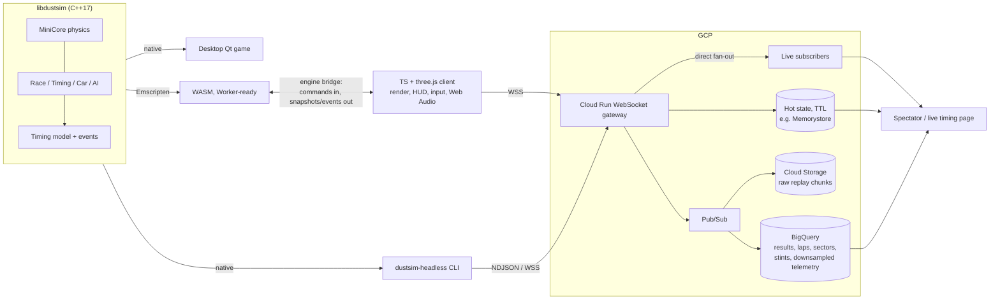
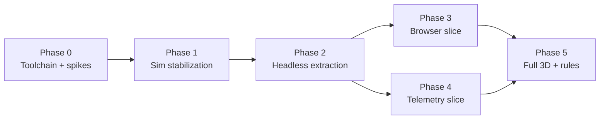

# DustRacing2D Upgrade — Scope & Phased Plan

**Date:** 2026-10-15 (rev 3)
**Status:** Architecture approved (hybrid, three.js). Phase 0 complete (`docs/phase0/findings.md`), all exit criteria met. Phase 1 not yet specified.
**Codebase:** `DustRacing2D/` (v2.2.0, upstream juzzlin/DustRacing2D)
**Reviews folded in:** two Codex assessments (architecture take; critique of rev 1); Phase 0 findings (`docs/phase0/findings.md`, rev 3). See §12 Decision log.

---

## 1. Goals

As stated:

1. Run in the browser.
2. Live telemetry of every race, F1-style.
3. F1-like and stable.
4. More visual / 3D / real-world look.
5. Any other worthwhile improvements.

**Purpose:** both equally — a real playable game *and* a real GCP data pipeline. Neither is a side feature of the other.

---

## 2. Constraints

- **Branding:** original team names, car designs, liveries, logos and terminology. "Formula-style", not "Formula 1", unless a licence is obtained.
- **Licensing:** DustRacing2D code is GPLv3 and its art is CC BY-SA 3.0. `apex-gp` declares ISC in `package.json` but has no LICENSE file and an empty `author`. Confirm copyright ownership and add a full ISC notice before copying any apex-gp code. ISC is GPL-compatible; the combined distribution is GPLv3.
- **Toolchain:** installed in Phase 0 by `tools/bootstrap.sh` (cmake, Ninja, pkg-config, Qt 6.12, OpenAL Soft, libvorbis via Homebrew; emsdk 4.0.10). Exact versions, including Node (reported, not installed, by the script), are in `docs/phase0/toolchain-versions.txt`. The desktop build is green locally.
- **Authority:** browser WASM is authoritative only for local single-player races. Trusted leaderboards, ranked events and competitive multiplayer need server authority or server-side replay validation, because the browser can tamper with its own WASM and telemetry.

---

## 3. Current State (findings)

| Area | Today | Implication |
|---|---|---|
| Stack | Qt6 (Core, OpenGL, Xml, Sql, Widgets), C++17, CMake | Qt is used throughout game logic (QObject signals in `Race`, `Timing`). |
| MiniCore coupling | `MCObject` holds physics *and* view state: shapes, surfaces, shadows, children, global-world access (`mcobject.hh:48`). `MCWorld` owns an `MCWorldRenderer` (`mcworld.hh:209`) and is a singleton. `Car : MCObject`. | **Extraction is about more than removing Qt.** Physics and rendering are fused inside the engine. |
| Rendering | `Renderer : QWindow` with a raw `QOpenGLContext`; GL 2.1; shaders as C strings; perspective top-down camera | Cars and tiles are flat quads. The only 3D meshes are `bridge.obj` and `cube.obj`. |
| Audio | OpenAL + libvorbis on a dedicated `QThread` | Replaced by Web Audio in the browser. |
| Game loop | 60 Hz `QTimer`; variable timestep = average of the last two measured whole-millisecond deltas (`game.cpp:110`), passed to `MCWorld::stepTime(int ms)` (`mcworld.cc:455`) | **Root stability issue:** physics depends on frame rate. Whole-ms time reaches all the way into `physicsComponent().stepTime(int)`. Physics was tuned around ~16 ms steps. |
| Race state | `Race` (positions, route progress, laps, pits, off-track, stuck), `Timing` (lap/race/record times), `Car` (speed, steer direction, tyre wear, damage, gearbox, off-track) | Close to F1 timing. Missing: sectors, gaps and intervals, analog steering magnitude (`steer()` takes `control` but only the `Steer` enum is stored), tyre compounds. |
| Telemetry hook | End of `Race::update` (`race.cpp:307`) | Natural emit point. |
| AI | PD steering toward route nodes; speed from per-tile editor hints (`ai.cpp`) | Hints are a self-admitted workaround. |
| Persistence | `QSettings`; SQLite via QtSql; XML `.trk` tracks (16, including Monza and Suzuka) | Browser needs a preloaded VFS plus IndexedDB. |
| Networking | None | Greenfield. |
| Tests / CI | One gearbox test plus four MiniCore suites; Ubuntu CI (`.github/workflows/ci.yml`) | Almost no coverage of race behaviour. Recent crash fixes (#144, `MCMesh`) point to fragile startup. |

**Related asset — `apex-gp/`:** a three.js Formula-style browser game. It uses a fixed 1/60 step with a 5-step catch-up cap, and has a timing tower, a time-at-position gap algorithm, procedural car, track and environment, and performance/screenshot tooling. Its own report calls it a tech demo. At 1080p on Apple Silicon:

| Camera | Mean frame time | p95 | Draw calls | Triangles |
|---|---|---|---|---|
| Chase (default) | 15.66 ms | 30.9 ms | 785 | 6.6 M |
| Cockpit | 19.71 ms | — | — | — |
| Hero | 22.41 ms | — | — | — |

---

## 4. Architecture — Hybrid

| Option | Verdict |
|---|---|
| Whole-game Qt → WASM port | Rejected as a product: GL 2.1 renderer, audio thread, 10–20 MB payload, low visual ceiling. Not even useful as a spike under this plan. |
| **Hybrid: C++ sim library + TS/three.js client** | **Chosen.** |
| Full TS rewrite | Rejected: drops the C++ sim and the headless/server path. |

**Renderer: three.js** (not Babylon.js). Chosen for direct reuse of apex-gp; three.js also has a WebGPU renderer.

**Shape:**

- One C++ simulation library, `libdustsim`, builds three ways:
  - native headless — tests, CI, data generation;
  - WASM — browser single-player;
  - native desktop — the existing game as a regression baseline.
- The browser client is TypeScript + three.js. It renders sim snapshots and owns the HUD, input, Web Audio and menus.
- Telemetry is emitted by the sim itself, so headless and browser runs produce the same feed.

---

## 5. Core Contracts

### 5.1 Simulation timing
- **Fixed tick of about 60 Hz.** Do not start at 120 Hz: physics was tuned around ~16 ms steps, and 8.33 ms would change grip, collisions, damping, AI and tyre wear.
- **Tick length: 16 ms (62.5 Hz), confirmed in Phase 0.** MiniCore's `stepTime(int ms)` is whole-millisecond all the way down, so a 16 ms tick is exact and needs no physics API change. The S1 headless harness and the S2 drift runs both ran on it. Tick N is the state after N steps (`tMs = N × 16`). Phase 1 verifies feel parity in the desktop game.
- **Time is an integer tick counter.** Race time = `tick × tickDuration`. Never accumulate wall-clock floats.
- **Catch-up cap of 5 ticks per frame**, to avoid a spiral of death (matches apex-gp).
- **Render interpolation** between the two latest sim states.
- 120 Hz is evaluated only after parity tests and profiling.

### 5.2 Determinism contract
- **Same build, same platform:** identical seed + inputs + rules version → identical state hashes, compared every N ticks.
- **Native vs WASM:**
  - race results and discrete events (laps, positions, pit stops, finishes) must agree exactly;
  - continuous state (position, velocity, angle) must also agree exactly. Phase 0 (S2) measured bit-identical MiniCore state, native arm64 vs WASM, over 6/6 runs of up to 20000 ticks, under two preconditions: every native sim translation unit is built with `-ffp-contract=off` and without `-ffast-math`/`-Ofast`, and collision pairs and contacts are processed in a deterministic order (S1 hack rows 39-42, or the per-world stable IDs from Phase 1). S2 built MiniCore from the S1 spike branch, so it never measured without that ordering;
  - fallback, only if native cannot use that flag: position 0.002 m and heading 0.001 rad, valid only for short sessions. Under default flags one collision outcome flipped at tick 17313 and the runs separated by 2.7 m, so long sessions compare discrete events and keyframes only;
  - S2 covered MiniCore physics only, with no libm calls from game code. Phase 2 reruns the native-vs-WASM diff with the full sim (Dust car physics `car.cpp`, `tire.cpp`, gearbox, and game-code libm calls such as `std::atan2` in `ai.cpp:70` and `std::pow` in `car.cpp:231`) before this contract is relied on. Native macOS libm and Emscripten's musl are different implementations. If that rerun shows libm-dependent drift, sim code uses a single portable math implementation (for example `MCTrigonom`-style lookup tables); failing that, native-vs-WASM checks fall back to discrete events plus keyframes.
- **Replays** store seed, inputs, rules version, sim build version and periodic authoritative keyframes. Replays still need versioning, seeking and migration as physics evolves; determinism makes them *cheaper*, not free.

### 5.3 Engine bridge
- Typed commands go in: inputs, pause, restart, config.
- Read-only snapshots and events come out.
- Designed so the sim can move into a **Web Worker** without API changes. Start on the main thread; move to a Worker when the frame budget demands it. A SharedArrayBuffer transport needs COOP/COEP headers.

### 5.4 Telemetry contract
Three message types, every message carrying `sessionId`, `schemaVersion`, `sequence`, `simulationTick` and `buildVersion`.

1. **`RaceSnapshot`** (10–20 Hz)
   - race phase and flags
   - per car: position, rotation, velocity, speed, throttle, brake, steering, gear
   - race position, lap, sector and progress
   - gap to leader and interval to the car ahead
   - tyre compound, wear and age; damage; pit state
2. **`RaceEvent`** (on occurrence, with an idempotent `eventId`)
   - lights out; sector, lap and fastest lap
   - position change; pit entry, stop and exit
   - contact, retirement, flag, penalty, finish
3. **`RaceResult`** (once)
   - classification; lap and sector history
   - pit stops, penalties and incidents
   - replay reference and integrity checksum

**Gap calculation:** time-at-position. Each car keeps a ring buffer of (progress, time), and the gap answers "how long ago was the car ahead where I am now?" This is ported from apex-gp `race.js:134`, not estimated as distance ÷ speed.

**Rules:**
- Telemetry never blocks the sim.
- Buffer and batch. Under backpressure, drop superseded snapshots before events.
- Per-session ordering, plus reconnect/resume from the last acknowledged `sequence`.
- Producers keep unacknowledged history and re-send from the receiver-reported last `sequence` after a gateway or relay restart. The Phase 0 relay held its log in memory, so a restart could only be recovered by the producer re-sending (S4).

### 5.5 Transport and storage
- **Live path:** game → WebSocket gateway → direct fan-out to subscribers, plus hot state with a TTL for late joiners. Pub/Sub is **not** on the live path: it has ~100 ms typical latency and at-least-once delivery.
- **Gateway responsibilities:**
  - authentication and ingest rate limits
  - schema validation
  - session expiry
  - cross-instance state sync, since Cloud Run instances don't share memory
  - client reconnect, since WebSockets are subject to request timeouts
- **Durable path:** Pub/Sub fans out to:
  - **Cloud Storage** — compressed raw replay chunks, full fidelity;
  - **BigQuery** — results, events, laps, sectors, stints and *downsampled* telemetry. Not every raw snapshot: 20 cars × 10–20 Hz grows fast.

### 5.6 Rules profiles
- Race rules are data, not hard-coded "F1". Profiles are versioned JSON, e.g. `rules/open-wheel-modern-v1.json`.
- Ship **one** profile first. Add `classic-drs-v1` and `arcade-v1` only when needed.
- Reason: 2026 regulations replaced traditional DRS with active aero modes plus a separate electrical overtake mode. Seasonal rules shouldn't be baked into code. Profiles also reduce trademark exposure.

---

## 6. apex-gp Reuse Boundaries

| Reuse / adapt directly | Mine for formulas, behaviour, tests and telemetry needs — **not** a source of truth |
|---|---|
| `car/`, `camera/`, `render/`, `textures/`, `fx/`, `audio/`, `hud/` drawing and presentation, input normalisation, perf and screenshot tooling (`tools/`), contract conventions (`CONTRACT.md`) | `physics/vehicle.js`, `ai/opponents.js`, `game/race.js` (gap algorithm ported into C++) |

The visual layer is driven by C++ snapshots. Reused visuals must ship with:
- low / medium / high / ultra presets
- dynamic resolution
- a cheaper sky fallback (sky costs 4.03 ms on the chase camera)
- shadow and AO quality levels
- a mobile / low-power mode
- automated frame-time and GPU budgets in CI

---

## 7. Phases

Each phase gets its own spec → plan → implementation cycle.

### Phase 0 — Toolchain & architecture spikes
Tooling: install CMake, Ninja, Qt 6.4+ and emsdk; get the existing desktop build green locally.

Spikes. Their code is throwaway; only the answers are kept.

| Spike | Question it answers |
|---|---|
| **S1** One car on one track, stepping headless with **no GL context** | Is the minimum extraction a null renderer + headless shapes/surfaces, or a `SimObject`/`RenderObject` split? Is "QtCore at most" achievable? |
| **S2** Compile a minimal sim step to WASM; run the same seed native vs WASM; diff the results | Cross-platform drift magnitude → tolerances for §5.2. |
| **S3** Render a Dust track in apex-gp from **mocked** sim snapshots | Track → mesh feasibility; snapshot shape the renderer needs. |
| **S4** Send a local telemetry feed to a minimal timing tower | Contract v0 is workable end to end. |

**Exit:** a dependency map of `Car`/`MCObject`/`MCWorld`/Qt, an extraction approach chosen, determinism tolerances set, and a go/no-go on each boundary.

### Phase 1 — Sim stabilization (inside the existing game)
- Fixed tick per §5.1, with catch-up cap and render interpolation.
- Seeded RNG with reset support, with the sim RNG split from a cosmetic RNG before any golden test is recorded. Particles, `TrackObjectFactory`, `Tree` and `CarParticleEffectManager` share the global `MCRandom` stream with the AI (Phase 0 dependency map, row 37), so golden hashes recorded against the shared stream would all change when Phase 2 moves particles render-side.
- Deterministic collision and contact order: iterate by per-world stable object IDs, not by `MCObject *` address. Phase 0 (S1) found that MiniCore's address-keyed `std::set`/`std::map` made same-seed 12-car races diverge by tick 315; a seeded RNG alone does not make golden tests pass. Validate the change against upstream collision behaviour.
- **Characterization tests before any refactor:** laps, sectors, positions, pit stops, finishes, collisions, AI recovery.
- Golden race tests: same seed + inputs → same classification and state hashes.
- Upstream `DustRacing2D/.gitignore` ignores `unittests/`, `test/` and `*.json` (also `src/contrib/`, `*__*`, `build*`). Adjust the subtree's ignore rules (or `git add -f`) when adding tests under `src/game/unittests/` or JSON golden fixtures, or they are silently left out of commits.
- State, event and input contracts written down.
- Track and asset validation in CI.

**Done when:** the desktop game runs on fixed ticks with feel parity, and a characterization suite guards behaviour.

### Phase 2 — Headless extraction
- `libdustsim`, using the null-surface approach chosen in S1: MiniCore split at link time into a GL-free core and a renderer library, not a `SimObject`/`RenderObject` split.
- Sim build flags: `-ffp-contract=off`, no `-ffast-math`/`-Ofast`, on every translation unit that feeds the simulation (§5.2).
- Qt boundary for WASM decided in the Phase 2 spec: Qt for WebAssembly (Core, Xml, Gui) vs a Qt-free core fed by the track pipeline's JSON. S1 still needs QtGui for `QImage` surface decode; S2-B's costs (about 0.5-1 day vs 3-5 agent-days to replace Qt) are estimates.
- Qt signals replaced by an event queue; global singleton state contained.
- `dustsim-headless` CLI → NDJSON telemetry per §5.4.
- Timing model: sectors and mini-sectors from route nodes, time-at-position gaps, speed traps, analog steering stored, purple/green bests.
- Track pipeline v1: `.trk` → versioned JSON.
- Desktop game moved onto the library through a regression adapter.

**Done when:** the headless CLI produces a full timing feed, the golden tests pass on both headless and desktop, and CI is green.

### Phase 3 — Browser vertical slice
- One track, 12 cars, single player.
- `libdustsim` → WASM behind the engine bridge.
- apex-gp-derived rendering, HUD, input (keyboard + gamepad) and Web Audio.
- Quality presets and frame-time budgets; IndexedDB saves.
- Playwright smoke tests on Chromium, Firefox and WebKit.
- Crash reporting with the build version attached to every session.

**Done when:** playable at 60 fps on desktop Chrome, Firefox and Safari, and 30 fps in low-power mode.

### Phase 4 — Telemetry vertical slice *(can run in parallel with Phase 3 once Phase 2 is done)*
- Cloud Run WebSocket gateway per §5.5, with direct live fan-out and hot state.
- Pub/Sub → Cloud Storage raw replay chunks + BigQuery summaries.
- Spectator live timing page: timing tower, track map, traces, lap chart, tyre stints.
- Sources: the headless CLI first, then browser races.

**Done when:** a live race is watchable with sub-second latency, reconnect/resume works, and laps, sectors and stints are queryable in BigQuery.

### Phase 5 — Full 3D & racing rules
- Track mesh pipeline: road, kerbs, barriers, run-off, grandstands; a **racing line** shared with the AI.
- Visual non-goal: "stylized realistic" 3D on top of the existing flat 2D physics. No elevation, suspension, tyre temperatures or weather physics.
- Chase, TV and cockpit cameras; broadcast HUD with accessibility options (colour-blind sector colours, UI scaling, reduced motion).
- 20-car field, five-light start, qualifying → grid, tyre compounds, pit-lane limiter, flags.
- Rules profile `open-wheel-modern-v1`.
- AI rewrite: braking points from track curvature, overtaking and defending, pit strategy.

**Done when:** races read as Formula-style on screen and in telemetry.

---

## 8. Deferred (after the browser and telemetry slices work)

- Cloud Run Jobs generating large volumes of AI races. Small headless runs to feed Phase 4 testing are in scope.
- Full race weekends (practice, Q1–Q3, sprint).
- Safety car, VSC and red-flag edge cases.
- Online leaderboards (need server validation, §2).
- Multiplayer (only after replay validation works).
- Web track editor; editor sector and DRS markers.
- 120 Hz simulation.
- Exact native/WASM equality across CPU architectures (x86-64 native). Phase 0 measured arm64 only. libm differences between native and Emscripten are not deferred: Phase 2 measures them with the full sim and, if they cause drift, uses one portable math implementation or falls back to discrete events plus keyframes (§5.2).
- Extras:
  - replay viewer with seek
  - time-trial ghost car
  - daily time-trial events
  - PWA offline practice
  - progressive asset loading
  - touch controls
  - weather and day/night (visual first)
  - simulation-grade physics (elevation, suspension, tyre temperatures)

---

## 9. Risks

| # | Risk | Mitigation |
|---|---|---|
| 1 | Physics/render fusion in MiniCore (`MCObject`, `MCWorld` owns the renderer) makes extraction much larger than "remove Qt signals" | S1 spike + dependency map before committing to an approach |
| 2 | Native vs WASM floating-point drift | `-ffp-contract=off` on native sim code plus deterministic collision order gives exact equality (S2); tolerance fallback for short sessions only (§5.2) |
| 3 | Fixed tick changes feel or AI behaviour | 16 ms tick close to the old ~16 ms tuning; characterization tests first |
| 4 | apex-gp frame time is too heavy for mid-range hardware | Quality presets, dynamic resolution, CI frame budgets |
| 5 | Fragile startup paths (#144, `MCMesh`) | Golden tests cover race start |
| 6 | apex-gp licensing unclear | Confirm ownership + add ISC notice before copying |

---

## 10. Open Questions

- GCP specifics: project, region, expected concurrent sessions, retention, and who watches the live page.
- Does the desktop Qt game stay a shipped product or only a regression baseline?
- Hosting for the browser build (Firebase Hosting, Cloud Storage + CDN).
- Commercial intent? It affects GPL obligations and the branding constraint.

---

## 11. Next Step

Phase 0 is done. Brainstorm **Phase 1** (sim stabilization) into its own spec, starting from `docs/phase0/findings.md` (decisions and open items).

---

## 12. Decision Log

| Decision | Source |
|---|---|
| Hybrid architecture (C++ sim lib + TS client) | Rev 1; independently matched by Codex |
| three.js over Babylon.js | User, for apex-gp reuse |
| Thin vertical slice / spikes before deep investment | Codex take #1 |
| Pub/Sub off the live path; direct fan-out + hot state | Codex take #1, reinforced in critique |
| 3-message telemetry contract with sequence and idempotency | Codex take #1 + critique |
| ~60 Hz fixed tick, not 120 Hz; 16 ms tick due to int-ms MiniCore API | Codex critique + code check (`mcworld.cc:455`) |
| ~~Tolerance-based native/WASM determinism~~ (superseded in rev 3 by exact equality, below) | Codex critique (rev 1 overclaimed byte-identical) |
| Extraction must address MiniCore physics/render fusion | Codex critique, verified in `mcobject.hh` / `mcworld.hh` |
| apex-gp reuse boundaries; port time-at-position gaps | Codex critique, verified in `race.js:134` |
| Tiered storage: GCS raw, BigQuery summaries | Codex critique |
| Rules profiles; ship one first | Codex critique (trimmed to one profile) |
| Emscripten determinism spike instead of a Qt-WASM spike | Rev 2 |
| Tick length fixed at 16 ms (§5.1) | Rev 3; Phase 0 decision 2, `docs/phase0/findings.md` |
| Exact native/WASM equality with `-ffp-contract=off` and deterministic collision order replaces tolerance-first contract; tolerances become a short-session fallback; libm drift measured in Phase 2 with a portable-math or events-plus-keyframes contingency (§5.2, §8, risk 2, Phase 2 build flags) | Rev 3; Phase 0 S2, decision 3, `docs/phase0/findings.md` |
| Producers retain history and re-send after a gateway restart (§5.4); late joiners without `from` already get logged events plus the latest snapshot, so no change there | Rev 3; Phase 0 S4 relay restart, decision 6, `docs/phase0/findings.md` |
| Deterministic collision order by stable object IDs in Phase 1; sim RNG split from cosmetic RNG before golden tests | Rev 3; Phase 0 S1 repeatability and dependency map row 37, `docs/phase0/findings.md` |
| Null-surface extraction with link-time MiniCore core/renderer split (Phase 2) | Rev 3; Phase 0 S1, decision 1, `docs/phase0/findings.md` |
| Qt-for-WASM vs Qt-free core decided in the Phase 2 spec | Rev 3; Phase 0 S1/S2-B, decision 4, `docs/phase0/findings.md` |
