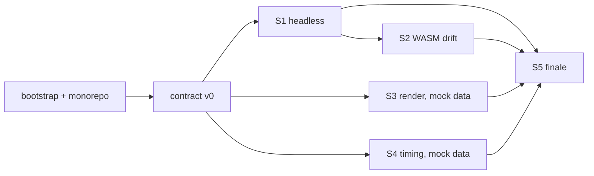

# Phase 0 — Toolchain & Architecture Spikes — Design

**Date:** 2026-10-15
**Status:** Design approved section by section (approach §2, layout/toolchain §4, spikes §6, exit §7–8). Awaiting written-spec review.
**Parent:** [DustRacing2D Upgrade — Scope & Phased Plan (rev 2)](2026-10-15-dustracing2d-upgrade-scope.md), Phase 0.

---

## 1. Purpose

Phase 0 answers the riskiest questions in the hybrid architecture before any production code is written:

1. Can the DustRacing2D simulation run with **no GL context**, and what is the minimum change needed?
2. How far do **native and WASM** results diverge for the same seed?
3. Can a Dust track become a credible **three.js** scene driven by sim snapshots?
4. Is a **telemetry contract** workable end to end, including resume and backpressure?
5. Do these pieces **fit together**?

The outputs are answers, a toolchain and a contract. **All spike code is throwaway.**

### Non-goals

- No GCP resources (S4 is localhost only).
- No fixed-tick change to the shipping game (Phase 1).
- No CI changes (Phase 1).
- No changes merged into DustRacing2D's main line beyond the subtree import.

---

## 2. Approach — Contract-first, converging spikes

Contract v0 is written first. S3 and S4 develop against mocked data in that format, in parallel with S1. S1 then produces the same format, S2 compiles S1's harness with Emscripten, and the S5 finale replays a real S1 recording through S3 and S4 together.

**Rejected:**

| Option | Why rejected |
|---|---|
| Independent spikes with mocked data only | Never proves the pieces fit. |
| One end-to-end throwaway prototype | Blurs which boundary failed and tempts keeping throwaway code. |

---

## 3. Context (verified 2026-10-15)

| Fact | Evidence | Consequence |
|---|---|---|
| Machine: macOS 15.6, arm64, Apple clang 16, Homebrew 5.1.5, Node 25.8, Docker | `uname`, `sw_vers`, `brew --version` | Native toolchain via Homebrew is viable. |
| **Missing:** `cmake`, `ninja`, Qt, `emcc` | `command -v` | Bootstrap is step zero. |
| **Disk: 16 GiB free (96% used)** | `df -h ~` | Toolchain ≈ 6–8 GB plus builds; tight. |
| Homebrew Qt is 6.12.0; project requires Qt ≥ 6.4 | `brew info qt`, `CMakeLists.txt:150` | Compatible. |
| Build deps: Qt6 (Core, OpenGL, Xml, Widgets, LinguistTools, Sql, Test), OpenGL, OpenAL, libvorbis/vorbisfile | `CMakeLists.txt:149-197` | Homebrew packages: `qt`, `openal-soft`, `libvorbis`, `pkg-config`. |
| `DustRacing2D/` is a clean clone of upstream `master`; parent folder is not a git repo | `git status`, `git remote -v` | Monorepo set-up must import the clone as a subtree. |
| MiniCore `Core/` and `Physics/` are Qt-free except `mclogger.cc` (`QDebug`), and GL-free | `grep '#include <Q'` | A Qt-free WASM sim core is plausible. |
| `MCWorld` can be constructed without a window (`MCWorldTest` uses `QTEST_GUILESS_MAIN`); the `MCWorldRenderer` constructor is trivial | `MCWorldTest.cpp:362`, `mcworldrenderer.cc:37` | World and physics already run headless in tests. |
| **`MCSurface` construction calls `initVBOs()` → `glGenBuffers`/`glGenVertexArrays`; `MCGLObjectBase` pulls shader programs from the `MCGLScene` singleton** | `mcsurface.cc:115,156`, `mcglobjectbase.cc:31-39,99,121` | **A `Car` (built from an `MCSurface`) cannot be constructed without a GL context.** This is S1's crux. |
| `Game::instance()` is used 50× in the game layer; `MCWorld::instance()` 38× | `grep` | Global state must be stubbed or contained. |
| `MCRandom` is a seeded `mt19937` lookup table, but one **global stream shared with particle effects**; `race.cpp:621` uses unseeded C `rand()` | `mcrandom.cc`, `particlefactory.cpp:154`, `race.cpp:621` | Visual effects perturb AI randomness, which is a determinism hazard. |
| `.trk` tracks are XML: `<track cols rows>`, tiles `<t i j o t="type">`, route nodes `<n x y w h i>`, tile size 256 world units | `data/levels/monza.trk` | Simple to parse in C++ or JS. |

---

## 4. Repo Layout & Toolchain

### 4.1 Monorepo

```
racing-telemetry-gcp/            ← git init (monorepo)
├── DustRacing2D/                ← git subtree of juzzlin/DustRacing2D @ current master
├── apex-gp/                     ← untouched reference; in .gitignore until licence/ownership confirmed
├── py-race/                     ← unrelated; in .gitignore
├── docs/
│   ├── superpowers/specs/       ← scope rev 2, this spec
│   └── phase0/                  ← findings.md, dependency-map.md, evidence/
├── contracts/telemetry-v0/      ← JSON Schema, sample NDJSON, validate script (survives Phase 0)
├── spikes/                      ← throwaway; tagged then removed from main at exit
│   ├── s1-headless/
│   ├── s2-wasm/
│   ├── s3-render/
│   └── s4-timing/
└── tools/bootstrap.sh           ← survives Phase 0
```

- **Subtree, not submodule.** Phase 2 edits DustRacing2D heavily. A subtree keeps upstream history and can still pull upstream fixes, with no fork hosting needed.
- **Import procedure.** The existing clone is moved aside, then `git subtree add --prefix=DustRacing2D <clone-path> master` runs from it, so no network fetch is needed. The moved-aside clone is deleted only after the import is verified.
- **Spike hacks** to DustRacing2D source live on branches `spike/s1-headless`, `spike/s2-wasm`, and so on. They are never merged.

### 4.2 Toolchain — native Homebrew + pinned emsdk

| Tool | Source | Pin |
|---|---|---|
| cmake, ninja, pkg-config | Homebrew | Version recorded in findings |
| Qt 6 | Homebrew `qt` | 6.12.x |
| openal-soft, libvorbis | Homebrew | Version recorded |
| Emscripten | `emsdk` in `~/.emsdk` | Exact version, chosen at bootstrap time and recorded |
| Node packages (S3/S4) | npm, per-spike `package.json` with lockfile | Lockfile |

`tools/bootstrap.sh`:

- refuses to run with **< 12 GB free**;
- is idempotent (skips tools already present at the pinned version);
- prints the versions installed.

**Docker rejected:** the Qt desktop game cannot render inside a macOS container, and the images consume scarce disk. CI remains Ubuntu; an Emscripten CI job is Phase 1 work.

**Precondition:** the user may need to free disk space before bootstrap.

---

## 5. Contract v0

Location: `contracts/telemetry-v0/`.

- `schema.json` — JSON Schema (draft 2020-12).
- `samples/*.ndjson` — at least one mocked multi-car race, plus real S1 output once available.
- `validate.mjs` — validates NDJSON against the schema (ajv).

**Format:** NDJSON, one message per line, discriminated by `type`.

Common fields on every line:

| Field | Type | Notes |
|---|---|---|
| `type` | `"snapshot" \| "event" \| "result"` | |
| `sessionId` | string (UUID) | |
| `schemaVersion` | string | `"0.1.0"` |
| `seq` | integer | Strictly increasing per session, across all types |
| `tick` | integer | Simulation tick number |
| `tMs` | integer | `tick × tickDurationMs` |

**`snapshot`** adds `phase` (`"countdown" \| "racing" \| "finished"`) and `cars[]`. Each car has:

| Field | Type | Unit |
|---|---|---|
| `id` | integer | |
| `x`, `y` | number | metres, Dust world frame (y-up, origin bottom-left; `.trk` files are y-down and the loader flips them, `trackloader.cpp:254,354`) |
| `heading` | number | radians |
| `vx`, `vy` | number | m/s |
| `speedKmh` | number | km/h |
| `throttle`, `brake` | number | 0–1 |
| `steer` | number | −1…1 (direction-only today; magnitude is a Phase 2 addition) |
| `gear` | integer | |
| `lap` | integer | |
| `progress` | number | 0–1 around the lap: `(nodeIndex + fractionToNextNode) / nodeCount`, continuous so time-at-position gaps work |
| `pos` | integer | race position |

**`event`** adds `eventId` (unique per session, for idempotency), `eventType` (`"lightsOut" \| "lap" \| "positionChange" \| "finish"` in v0), `carId` (optional) and `data` (object).

**`result`** adds `classification[]` (`carId`, `pos`, `laps`, `totalMs`, `bestLapMs`).

**Units:** metres and radians in the contract. The sim converts from world units using `MCWorld::metersPerUnit`, so clients never see engine units.

**Two feeds, one schema:**

- **Tick feed:** a snapshot every sim tick, used locally for rendering.
- **Telemetry feed:** snapshots subsampled to 20 Hz, plus all events and the result.

v0 is expected to change during the spikes. Every change is recorded in findings, and the final v0 feeds the Phase 2 schema v1.

---

## 6. Spikes

Caps are agent-assisted working days. A spike that hits its cap stops and reports what it learned; it does not push on.

### S1 — Headless sim (cap: 3 days)

**Question:** what is the minimum change for the simulation to run with no GL context, and is "QtCore at most" realistic?

**Method:**

1. A harness in `spikes/s1-headless/` loads one track (Monza) and spawns one AI-driven car.
2. The harness steps fixed **16 ms** ticks for 3 laps and writes the tick feed (contract v0) to NDJSON.
3. Main probe: add a compile flag `MC_HEADLESS` on branch `spike/s1-headless` that makes `MCGLObjectBase` and `MCSurface` skip all GL calls and `MCGLScene` lookups, while keeping the geometry (width, height, z) that physics shapes need.
4. Stub or contain `Game::instance()` dependencies as needed.
5. Seed `MCRandom` explicitly, and replace `rand()` in `race.cpp` with a seeded generator.
6. **Log every hack** (file, line, what, why) → `docs/phase0/dependency-map.md`.
7. Stretch goal: a full 12-car AI race.

**Pass signals:**

- The harness links **without** the OpenGL library, and `QT_QPA_PLATFORM` is unset.
- The car completes at least one lap.
- Two runs with the same seed produce identical per-tick state hashes (FNV-1a over the raw float bits of every car's position, velocity, angle and angular velocity; same-platform comparison is exact, quantization is only for S2).

**Fallback / kill:**

- **Fallback:** an offscreen GL context. This proves the logic works headless-ish, but the verdict is GO-with-conditions, not true headless.
- **Kill:** if the hack log shows a null surface can't work (physics reads GL-owned state, or hacks cascade through the codebase), the verdict is NO-GO on null-surface, and Phase 2 plans a `SimObject`/`RenderObject` split.

**Outputs:**

- dependency map;
- Qt-usage inventory for the harness (which Qt modules remain);
- sample tick feed committed to `contracts/telemetry-v0/samples/`.

### S2 — WASM drift (cap: 2 days; needs S1 harness)

**Question:** how far do native and WASM results diverge for the same seed?

**Method:**

1. Compile the S1 harness with Emscripten (`-sENVIRONMENT=node`) and run it under Node.
2. **Avoid Qt for WASM.** Pre-convert `monza.trk` to JSON with a small native converter (a preview of the Phase 2 track pipeline). Stub `mclogger`'s `QDebug`.
3. Run native twice: default flags, and with `-ffp-contract=off`. Apple clang on arm64 fuses multiply-adds (FMA); WASM does not.
4. Diff WASM against each native run, per tick.

**Pass signals — a report containing:**

- first tick of divergence;
- maximum position and heading error over the run;
- whether discrete events (laps, positions, finish order) match exactly;
- whether `-ffp-contract=off` gives bit-identical results;
- **proposed tolerances** for scope §5.2.

**Fallback / kill:**

- If Qt cannot be removed from the harness, that is itself the finding: estimate the cost of Qt for WASM (payload, build) against replacing the remaining Qt pieces.
- If drift is chaotic (cars take different lines or the event order differs), the native-vs-WASM contract becomes "discrete events must match, verified against keyframes".

### S3 — Render (cap: 2 days; parallel with S1)

**Question:** can a Dust track become a credible three.js scene, and what does the renderer need from snapshots?

**Method:**

1. A Vite + three.js page in `spikes/s3-render/` parses `.trk` XML with `DOMParser`.
2. Build a 3D ground plane per tile, using the existing tile textures (CC BY-SA), plus simple extruded barriers along track edges.
3. Car model: an apex-gp `car/` model if it lifts cleanly; otherwise a box. Local use only, since apex-gp's licence is unresolved.
4. Play back a **20 Hz** feed with interpolation (the spectator/replay case) and the **tick feed** (the game case). Mock data first, then S1 output.
5. Cameras: chase and top-down.

**Pass signals:**

- Monza renders recognisably.
- Car motion is smooth at 60 fps from both feeds.
- Frame time is measured and recorded.
- The coordinate mapping is documented (Dust world frame, y-up, world units × 0.05 → three.js x/−z metres).
- The list of snapshot fields the renderer actually needs is recorded.

**Fallback:** if apex-gp modules are too entangled to lift, record the reuse cost (files, dependencies, globals) and keep the box car.

### S4 — Timing (cap: 1 day; parallel with S1)

**Question:** is contract v0 workable end to end, including sequence/resume and backpressure?

**Method:**

1. A Node WebSocket relay (`ws`) runs on localhost.
2. Producer: an NDJSON replayer that plays the mock feed in real time, later S1 output.
3. A browser timing tower shows position, driver, lap, last lap and gap to the car ahead.
4. Gaps are computed with **time-at-position** (a per-car ring buffer of `(progress, tMs)`, after apex-gp `race.js:134`), to validate the algorithm before it is ported to C++.
5. Resume test: kill the client and the relay mid-race; the client reconnects and resumes from its last acknowledged `seq`.
6. Backpressure test: throttle the client; the relay drops superseded snapshots but never events.

**Pass signals:**

- The tower updates at 20 Hz.
- Resume loses no events and duplicates none (`eventId` dedupe).
- Local end-to-end latency is measured.

**Fallback:** missing fields → amend contract v0 and record the change.

### S5 — Finale (cap: 0.5 day; after S1–S4)

**Question:** do the pieces fit?

**Method:** one recorded S1 run is streamed through the S4 relay into the S4 tower and the S3 renderer simultaneously. If S1 reached only one car, mocked cars are added.

**Pass signal:** the user watches it end to end. A screenshot and a short screen recording go into `docs/phase0/evidence/`.

### Order



---

## 7. Findings Report

**`docs/phase0/findings.md`:**

1. **Summary table:** boundary | verdict (GO / GO-with-conditions / NO-GO) | key number | implication for the plan.
2. **Per spike:** question, what was tried, results with numbers, evidence links (logs, hashes, frame times, screenshots), recommendation, open issues.
3. **Decisions:**
   - extraction approach (null surface vs sim/render split);
   - tick length (confirm 16 ms);
   - determinism tolerances;
   - Qt status ("QtCore at most" feasible?);
   - apex-gp reuse cost;
   - contract v0 amendments.
4. **Toolchain record:** exact versions installed.

**`docs/phase0/dependency-map.md`:**

- Mermaid graph of the coupling between `Car`, `MCObject`, `MCSurface`, `MCGLObjectBase`, `MCGLScene`, `MCWorld`, `Game`, Qt types and the RNG.
- Hack table: file:line | hack | why | Phase 2 resolution.

**Evidence:** `docs/phase0/evidence/` (state hashes, diff CSVs, frame-time logs, screenshots, recording).

---

## 8. Exit Criteria

Phase 0 is done when all of the following hold:

1. `tools/bootstrap.sh` sets up the toolchain from scratch; desktop DustRacing2D builds and runs locally; the existing `ctest` suite passes.
2. The monorepo exists, with DustRacing2D as a subtree; docs are committed.
3. `contracts/telemetry-v0` is committed: schema, samples (mock plus real S1), and a passing validation script.
4. Every spike has a verdict with evidence in `findings.md`.
5. All six decisions in §7 are recorded.
6. The user has watched the S5 demo.
7. Spike code is tagged `phase0-spikes` (including spike branches) and removed from `main`.
8. If any finding changes the plan, the scope doc is updated to rev 3.

### Responses to NO-GO

| Spike | NO-GO means | Plan response |
|---|---|---|
| S1 | A null surface can't work | Phase 2 designs a `SimObject`/`RenderObject` split. |
| S2 | Qt can't be removed from the harness | Cost out Qt for WASM against replacing the remaining Qt pieces; decide in the Phase 2 spec. |
| S2 | Drift is chaotic | Native-vs-WASM checks compare discrete events and keyframes only. |
| S3 | apex-gp reuse is too costly | Box or simple procedural cars in Phase 3; shrink the reuse table in the scope doc. |
| S4 | Contract gaps | Amend v0; no plan change. |

---

## 9. Testing (for spikes)

Spikes are throwaway, so testing is limited to what produces trustworthy answers:

- **S1:** same-seed repeatability script (run twice, compare hash streams).
- **S2:** diff script producing per-tick error CSVs and the summary numbers.
- **S3:** frame-time capture script (rAF timing over 60 s).
- **S4:** scripted kill/reconnect and throttle scenarios with assertions on `seq` continuity and `eventId` dedupe.
- **Contract:** `validate.mjs` runs over every sample.

---

## 10. Risks

| Risk | Mitigation |
|---|---|
| Disk runs out mid-bootstrap or mid-build | 12 GB gate in bootstrap; build directories outside the repo can be cleaned; no Docker. |
| Desktop build fails on macOS arm64 (upstream CI is Ubuntu only) | Fix minimally on a branch and record it; it doesn't block S3/S4. |
| `MC_HEADLESS` hacks cascade through the codebase | S1 cap plus kill rule; the cascade is itself the answer. |
| Game-layer singletons (`Game::instance()`) block the harness | Stub `Game` in the harness; record each touchpoint in the dependency map. |
| apex-gp licence unresolved | Local use only in spikes; nothing from apex-gp is committed. |

---

## 11. Open Items (resolved during Phase 0, not before)

- Exact emsdk version (latest stable at bootstrap time, then pinned).
- Whether spike branches are pushed to a remote; the monorepo hosting location is not yet chosen.
